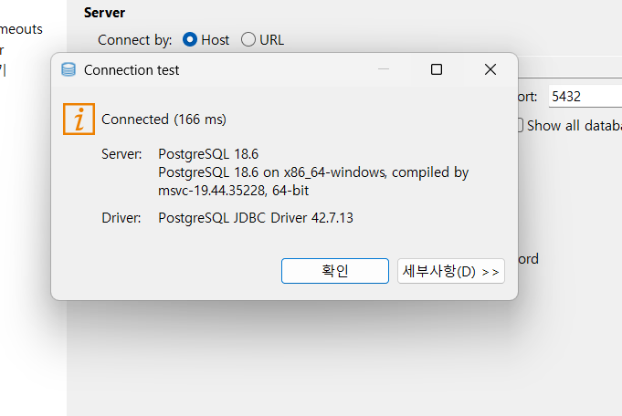
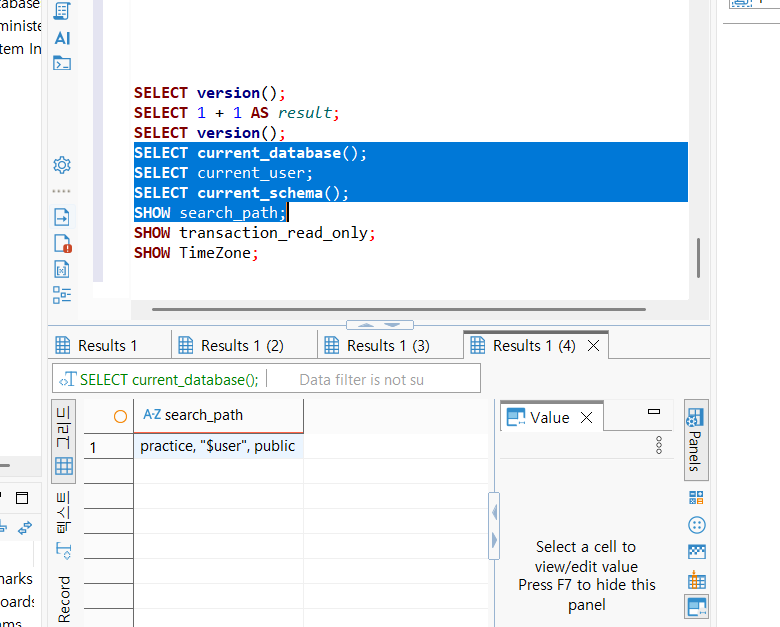
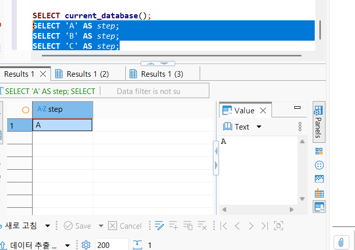

# Chapter 03 확장 실습 답안 템플릿

> **과제:** PostgreSQL과 DBeaver로 실습 환경 검증하기  
> **사용 방법:** 이 파일을 내려받아 본인의 GitHub 저장소에 `chapter03_answer.md`라는 이름으로 저장한 뒤 실습하면서 바로 작성합니다.  
> **제출 방법:** LMS에는 파일을 직접 업로드하지 않고, **본인 GitHub 저장소의 `chapter03_answer.md` 파일 URL**을 제출합니다.

---

## 제출 전 보안 주의

이 과제 파일과 캡처 화면에는 다음 정보를 올리지 않습니다.

```text
실제 PostgreSQL 비밀번호
전체 DB 접속 URL
API Key / Token
개인정보
공개할 필요가 없는 사내 서버 주소
```

LMS에서 제출자를 확인할 수 있으므로 공개 저장소의 답안 파일에 학번이나 실명을 반드시 적을 필요는 없습니다.

```text
GitHub 계정 또는 별칭:hangyeom06
과제 작성일:2026.09.22
사용한 AI 도구:chatGPT
```

---

# 1. PostgreSQL과 DBeaver 환경 확인

## 1-1. 내 환경

| 항목 | 작성 내용 |
| --- | --- |
| 운영체제 | windows |
| PostgreSQL 버전 | PostgreSQL 18.6 on x86_64-windows, compiled by msvc-19.44.35228, 64-bit |
| DBeaver 버전 | 26.2.1.202609210342 |
| Host | localhost |
| Port | 5432 |
| Database | postgres |
| Username | postgres |

> 비밀번호는 기록하지 않습니다.

## 1-2. PostgreSQL과 DBeaver 역할 설명

```text
PostgreSQL은:데이터를 저장하고 관리하는 시스템

DBeaver는:PostgreSQL에 접속하여 데이터를 확인하거나 SQL을 실행할 수 있게 해주는 도구

두 프로그램의 차이는:PostgreSQL은 데이터 저장 관리, DBeaver은 사람이 PostgreSQL을 활용할 수 있도록 하는 도구
```

---

# 2. 연결 테스트와 첫 SQL

## 2-1. DBeaver 연결 결과

- [ ] PostgreSQL 연결 유형 선택
- [ ] Host 확인
- [ ] Port 확인
- [ ] Database 확인
- [ ] Username 확인
- [ ] Test Connection 성공

### 연결 성공 화면

권장 이미지 경로:

```text
assignments/chapter03/images/step02_connection.png
```

`여기에 연결 성공 화면을 삽입하세요.`

## 2-2. 첫 SQL 실행

```sql
SELECT 1 + 1 AS result;
```

실행 전 예상:

```text
2
```

실제 결과:

```text
2
```

이 결과가 의미하는 것:

```text
현재 데이터베이스 연결과 SQL 실행이 정상적으로 작동한다.
```

---

# 3. 현재 연결 위치를 SQL로 검증

다음 SQL을 실행합니다.

```sql
SELECT version();
SELECT current_database();
SELECT current_user;
SELECT current_schema();
SHOW search_path;
SHOW transaction_read_only;
SHOW TimeZone;
```

## 3-1. 결과 기록

| 확인 항목 | 실제 결과 | 내가 이해한 의미 |
| --- | --- | --- |
| `version()` | PostgreSQL 18.6 on x86_64-windows, compiled by msvc-19.44.35228, 64-bit | 현재 사용하고 있는 버전 |
| `current_database()` | postgres | 현재 접속한 데이터베이스 이름 |
| `current_user` | postgres | 현재 어떤 사용자 이름으로 접속했는지 |
| `current_schema()` | practice | 현재의 스키마 |
| `search_path` | practice, "$user", public | 먼저 practice 스키마를 확인한다 |
| `transaction_read_only` | off | 현재 데이터베이스가 읽기 전용이 아니다 |
| `TimeZone` | Asia/Seoul | 현재 데이터베이스의 시간대가 서울 시간이다 |

## 3-2. 반드시 설명할 것

### DBeaver 연결 이름과 `current_database()`는 왜 같은 개념이 아닌가요?

```text
DBeaver 연결 이름은 사용자가 설정한 이름이고 current_database()는 PostgreSQL에서 실제로 접속해 있는 데이터베이스의 이름이다.
```

### `current_schema()`와 `search_path`는 어떤 관계가 있나요?

```text
search_path는 PostgreSQL이 객체를 찾을 때 스키마를 어떤 순서로 확인할지 정해놓은 것이고 current_schema는 현재 사용하는 첫번째 스키마이다.
```

### `transaction_read_only = off`라는 결과만으로 모든 테이블을 만들 권한이 있다고 단정할 수 있나요?

```text
아니다. 읽기전용이 아니라는 의미일 뿐이고 권한에 따라 다르다.
```

## 3-3. 증거 화면

권장 경로:

```text
assignments/chapter03/images/step03_location_check.png
```

`여기에 현재 DB/사용자/스키마/search_path 결과 화면을 삽입하세요.`

---

# 4. `ai_database_book` 데이터베이스 확인

## 4-1. 현재 데이터베이스

```sql
SELECT current_database();
```

실제 결과:

```text
postgres
```

- [ ] 결과가 `ai_database_book`이다.
- [ ] 다른 DB라면 올바른 연결로 전환했다.

## 4-2. 연결을 바꾼 뒤 다시 검증

```text
전환 전 데이터베이스:postgres
전환 후 데이터베이스:ai_database_book
전환 여부를 판단한 근거:현재 데이터베이스 SQL을 실행했을 떄의 결과가 ai_database_book이기 때문이다.
```

### 화면에서 보이는 연결 이름만 믿지 않고 SQL을 다시 실행해야 하는 이유

```text
DBeaver 화면에 표시되는 연결 이름만으로는 어느 데이터베이스에 접속되어 있는지 확실하게 알 수 없다.
```

---

# 5. SQL 실행 범위 실험

SQL Editor에 다음 세 문장을 입력합니다.

```sql
SELECT 'A' AS step;
SELECT 'B' AS step;
SELECT 'C' AS step;
```

## 5-1. 한 문장 실행

```text
내가 실행한 문장:SELECT 'A' AS step;
실제 결과:A
```

## 5-2. 선택 영역 실행

```text
선택한 문장:SELECT 'B' AS step;
실제 결과:B
```

## 5-3. 전체 스크립트 실행

```text
실제 결과:(각각 순서대로) A B C
결과 탭 또는 실행 순서에서 관찰한 점: 전체 스크립트를 실행하면 입력한 여러 SQL이 위에서부터 순서대로 실행된다.
```

## 5-4. 결과 해석

```text
한 문장 실행과 전체 스크립트 실행의 차이: 한 문장 실행은 선택한 하나의 SQL만 실행하지만 전체 스크립트 실행은 여러 SQL 문장을 순서대로 실행한다.

변경 SQL에서 실행 범위를 잘못 선택하면 위험한 이유: 여러 SQL 문장 중 실행하지 않으려던 문장까지 함께 실행될 수 있기 때문이다.
```

### 증거 화면

권장 경로:

```text
assignments/chapter03/images/step05_execution_scope.png
```

`여기에 실행 범위 비교 화면을 삽입하세요.`

---

# 6. 제공된 환경 확인 SQL 실행

Public 저장소의 Chapter 03 파일을 사용합니다.

```text
code/chapter03/setup_check.sql
code/chapter03/setup_validate_local.sql
```

## 6-1. `setup_check.sql`

실행 결과에서 확인한 항목:

```text
PostgreSQL 버전:PostgreSQL 18.6 on x86_64-windows, compiled by msvc-19.44.35228, 64-bit
현재 DB:ai_database_book
현재 사용자:postgres
현재 스키마:public
search_path:public, "$user"
읽기 전용 여부:off
TimeZone:Asia/Seoul
1 + 1 결과:2
public 스키마 존재 여부: O
public USAGE 권한:O
public CREATE 권한:O
```

### 이 파일을 여러 번 실행해도 비교적 안전한 이유

```text
이 파일은 데이터베이스의 정보들을 확인하는 SQL이기 때문에 데이터를 변경하지 않는다. 따라서 안전하다.
```

## 6-2. `setup_validate_local.sql`

```text
실행 결과: 180006 / ai_database_book / postgres / public / off / Asia/Seoul / true / true / true
PASS / FAIL: pass
```

실패했다면 실패 항목:

```text
없음
```

그 실패가 실제 문제인지 환경 차이인지 판단한 근거:

```text

```

---

# 7. 안전한 오류 진단 실습

실제 오류가 있었다면 그 오류를 사용합니다. 오류가 없었다면 **데이터를 삭제하거나 서버를 강제로 중지하지 말고**, 안전한 SQL 문법 오류를 하나 만들어 관찰합니다.

예:

```sql
SELEC 1;
```

> 오류를 확인한 뒤 올바른 `SELECT 1;`로 복구합니다.

## 7-1. 오류 기록

```text
오류 메시지 핵심 문장:구문 오류, "SELEC" 부근
  위치: 1

내가 먼저 생각한 원인 1: SQL의 철자가 잘못되었다.

내가 먼저 생각한 원인 2:SQL의 구조가 잘못되었다.

실제로 확인한 방법:SELEC 부근을 다시 확인하였다.

실제 원인:SELECT를 SELEC으로 잘못 입력하여 오류 발생

수정한 내용: SELECT 1;
```

## 7-2. 수정 후 재검증

```sql
SELECT 1;
SELECT current_database();
```

```text
재검증 결과:1 / ai_database_book
```

## 7-3. 오류를 유형으로 분류

- [ ] 서버 실행 문제
- [ ] Host 문제
- [ ] Port 문제
- [ ] Database 문제
- [ ] Username/인증 문제
- [V] SQL 문법 문제
- [ ] 권한 문제
- [ ] 기타

선택 이유:

```text
오류 메시지에서 "SELEC" 부근에서 구문 오류가 발생했다고 나왔고 이를 SELECT로 수정한 후 정상적으로 실행되었다.
```

---

# 8. AI를 오류 분석 보조 도구로 사용

## 8-1. AI에게 전달한 프롬프트

비밀번호·개인정보·전체 접속 URL은 제거하고 기록합니다.

```text
DBeaver에서 PostgreSQL SQL을 실행했는데 다음과 같은 오류가 발생했어.
SQL Error [42601]: 오류: 구문 오류, "SELEC" 부근 위치: 1 
이 오류의 원인이 무엇인지 확인하고 어떻게 수정하면 되는지 알려줘.
```

## 8-2. AI 답변 검토

| AI가 제안한 확인 방법 | 실제로 확인했는가? | 결과 | 수용 / 수정 / 거절 |
| --- | --- | --- | --- |
| 오류 메시지에서 오류가 발생한 부분 확인 | 네 | SELEC 부근에 구문 오류 발생 발견 | 수용 |
| 실행한 SQL을 다시 확인한다. | 네 | SELECT를 SELEC으로 잘못 입력한 것 확인 | 수용 |
| 잘못 입력한 부분 수정 후 다시 실행 | 네 | SELECT로 수정 후 결과 1로 나옴, 데이터 베이스는 ai_database_book | 수용 |

### AI가 오류 원인을 너무 빨리 단정한 부분이 있었나요?

```text
처음에는 오류 메시지만 보고 SQL 문법 문제라고 판단할 수 있었지만 실제로 실행한 SQL을 다시 확인하기 전에는 정확한 원인을 알 수 없다.
```

### 오류 메시지와 실제 환경 중 무엇을 확인해서 최종 판단했나요?

```text
실제 SQL에서 잘못된 부분을 확인했다.
```

### AI 활용에서 가장 유용했던 점

```text
오류 메세지의 의미를 쉽게 이해하고 어떤 부분을 먼저 확인해야 하는지 알 수 있었다.
```

### AI 답변을 그대로 실행하지 않고 확인해야 하는 이유

```text
AI 답변이 항상 실제 오류 원인과 일치한다고 보장할 수 없다.
```

---

# 9. Chapter 01~02 개인 서비스와 연결

앞에서 선택한 개인 서비스가 PostgreSQL을 사용한다고 가정합니다.

```text
서비스 이름: 도서대여 서비스

사용할 데이터베이스 이름 후보: library_db

사용할 스키마 이름 후보: library

앞으로 만들고 싶은 테이블 후보 3개:
1. books
2. members
3.rentals
```

### 아직 SQL을 만들지 않고 이름과 역할만 정하는 이유

```text
아직 데이터베이스의 전체적인 구조와 필요한 정보를 확정하지 못했기 때문이다.
```

### Chapter 02에서 정리했던 한 행의 의미 중 수정할 부분이 있나요?

```text
없다.
```

---

# 10. 초보자용 연결 가이드 작성

친구가 자신의 PC에서 같은 실습을 시작한다고 가정합니다. 아래 순서를 자신의 말로 작성합니다.

```text
1. PostgreSQL 서버가 실행되는지 확인하는 방법: DBeaver에서 PostgreSQL 연결을 선택하고 연결이 정상적으로 되는지 확인한다.

2. DBeaver에서 PostgreSQL 연결을 만드는 방법: DBeaver에서 새 데이터베이스 연결을 선택하고 PostgreSQL을 고른 다음 Host, Port, Database, Username, Password를 입력하고 Test Connection을 눌러 연결이 되는지 확인한다.

3. Host / Port / Database / Username의 의미: 서버의 위치, 서버와 통신 시 사용하는 번호, 연결하려는 데이터베이스 이름, PostgreSQL에 접속할 때 사용하는 사용자 이름

4. ai_database_book에 연결되었는지 확인하는 방법: DBeaver의 연결 설정에서 데이터베이스가 ai_database_book으로 되어 있는지 확인하고 SELECT current_database();를 실행해서 결과를 확인한다.

5. 현재 위치를 확인하는 SQL: SELECT current_database();

6. 한 문장과 전체 스크립트 실행을 구분해야 하는 이유: 한 문장만 실행해야 할 때 전체 스크립트를 실행하면 의도하지 않은 SQL까지 실행될 수도 있다. 

7. 비밀번호를 GitHub나 AI 프롬프트에 넣으면 안 되는 이유: 비밀번호가 다른 사람에게 공개될 수 있어 계정과 데이터베이스가 위험해진다.
```

---

# 11. 최종 성찰

아래 문장은 반드시 본인의 말로 작성합니다.

```text
1. DBeaver와 PostgreSQL의 가장 중요한 차이는
   PostgreSQL은 데이터를 저장하고 관리하는 시스템이고 DBeaver은 그것에 접속해서 활용할 수 있게 해주는 도구 이다.

2. 내가 지금 어느 데이터베이스에 연결되어 있는지 확인할 때
   화면 이름만 보지 않고 SELECT current_database();를 실행해서 실제 연결된 데이터베이스를 확인 해야 한다.

3. PostgreSQL 오류가 발생했을 때 가장 먼저 해야 할 일은
   오류 메시지를 확인하고 실행된 SQL에 잘못된 부분이 있는지 확인하는 것 이다.

4. AI를 오류 해결에 사용할 때 가장 중요한 것은
   AI의 답변을 그대로 믿지 않고 실제 상태를 직접 보고 판단하는 것 이다.
```

---

# 12. 제출 체크리스트

- [ ] `chapter03_answer.md`의 빈 필수 항목을 작성했다.
- [ ] PostgreSQL과 DBeaver의 역할 차이를 설명했다.
- [ ] `current_database/current_user/current_schema/search_path`를 실제로 확인했다.
- [ ] `ai_database_book` 연결 여부를 SQL로 검증했다.
- [ ] SQL 실행 범위 세 가지를 비교했다.
- [ ] `setup_check.sql`을 실행했다.
- [ ] `setup_validate_local.sql` 결과를 확인했다.
- [ ] 오류 원인을 먼저 스스로 추정한 뒤 AI를 사용했다.
- [ ] AI 제안을 실제 환경에서 검증했다.
- [ ] 핵심 캡처 3~4장만 골라 넣었다.
- [ ] 캡처에 비밀번호·개인정보·전체 접속 URL이 없다.
- [ ] Markdown 이미지가 GitHub 웹 화면에서 실제로 보인다.
- [ ] 최종 답안 파일을 commit/push했다.

---

# 13. LMS 제출 URL

아래 형식의 **본인 GitHub 파일 URL**을 LMS에 제출합니다.

```text
https://github.com/<본인-GitHub-ID>/<본인-저장소>/blob/main/assignments/chapter03/chapter03_answer.md
```

내 제출 URL:

```text

```

> 저장소 메인 URL, 교수자 템플릿 URL, Raw URL이 아니라 **작성 완료된 본인 `chapter03_answer.md` 파일 화면 URL**을 제출합니다.
