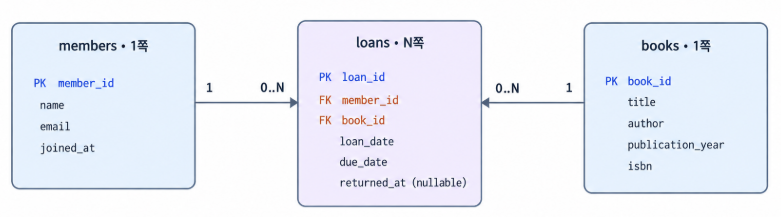
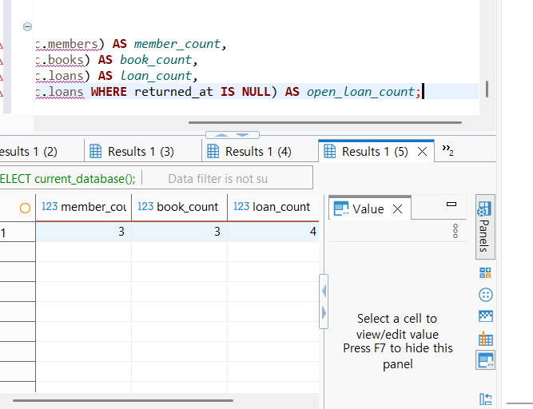
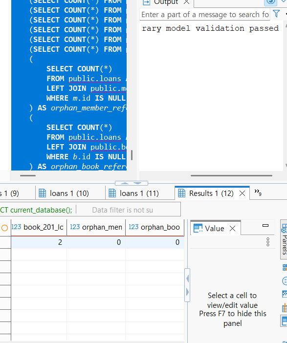
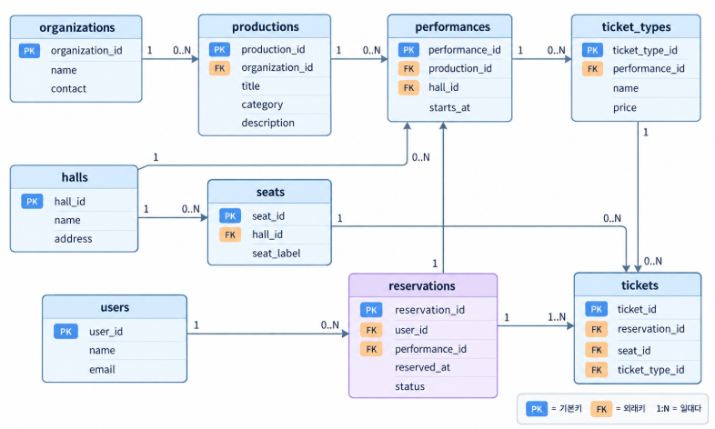

# Chapter 05 확장 실습 답안 템플릿

> **과제:** 요구사항에서 데이터 모델과 ERD 만들기  
> **사용 방법:** 이 파일을 내려받아 본인의 GitHub 저장소에 `chapter05_answer.md`라는 이름으로 저장한 뒤 실습하면서 바로 작성합니다.  
> **제출 방법:** LMS에는 파일을 직접 업로드하지 않고, **본인 GitHub 저장소의 `chapter05_answer.md` 파일 URL**을 제출합니다.

---

## 제출 전 주의

이 파일과 캡처 화면에는 실제 비밀번호, 전체 DB 접속 URL, API Key, 개인정보를 기록하지 않습니다.

```text
GitHub 계정 또는 별칭:hangyeom06
과제 작성일:2026.10.13
사용한 AI 도구:chatgpt
```

---

# 1. Chapter 05 핵심 개념 복습

본문을 보지 않고 먼저 작성합니다.

```text
요구사항에서 바로 테이블부터 만들면 위험한 이유: 요구사항의 의미와 규칙을 제대로 파악하지 않은 채 테이블부터 만들면 나중에 데이터 입력 시 필요한 데이터가 누락되거나 관계가 잘못 설정될 수 있다.

한 행의 의미를 먼저 정해야 하는 이유: 테이블의 한 행이 무엇을 뜻하는지 정해야 각 행에 어떤 정보를 저장할 지가 명확해지기 때문이다.

확정 요구사항과 미확정 정책을 구분해야 하는 이유: 확정된 요구사항은 설계에 반영하고 아직 결정되지 않은 정책은 임의로 정하지 않아야 잘못된 가정을 반영하지 않을 수 있다.

PK와 업무상 고유값 후보의 차이: PK는 테이블에서 각 행을 식별하기 위해 데이터베이스가 사용하는 기본 키이고 업무상 고유값 후보는 실제 업무에서 한 사람이나 대상을 구별하는 데에 쓰이는 값이다.

N:M 관계를 그대로 두지 않고 연결 테이블을 검토하는 이유: 직접 연결하면 데이터가 중복되는 등의 문제가 생길 수 있기 때문에 연결 테이블을 둬서 1:N으로 나누어 표현하는 것이다.
```

---

# 2. 도서 대여 요구사항 R-01~R-07 다시 분해

| 요구사항 | 관리 대상 / 사건 | 속성 후보 | 관계 / 규칙 후보 | 미확정 질문 |
| --- | --- | --- | --- | --- |
| R-01 | 회원 | 회원 정보 | 도서관이 회원을 관리한다 | 탈퇴 회원도 보관하는가 |
| R-02 | 회원 | 이름, 이메일, 가입일 | 회원에 이름, 이메일, 가입일을 저장한다 | 중복될 수 있는가 |
| R-03 | 도서 | 제목, 저자, 출판연도, ISBN | 도서에 제목과 저자를 관리하고 출판연도와 ISBN을 저장할 수 있다 | 같은 책이 여러 권 있을 때 구분하는가 |
| R-04 | 대여 | 회원과 도서의 대여 관계 | 한 회원은 여러 권을 대여할 수 있다 | 회원이 동시에 대여할 수 있는 최대 권수는 얼마인가 |
| R-05 | 대여 | 대여 대상 도서, 대여 시점 | 한 도서는 시간에 따라 여러 번 대여될 수 있다 | 대여 가능 상태를 별도로 관리하는가 |
| R-06 | 대여 기록 | 대여일, 반납 예정일, 실제 반납일 | 대여 기록마다 대여일과 반납예정일을 저장하고 실제반납일은 반납 후 기록한다 | 반납 예정일은 대여일로부터 어떻게 정하는가 |
| R-07 | 미반납 대여 기록 | 실제 반납일 | 미반납 상태에서는 실제 반납일이 비어 있을 수 있다 | 연체 상태도 관리하는가 |

### 본문과 비교한 뒤 수정한 내용

```text
처음에 놓친 부분: R-02에서 무엇이 중복될 수 있는지 명시하지 않았다. 이름, 이메일, 가입일이 각각 중복 가능한지 고유한 것인지를 질문으로 써야 한다.

처음에 잘못 분류한 부분: 관리 대상에 '대여'라고 적은 것이 관리 '대상'의 특성에 잘 부합하지 않으므로 대여 사건 정도로 바꿀 수 있다.

수정한 이유: 한 회원과 도서 사이에 대여의 관계가 여러 번 생길 수 있으므로 대여 사건으로 구분해야 한다.
```

---

# 3. 확정 규칙과 미확정 정책 구분

## 3-1. 확정된 규칙

```text
1.도서관은 회원을 관리한다
2.회원은 이름, 이메일, 가입일을 가진다.
3.도서는 제목과 저자를 관리하며 출판연도와 ISBN을 저장할 수 있다.
4.회원은 여러 권의 책을 대여할 수 있고 도서는 시간에 따라 여러 번 대여될 수 있다.
5.대여 기록에는 대여일과 반납예정일을 저장하며 실제 반납일은 아직 반납되지 않은 경우 비어 있을 수 있다.
```

## 3-2. 미확정 질문

최소 5개를 작성합니다.

```text
Q1.회원 이메일은 회원마다 고유해야 하는가
Q2.탈퇴한 회원의 정보와 대여 이록도 보관하는가
Q3.같은 책이 여러 권 있을 때 각각의 책을 구분해 관리하는가
Q4.회원 한 명이 동시에 대여할 수 있는 최대 권수는 얼마인가
Q5.대여 가능 상태를 별도로 관리해야 하는가
```

### 미확정 정책을 바로 `UNIQUE`, `CHECK`, 삭제 규칙으로 구현하면 위험한 이유

```text
미확정 정책을 확인하지 않고 UNIQUE, CHECK, 삭제 규칙으로 구현하면 실제 업무 규칙과 다른 규칙을 적용하게 될 수 있다. 따라서 정책을 확정한 후 그 규칙을 구현해야 한다.
```

---

# 4. 엔터티·속성·사건 후보 구분

| 후보 | 대상 엔터티 / 사건 엔터티 / 속성 | 판단 근거 | 독립 식별 필요? |
| --- | --- | --- | --- |
| 회원 | 대상 엔터티 | 회원은 이름, 이메일, 가입일 등 여러 속성을 가지며 도서 대여와 관계를 맺는다. | 필요. 회원을 구별할 식별자가 필요하다. |
| 도서 | 대상 엔터티 | 도서는 제목, 저자, 출판연도, ISBN 등의 정보를 가지며 대여 대상이 되기 떄문이다. | 필요. 같은 책이 여러 권이면 실물 책을 구별할 식별자가 필요하다. |
| 대여 기록 | 사건 엔터티 | 회원이 도서를 빌리는 사건이 발생하며 대여일, 반납예정일, 실제반납일을 기록하기 때문이다. | 필요. 같은 회원과 도서 사이에도 대여가 여러 번 일어날 수 있기 때문에 구별해야 한다. |
| 이메일 | 속성 | 이메일은 회원에게 속하는 정보이기 때문이다. | 필요X  |
| ISBN | 속성 | 도서의 식별 정보를 나타내는 속성이기 때문이다. | 필요X |
| 반납예정일 | 속성 | 반납예정일은 각각의 대여 기록에 속하는 날짜 정보이기 때문이다. | 필요X |

### “명사가 보이면 무조건 테이블”이 아닌 이유

```text

```
어떤 명사는 회원이나 도서처럼 여러 정보를 가지고 다른 데이터와 관계를 맺지만 이메일이나 반납 예정일처럼 다른 엔터티에 속하는 속성일 수 있기 때문이다.
---

# 5. 테이블별 한 행의 의미와 키 후보

| 테이블 | 한 행의 의미 | PK 후보 | 업무상 고유값 후보 | FK 후보 |
| --- | --- | --- | --- | --- |
| `members` | 도서관에 등록된 회원 한 명의 정보 | member_id | email | 없음 |
| `books` | 도서 한 권 | book_id | isbn | 없음 |
| `loans` | 회원이 도서를 한 번 대여한 기록 | loan_id | 없음 | member_id, book_id |

### `members.email`을 지금 바로 UNIQUE라고 확정하지 않는 이유

```text
요구사항에는 이메일을 회원 정보로 저장한다고만 되어 있고 이메일이 회원마다 반드시 달라야 한다는 규칙은 없기 때문이다.
```

### `books.isbn`을 지금 바로 NOT NULL + UNIQUE라고 확정하지 않는 이유

```text
요구사항에서 ISBN 정보를 저장할 수 있다고만 했고 ISBN이 없는 도서도 등록할 수 있는지 여부는 확인되지 않았다.
```

---

# 6. 관계를 양방향 문장으로 작성

## 6-1. `members ↔ loans`

```text
회원 한 명은 대여 기록을 여러 건 가질 수 있다.

대여 기록 한 건은 회원 한 명에게 속한다.

카디널리티:회원 1:N 대여 기록
선택성에서 확인할 점: 대여 기록이 반드시 회원 한 명과 연결되어야 하는가
```

## 6-2. `books ↔ loans`

```text
도서 한 건은 대여 기록을 여러 건 가질 수 있다.

대여 기록 한 건은 도서 한 건에 해당한다.

카디널리티: 도서 1:N 대여 기록
선택성에서 확인할 점: 대여 기록이 반드시 도서 한 건과 연결되어야 하는가
```

## 6-3. `members ↔ books`를 직접 N:M으로 저장하지 않고 `loans`를 두는 이유

```text
한 회원은 여러 도서를 대여할 수 있고, 한 도서도 시간에 따라 여러 회원에게 대여될 수 있으므로 N:M 관계이다. 이 관계를 직접 저장하면 같은 회원과 같은 도서 사이의 대여가 여러 번 발생했을 때 각각을 구별할 수 없기 때문이다.
```

### `loans`가 단순 연결표가 아니라 사건 엔터티라고 볼 수 있는 이유

```text
회원과 도서를 연결하는 정보뿐 아니라 대여일, 반납예정일, 실제반납일처럼 대여가 언제 일어나고 어떻게 끝났는지를 나타내는 속성이 존재하기 때문이다.
```

---

# 7. 도서 대여 ERD 초안

아래 항목이 보이도록 ERD를 작성합니다.

```text
members
books
loans
PK
FK
주요 속성
1:N 관계
```

권장 이미지 경로:

```text
assignments/chapter05/images/step07_library_erd.png
```

Markdown 예시:

```markdown

```

`여기에 ERD 이미지를 삽입하세요.`

### ERD를 그린 뒤 수정한 부분

```text
loans에 member_id와 book_id를 fk로 표시하고 회원과 대여 기록 및 도서와 대여 기록의 관계를 각각 1:N으로 만들었다.
```

---

# 8. PostgreSQL로 도서 대여 모델 구현 확인

## 8-1. 현재 환경 확인

```sql
SELECT current_database();
SELECT current_user;
SELECT current_schema();
SHOW search_path;
SHOW transaction_read_only;
```

```text
현재 DB:ai_database_book
현재 사용자:postgres
현재 스키마:public
search_path:public, "$user"
읽기 전용 여부:off
```

- [ ] 현재 DB가 `ai_database_book`이다.
- [ ] 실행 범위를 확인했다.
- [ ] Auto-commit 상태를 확인했다.

## 8-2. 스키마 생성 SQL 실행

사용 파일:

```text
code/chapter05/01_library_schema.sql
```

실행 전 예상:

```text
생성될 테이블 수: 3
생성 순서: members -> books -> loans
각 테이블 예상 행 수: 0,0,0
```

실행 후 실제:

```text
members 존재: O
books 존재:O
loans 존재:O
각 테이블 행 수:0
```

### `loans`를 마지막에 만드는 이유

```text
loans는 회원과 도서의 정보를 필요로 하므로 먼저 members와 books를 만들어야 한다.
```

---

# 9. 샘플 데이터 입력과 관계 관찰

사용 파일:

```text
code/chapter05/02_library_seed.sql
```

## 9-1. 실행 전 예상

```text
members 예상 행 수:3
books 예상 행 수:3
loans 예상 행 수:4
미반납 예상 건수:3
회원 101 대여 예상 건수:2
도서 201 대여 예상 건수:2
```

## 9-2. 실제 결과

```text
members 실제 행 수:3
books 실제 행 수:3
loans 실제 행 수:4
미반납 실제 건수:3
회원 101 대여 실제 건수:2
도서 201 대여 실제 건수:2
```

### 샘플 데이터에서 확인한 1:N 관계

```text
회원 101은 대여 기록 1001과 1002, 총 2건을 가지고 있다. 도서 201도 대여 기록 1001과 1003에 나타나므로 시간에 따라 여러 번 대여될 수 있다. 따라서 회원과 대여 기록, 도서와 대여 기록은 각각 1:N 관계다.
```

### `returned_at = NULL`이 의미하는 것

```text
returned_at이 NULL이면 해당 대여 기록의 실제 반납일이 아직 입력되지 않았다는 뜻이다. 이 샘플 데이터에서는 반납되지 않은 대여 기록으로 볼 수 있다.
```

### 증거 화면

권장 경로:

```text
assignments/chapter05/images/step09_seed_result.png
```

`여기에 샘플 데이터 또는 관계 확인 화면을 삽입하세요.`

---

# 10. 검증 SQL 실행

사용 파일:

```text
code/chapter05/03_library_validation.sql
```

## 10-1. 결과 기록

```text
members =3
books =3
loans =4
미반납 건수 =3
회원 101 대여 이력 =2
도서 201 대여 이력 =2
회원 참조 고아 행 =0
도서 참조 고아 행 =0
loans FK 개수 =2
검증 최종 메시지 =Chapter 05 library model validation passed
```

### 단순히 테이블 3개가 생성되었다고 설계 검증이 끝난 것이 아닌 이유

```text
테이블이 생성되었다는 것은 SQL이 실행되어 구조가 만들어졌다는 뜻일 뿐 그 구조가 요구사항을 제대로 반영했는지까지 확인해 주지는 않는다. 행의 수가 예상과 맞는지, 미반납 대여를 표현할 수 있는지, 대여 기록이 회원과 도서를 올바르게 가져왔는지, 반복 대여 이력이 남는지 등도 확인해야 한다.
```

### 증거 화면

권장 경로:

```text
assignments/chapter05/images/step10_validation.png
```

`여기에 검증 PASS 화면을 삽입하세요.`

---

# 11. 작은 시나리오로 모델 검증

아래 시나리오를 현재 모델이 표현할 수 있는지 판단합니다.

| 시나리오 | 표현 가능? | 이유 | 추가 확인할 정책 |
| --- | --- | --- | --- |
| 회원 A가 서로 다른 책 2권을 대여 | 가능 | loans에 회원 A와 각 도서를 연결한 대여 기록을 두 개 저장하면 된다 | 회원의 동시 대여 가능 권수에 제한이 있는가 |
| 같은 책을 시간 차를 두고 다시 대여 | 가능 | 같은 도서에 대해 대여 기록을 여러 건 저장할 수 있다 | 이전 대여가 완료된 뒤에만 다시 대여가 가능한가 |
| 아직 반납하지 않은 대여 | 가능 | returned_at을 NULL로 저장하면 된다 | 연체 여부를 별도로 관리하는가 |
| 회원은 있지만 대여 기록이 없음 | 가능 | 회원 정보는 members에 대여 기록은 loans에 별도로 저장하므로 대여 기록 없이 회원 등록이 가능하다 | 대여 이력이 없는 회원도 보관하는가 |
| ISBN이 없는 도서 | 가능 | books.isbn이 NULL을 허용하도록 정의되어 있다 | ISBN이 없는 도서의  등록을 계속 허용할 것인가 |
| 같은 ISBN의 실물 복본 2권 | 불확실 | books의 한 행이 실물 한 권을 뜻하는지 같은 ISBN의 도서를 묶어서 표현하는지 나타나지 않았다 | 실물 책마다 별도의 book_id를 부여할 것인가 |
| 한 도서에 저자 2명 | 불확실 | books.author이 한 개의 문자열로 되어 있어 저자별 정보를 따로 저장하거나 검색할 수 있는지 불확실하다 | 저자들을 하나의 문자열로 저장할 것인가 |
| 같은 도서를 두 명이 동시에 대여 | 가능 | 현재는 이와 관련해 제한을 두는 규칙이 없다 | 같은 책의 동시 대여를 금지할 것인가 |

### 현재 Chapter 05 모델의 한계 3가지

```text
1. 같은 ISBN을 가진 실물 복사본을 서로 다른 책으로 구분할 지 정해져 있지 않다
2. 저자 정보가 하나의 문자열로 저장되어 여러 저자일 때 관리하기 힘들다
3. 같은 도서에 미반납 대여 기록이 여러 개 생기는 것에 제한 규칙이 없다
```

---

# 12. Chapter 01~04 개인 서비스 요구사항 작성

지금까지 선택한 개인 서비스 아이디어를 사용합니다.

```text
서비스 이름: 소극장 공연 검색 및 좌석 예매 서비스
서비스 목적: 공연단체가 공연과 회차별 정보를 등록하고 관객이 공연을 검색해 좌석을 예매하고 예약 내역을 확인하며 리뷰를 남길 수 있도록 한다.
```

## 12-1. 요구사항

최소 8개를 작성합니다.

```text
P05-R01.공연단체는 서비스에 작품 정보를 등록하고 관리할 수 있다.
P05-R02.공연단체는 작품별 공연 회차와 공연 장소를 등록할 수 있다. 
P05-R03.공연단체는 공연 회차별 티켓 종류와 가격을 등록할 수 있다.
P05-R04.관객은 작품 카테고리, 공연 날짜와 시간으로 공연을 검색할 수 있다.
P05-R05.관객은 공연 회차를 선택하고 해당 회차에서 예매 가능한 좌석을 확인할 수 있다.
P05-R06.관객은 공연 회차와 좌석을 선택해 예매할 수 있다.
P05-R07.서비스는 이미 예매된 좌석이 같은 회차에서 중복 예매되지 않도록 관리해야 한다.
P05-R08.관객은 자신의 예매 내역과 좌석, 공연 정보를 확인할 수 있다.
```

> 화면 기능보다 **저장해야 할 사실, 반복 사건, 상태와 관계**를 중심으로 작성합니다.

## 12-2. 미확정 질문

최소 3개를 작성합니다.

```text
P05-Q01.공연 단체는 서비스에 가입하거나 등록할 때 어떤 정보를 입력해야 하는가
P05-Q02.좌석 예매는 결제가 완료된 후 확정되는가 아니면 결제 전에도 좌석을 일정 시간 확보할 수 있는가
P05-Q03.관객은 공연 시작 전 언제까지 예매를 취소할 수 있으며 취소된 좌석은 즉시 다시 예매할 수 있는가
```

---

# 13. 개인 서비스 모델 초안

## 13-1. 엔터티·사건 후보표

| 후보 | 대상 / 사건 | 한 행의 의미 | 주요 속성 | PK 후보 | 업무 식별자 후보 |
| --- | --- | --- | --- | --- | --- |
| 사용자 | 대상 엔터티 | 서비스에 가입한 관객 한 명의 정보 | 이름, 이메일, 연락처 | user_id | 이메일 |
| 공연단체 | 대상 엔터티 | 공연을 등록하고 관리하는 단체 한 곳 | 단체명, 대표자, 연락처 | organization_id | 단체명 |
| 작품 | 대상 엔터티 | 공연단체가 등록한 작품 한 편 | 작품명, 카테고리, 소개 | production_id | 작품명 |
| 예약 | 사건 엔터티 | 관객이 특정 공연 회차를 예매한 한 건 | 관객, 공연, 회차, 예약일, 예약 상태 | reservation_id | 없음 |

## 13-2. 관계 문장

최소 3쌍을 양방향으로 작성합니다.

```text
관계 1:
공연단체 한 곳은 작품을 여러 편 등록할 수 있다.
작품 한 편은 공연단체 한 곳에 속한다.
1:N

관계 2:
관객 한 명은 예약을 여러 건 할 수 있다.
예약 한 건은 관객 한 명이 한다.
1:N

관계 3:
예약 한 건은 티켓을 여러 장 포함할 수 있다.
티켓 한 장은 예약 한 건에 속한다.
1:N
```

## 13-3. N:M 관계 검토

```text
N:M 관계 후보:관객과 공연 회차
연결 테이블 후보: reservation
연결 테이블 한 행의 의미:관객 한 명이 공연 회차 한 건을 예매한 기록 한 건
연결 테이블 자체에 필요한 사건 속성:예매일, 예약 상태, 취소일
```

---

# 14. 개인 서비스 ERD 초안

ERD에 최소 다음을 표시합니다.

```text
테이블 3개 이상
각 테이블 PK
주요 속성
필요한 FK
관계선
카디널리티
```

권장 이미지 경로:

```text
assignments/chapter05/images/step14_my_erd.png
```

`여기에 개인 서비스 ERD 이미지를 삽입하세요.`

### ERD의 각 테이블이 어떤 요구사항에서 나왔는지 설명

| 테이블 | 근거 요구사항 ID | 한 행의 의미 |
| --- | --- | --- |
| organizations | P05-R01 | 공연 정보를 등록하는 공연단체 한 곳 |
| productions | P05-R01, P05-R04 | 공연단체가 등록한 작품 한 편 |
| halls | P05-R02 | 공연이 열리는 공연장 한 곳 |
| seats | P05-R05, P05-R07 | 공연장에 속한 좌석 한 개 |
| performances | P05-R02, P05-R04, P05-R05 | 특정 작품이 특정 공연장에서 열리는 회차 한 건 |
| ticket_types | P05-R03, P05-R05 | 공연 회차에서 판매하는 티켓 종류 한 가지 |
| users | P05-R04, P05-R06, P05-R08 | 서비스를 이용하는 관객 한 명 |
| reservations | P05-R06, P05-R08 | 관객이 공연 회차를 예매한 기록 한 건 |
| tickets | P05-R05, P05-R06, P05-R07, P05-R08 | 예약에 포함된 좌석 티켓 한 장 |
---

# 15. 요구사항 추적표

| 요구사항 ID | 데이터 모델 반영 위치 | 검증 방법 | 상태 |
| --- | --- | --- | --- |
| P05-R01 | organizations, productions | 공연 단체와 그 단체가 등록한 작품을 조회 | 반영 |
| P05-R02 | performances, productions, halls | 작품별 회차와 공연장 정보가 연결되는지 조회 | 반영 |
| P05-R03 | ticket_types | 회차별 티켓 종류와 가격을 조회 | 반영 |
| P05-R04 | productions.category, performances.starts_at | 카테고리와 공연 일시 조건으로 공연 검색 | 반영 |
| P05-R05 | seats, tickets, ticket_types | 회차의 좌석과 티켓 정보 조회 및 예매좌석과 비교 | 확인필요 |
| P05-R06 | reservations, tickets | 예약에 관객, 회차, 티켓이 연결되는지 조회 | 반영 |
| P05-R07 | tickets.seat_id, reservation.performance_id | 같은 회차의 같은 좌석으로 중복 예매가 가능한지 검사 | 확인필요 |
| P05-R08 | reservations, tickets, users, performances, seats | 관객별 예약 내역과 공연, 좌석 정보를 조회 | 반영 |

### ERD 그림만으로 요구사항 누락을 발견하기 어려운 이유

```text
ERD는 테이블과 속성, 테이블 간의 관계를 보여주지만 각 기능이 어떤 요구사항에서 나온 것인지는 보여주지 않기 때문에 구체적인 규칙들을 확인하기는 어렵다.
```

---

# 16. 개인 서비스 작은 데이터 시나리오 검증

가상 데이터만 사용합니다.

```text
사용자/대상 A: 관객 101 김민지
사용자/대상 B:관객 102 이준호
대상 X: 공연 회차 301 - 작품 '봄', 2026년 10월 13일 공연
대상 Y: 공연 회차 302 - 작품 '여름', 2026년 10월 14일 공연
사건 1: 예약 5001 - 김민지가 공연 회차 301의 A열 1번 좌석을 예매함
사건 2: 예약 5002 - 김민지가 공연 회차 302의 B열 1번 좌석을 예매함
사건 3: 예약 5003 - 이준호가 공연 회차 301의 A열 2번 좌석을 예매함
사건 4: 예약 5004 - 이준호가 공연 회차 302의 B열 2번 좌석을 예매함
```

### 이 시나리오를 현재 ERD로 저장할 수 있는가?

```text
저장할 수 있다. users에 관객 101과 102를, performances에 회차 301과 302를 등록한 뒤 reservations에 네 건의 예약을 저장하면 된다. 각 예약에 연결된 tickets에 해당 좌석을 기록할 수 있다.
```

### 저장하기 어려운 상황 또는 모호한 부분

```text
현재 ERD만으로는 같은 공연 회차의 같은 좌석이 중복 예매되는 것을 막을 수 없다. 또 티켓의 좌석이 해당 공연장의 좌석인지 티켓 종류가 해당 공연 회차에 속하는지를 확인하는 규칙도 명확하지 않다.
```

### 시나리오 검증 후 수정한 ERD 내용

```text
시나리오의 네 가지 예약은 현재 테이블 구조에 저장할 수 있으므로 엔터티를 추가할 필요는 없다. 또한 한 예약에 여러 장의 티켓이 포함될 수 있다는 의미가 잘 적용이 되었는지 확인하고 맞다면 현재의 reservations와 tickets의 관계를 유지한다. 좌석 중복 예매 방지와 좌석, 티켓 종류가 공연 회차와 일치하는 규칙은 추가 정책으로 확정한 후에 제약 조건이나 검증 절차에 추가로 반영한다.
```

---

# 17. AI를 설계자가 아니라 리뷰어로 활용

## 17-1. AI에게 전달한 핵심 자료

```text
요구사항:
P05-R01. 공연단체는 작품 정보를 등록하고 관리할 수 있다.
P05-R02. 공연단체는 작품별 공연 회차와 공연 장소를 등록할 수 있다.
P05-R03. 공연단체는 공연 회차별 티켓 종류와 가격을 등록할 수 있다.
P05-R04. 관객은 작품 카테고리와 공연 날짜·시간으로 공연을 검색할 수 있다.
P05-R05. 관객은 공연 회차의 예매 가능한 좌석을 확인할 수 있다.
P05-R06. 관객은 공연 회차와 좌석을 선택해 예매할 수 있다.
P05-R07. 이미 예매된 좌석은 같은 공연 회차에서 중복 예매할 수 없다.
P05-R08. 관객은 자신의 예매 내역과 공연·좌석 정보를 확인할 수 있다.

미확정 질문:
공연단체 가입 시 어떤 정보를 받아야 하는가?
예매는 결제 전후 어느 시점에 확정되는가?
좌석은 결제 전 일정 시간 동안 임시로 확보되는가?
예매 취소는 공연 시작 전 언제까지 가능한가?
취소된 좌석은 언제 다시 예매할 수 있는가?
한 예약에 여러 장의 티켓을 포함할 수 있는가?
같은 좌석의 중복 예매를 어떤 제약조건으로 방지할 것인가?


테이블별 한 행 의미:
organizations: 공연 정보를 등록하는 공연단체 한 곳
productions: 공연단체가 등록한 작품 한 편
halls: 공연이 열리는 공연장 한 곳
seats: 공연장에 속한 좌석 한 개
performances: 특정 작품이 특정 공연장에서 열리는 회차 한 건
ticket_types: 공연 회차에서 판매하는 티켓 종류 한 가지
users: 서비스를 이용하는 관객 한 명
reservations: 관객이 특정 공연 회차를 예매한 기록 한 건
tickets: 예약에 포함된 좌석 티켓 한 장


관계 문장:
공연단체 한 곳은 여러 작품을 등록할 수 있고, 작품 한 편은 한 공연단체에 속한다. (1:N)
작품 한 편은 여러 공연 회차를 가질 수 있고, 공연 회차 한 건은 한 작품에 속한다. (1:N)
공연장 한 곳은 여러 좌석을 가지며, 좌석 한 개는 한 공연장에 속한다. (1:N)
공연장 한 곳에서 여러 공연 회차가 열릴 수 있고, 공연 회차 한 건은 한 공연장에서 열린다. (1:N)
공연 회차 한 건은 여러 티켓 종류를 제공할 수 있고, 티켓 종류 한 가지는 한 공연 회차에 속한다. (1:N)
관객 한 명은 여러 예약을 할 수 있고, 예약 한 건은 한 관객이 한다. (1:N)
공연 회차 한 건은 여러 예약을 받을 수 있고, 예약 한 건은 한 공연 회차에 해당한다. (1:N)
예약 한 건은 여러 티켓을 포함할 수 있고, 티켓 한 장은 한 예약에 속한다. (1:N)

ERD 설명:
관객(users)과 공연 회차(performances)는 서로 N:M 관계이므로 reservations를 연결 테이블로 둔다. reservations는 관객과 공연 회차를 연결하고 예매 시점과 상태를 저장한다. 예약에 포함된 각 좌석 티켓은 tickets에 기록하며, tickets는 좌석과 티켓 종류를 참조한다. 각 테이블에는 행을 구분하는 PK를 두고, 관련 테이블을 참조하는 FK를 둔다. 다만 같은 회차의 같은 좌석 중복 예매를 막는 규칙과 좌석·티켓 종류가 해당 회차와 일치하는지는 추가 정책으로 확인해야 한다.
```

## 17-2. AI 검토 요청

실제로 사용한 프롬프트 또는 핵심 내용을 기록합니다.

```text
아래 공연 예매 서비스의 요구사항, 테이블별 한 행의 의미, 관계 문장, ERD 설명을 검토해줘. 요구 사항에 없는 기능이나 정책을 사실처럼 추가하지 말고 요구사항이 ERD에 반영되지 않은 부분, 잘못된 부분, 추가 확인이 필요한 정책을 구분해서 알려줘. 각 의견마다 근거가 되는 요구사항 ID와 이유 제시해줘.
```

## 17-3. AI 제안 검토

| AI 제안 또는 질문 | 수용 / 수정 / 보류 / 거절 | 실제 근거 요구사항 | 나의 판단 이유 |
| 예약에 포함된 좌석별 티켓을 tickets에 별도 기록한다 | 수용 | P05-R05, P05-R06, P05-R08 | 예매한 좌석과 티켓 종류를 예약 내역과 함께 확인해야 하므로 적절하다 |
| 같은 공연 회차에서 같은 좌석이 중복 예매되지 않게 제약을 둔다 | 수정 | P05-R07 | 중복 예매를 막아야 한다는 요구는 있지만 이를 구현할 제역 조건은 ERD에 아직 표시하지 않았기 때문에 좌석과 회차의 연결을 확인한 후 규칙을 확정한 후 반영해야 한다. |
| 결제 내역 테이블을 추가한다 | 보류 | 직접적인 근거 요구 사항 없음 | 현재 요구사항에는 결제 정보 저장 방식과 결제 상태 관리가 구체적으로 정의되어 있지 않으므로 결제 정책이 확정되면 추가 여부를 판단한다. |
| 공연 취소 가능 기간과 취소된 좌석의 재판매 규칙을 정한다 | 보류 | 현재 요구사항에는 없음 | 취소 기능은 언급되어 있지만 취소 가능 시점과 좌석 재판매 시점은 정해져 있지 않다. 정책 확인한 후 반영한다. |

### AI가 요구사항에 없는 정책을 임의로 확정한 부분이 있었나요?

```text
결제 내역 테이블 추가와 취소 정책 관련해서는 요구사항에 없는 내용인데 제안해서 보류했다.
```

### AI 검토를 받고도 채택하지 않은 제안 하나와 그 이유

```text
결제 내역 테이블을 추가하자는 제안을 보류했다. 현재 요구사항에는 결제 정보를 저장하거나 관리한다는 내용이 없으므로 이를 뒷받침할 요구사항이 생기기 전까지 테이블을 추가하지 않을 예정이다.
```

---

# 18. 선택 — PostgreSQL DDL 초안

> 이 단계는 완성된 구현이 아니라 **현재 데이터 모델을 SQL 구조로 옮겨 보는 연습**입니다. Chapter 06에서 정규화와 제약조건을 더 엄격하게 검토합니다.

```sql
-- 개인 서비스 DDL 초안

```

### 아직 구현하지 않은 미확정 정책

```text
1.예매가 결제 전후 어느 시점에 확정되는지
2.공연 시작 전 예매 취소를 언제까지 허용하고 취소 좌석을 언제 다시 예매할 수 있는지
3.같은 공연 회차에서 같은 좌석의 중복 예매를 어떤 제약조건으로 방지할지
```

---

# 19. 최종 성찰

아래 문장은 반드시 본인의 말로 작성합니다.

```text
1. 요구사항에서 바로 테이블을 만들지 않고 중간 설계 과정을 거쳐야 하는 이유는
   요구사항의 의미와 관계를 먼저 정리해야 필요한 데이터나 규칙을 빠뜨리지 않기 때문 이다.

2. 테이블의 한 행 의미가 중요한 이유는
   한 행이 무엇을 나타내는지 분명해야 속성을 알맞은 테이블에 넣고 중복을 줄일 수 있기 때문 이다.

3. 미확정 정책을 그대로 남겨 두는 것이 좋은 설계 활동일 수 있는 이유는
   정해지지 않은 규칙을 임의로 가정해 제약조건으로 만들지 않고 나중에 확인하고 수정할 여지를 남기기 때문 이다.

4. N:M 관계에서 연결 엔터티가 필요한 이유는
   두 대상 사이의 관계를 여러 건으로 저장하고 관계 자체의 속성이나 사건 정보를 기록할 수 있기 때문 이다.

5. AI가 ERD를 만들어 주더라도 사람이 반드시 확인해야 하는 것은
   ERD가 실제 요구사항을 반영하는지, 미확정 정책을 임의로 확정하지 않았는지, 관계가 잘 설정되었는지 이다.
```

---

# 20. 제출 체크리스트

- [ ] `chapter05_answer.md`를 본인 저장소에 만들었다.
- [ ] R-01~R-07을 직접 재분해했다.
- [ ] 확정 규칙과 미확정 질문을 구분했다.
- [ ] `members/books/loans`의 한 행 의미를 설명했다.
- [ ] 관계를 양방향 문장으로 작성했다.
- [ ] 도서 대여 ERD를 작성했다.
- [ ] `01_library_schema.sql`을 실행했다.
- [ ] `02_library_seed.sql`을 실행했다.
- [ ] `03_library_validation.sql` 결과를 확인했다.
- [ ] 작은 시나리오로 모델의 한계를 확인했다.
- [ ] 개인 서비스 요구사항을 8개 이상 작성했다.
- [ ] 개인 서비스 미확정 질문을 3개 이상 작성했다.
- [ ] 개인 서비스 ERD를 작성했다.
- [ ] 요구사항 추적표를 작성했다.
- [ ] 개인 서비스 작은 데이터 시나리오를 검증했다.
- [ ] AI 제안을 수용/수정/보류/거절로 판단했다.
- [ ] 핵심 캡처 또는 ERD 이미지 3~4장 이내로 정리했다.
- [ ] 이미지가 GitHub 웹 화면에서 실제로 보인다.
- [ ] 답안 파일을 commit/push했다.

---

# 21. LMS 제출 URL

아래 형식의 **본인 GitHub 파일 URL**을 LMS에 제출합니다.

```text
https://github.com/<본인-GitHub-ID>/<본인-저장소>/blob/main/assignments/chapter05/chapter05_answer.md
```

내 제출 URL:

```text

```

> 저장소 메인 URL, 교수자 템플릿 URL, Raw URL이 아니라 **작성 완료된 본인 `chapter05_answer.md` 파일 화면 URL**을 제출합니다.
