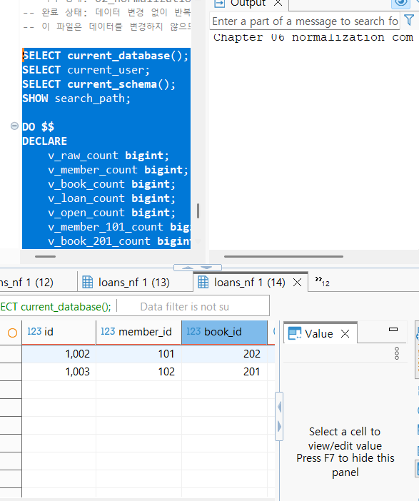
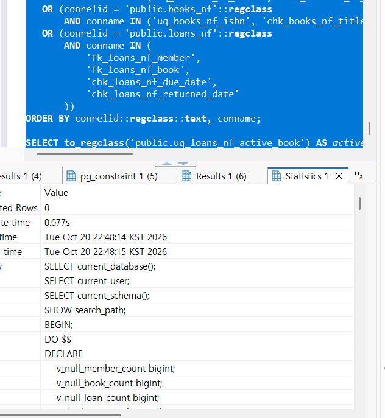
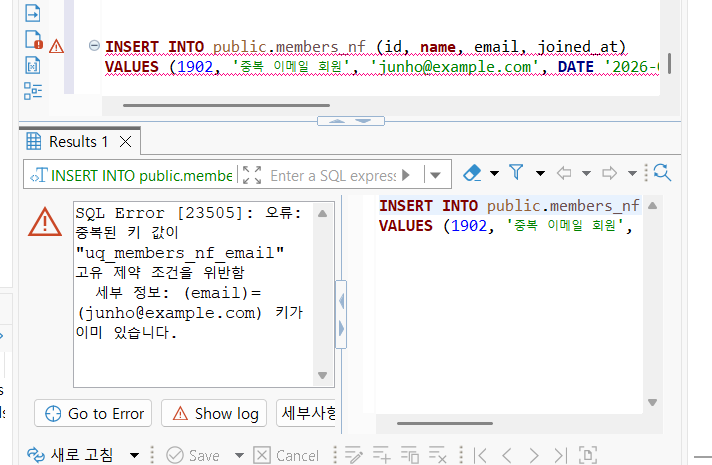
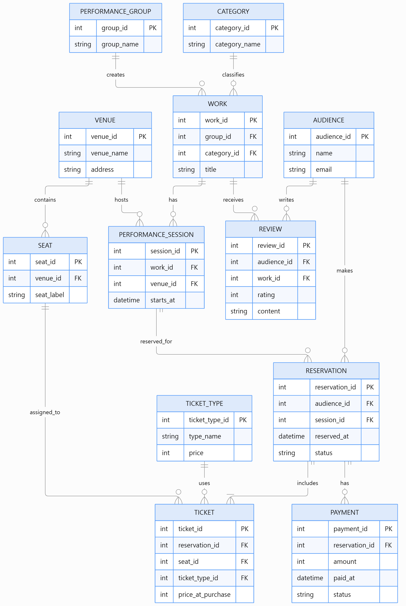

# Chapter 06 확장 실습 답안 템플릿

> **과제:** 정규화와 데이터 무결성으로 좋은 테이블 만들기  
> **사용 방법:** 이 파일을 내려받아 본인의 GitHub 저장소에 `chapter06_answer.md`라는 이름으로 저장한 뒤 실습하면서 바로 작성합니다.  
> **제출 방법:** LMS에는 파일을 직접 업로드하지 않고, **본인 GitHub 저장소의 `chapter06_answer.md` 파일 URL**을 제출합니다.

---

## 제출 전 주의

이 파일과 캡처 화면에는 실제 비밀번호, 전체 DB 접속 URL, API Key, 개인정보를 기록하지 않습니다.

```text
GitHub 계정 또는 별칭:hangyeom06
과제 작성일:26.10.20
사용한 AI 도구:chatGPT
```

---

# 1. 실습 환경과 시작 상태 확인

다음을 실행합니다.

```sql
SELECT current_database();
SELECT current_user;
SELECT current_schema();
SHOW search_path;
SHOW transaction_read_only;
```

| 확인 항목 | 실제 결과 | 의미 |
| --- | --- | --- |
| `current_database()` | ai_database_book | 현재 접속한 데이터베이스의 이름 |
| `current_user` | postgres | 현재 SQL을 실행하는 계정 |
| `current_schema()` | public | 테이블 등을 찾을 때 기준이 되는 현재 스키마 |
| `search_path` | public, "$user" | 객체를 찾을 때 public 스키마를 먼저 검색하고 그다음 사용자 이름과 같은 스키마를 검색한다 |
| `transaction_read_only` | off | 읽기 전용 모드가 꺼져 있다 |

- [ ] 현재 DB가 `ai_database_book`이다.
- [ ] 변경 가능한 연결인지 확인했다.
- [ ] Auto-commit 상태를 확인했다.
- [ ] Chapter 06 번호형 SQL 파일을 사용한다.

---

# 2. 정규화 전 큰 테이블의 문제 찾기

본문의 `library_records_raw` 구조를 기준으로 생각합니다.

```text
library_records_raw 한 행
→ 대여 사건 한 건이지만 회원·도서의 현재 사실까지 함께 저장된 구조
```

## 2-1. 위험한 중복과 의미 있는 반복 구분

| 반복되는 값/상황 | 위험한 중복 / 의미 있는 반복 | 판단 이유 |
| --- | --- | --- |
| 회원 이메일이 여러 대여 행에 반복 | 위험한 중복 | 이메일은 회원에 대한 값이고 대여할 때마다 저장하면 수정 시 여러 행을 바꿔야 하고 행마다 값이 달라질 수 있다 |
| 도서 제목이 여러 대여 행에 반복 | 위험한 중복 | 제목은 도서에 대한 값인데 기록마다 저장하면 제목 변경이나 오타가 여러 행에 나타날 수 있다 |
| `loans_nf.member_id = 101` 반복 | 의미 있는 반복 | 각 대여 사건에 회원 정보를 연결하는 값이므로 같은 회원이 여러 번 대여를 하는 것을 표현하려면 반복될 수 있다 |
| 사건 당시 가격 같은 이력값 반복 | 의미 있는 반복 | 각 사건이 발새한 지점의 가격을 보존해야 하므로 현재 가격이 바뀌어도 과거 사건의 가격은 그 시점에서의 기록을 해야 하기 때문이다 |

## 2-2. 이상 현상 설명

### 삽입 이상

```text
아직 한 번도 대여되지 않은 새 도서를 등록하려 할 때 생기는 문제: 아직 대여 기록이 없으면 도서 정보를 넣을 행이 없어 새 도서를 등록할 수 없거나 실제 대여가 발생한 것처럼 불필요한 값을 채워 넣어야 한다
```

### 수정 이상

```text
회원 이메일이 변경될 때 생기는 문제: 회원 이메일이 여러 대여 행에 반복 저장되어 있기 때문에 모든 행을 수정해야 한다
```

### 삭제 이상

```text
마지막 대여 기록을 삭제할 때 생길 수 있는 문제:도서의 마지막 대여 기록을 삭제하면서 해당 행에 있던 도서 정보까지 사라질 수 있다
```

### 왜 이것이 SQL 문법 문제가 아니라 구조 문제인가요?

```text
SQL 문법이 올바르더라도 회원, 도서 정보와 대여 사건을 한 테이블에 함께 저장하면 삽입, 수정, 삭제 과정에서 정보가 누락되거나 불일치할 수 있다. 이는 데이터를 어떤 테이블에 어떻게 나누어 저장할지의 구조 문제이다.
```

---

# 3. 1NF·2NF·3NF 핵심 질문 복습

정규형 이름만 외우지 말고 **왜 분리하는지** 설명합니다.

## 3-1. 제1정규형(1NF)

```text
한 셀에 쉼표로 여러 독립 값을 넣거나 book1/book2/book3처럼 반복 열을 만들면 왜 문제가 되는가: 한 셀에 여러 값을 넣으면 값 하나를 따로 조회하거나 수정하기 힘들고 반복 열을 만들면 검색, 집계 등이 복잡해지고 데이터 입력도 힘들다.
```

내 서비스에서 비슷한 위험이 있는 예:

```text
공연 예약 한 행에서 좌석번호를 A1, A2, A3로 저장하는 경우 좌석별 예약 여부를 확인하거나 일부 좌석만 취소하기 어렵다.
```

## 3-2. 제2정규형(2NF)

다음 관계를 설명합니다.

```text
(student_id, course_id) → grade
student_id → student_name
course_id → course_name
```

```text
복합키 전체가 아니라 일부에만 의존하는 열을 분리해야 하는 이유:grade는 (student_id, course_id)조합에 따라 달라지지만 student_name은 student_id만으로, course_name은 course_id 만으로 정해진다. 이런 열을 한 테이블에 함께 두면 같은 학생 이름이나 과목명이 여러 행에 반복되어 수정, 삭제할 때 불일치하게 될 수 있다. 따라서 학생 정보와 과목 정보는 각각 별도 테이블에 둬야 한다.
```

## 3-3. 제3정규형(3NF)

```text
member_id → zip_code
zip_code → city
```

```text
일반 열이 다른 일반 열을 결정하는 구조를 검토해야 하는 이유:city는 member_id가 아니라 zip_code에 따라 정해지므로 회원 테이블에 우편번호와 도시를 함께 저장하면 같은 우편번호의 도서명이 여러 회원 행에 반복된다. 도시명이 바뀌거나 잘못 입력되었을 때 여러 행을 수정해야 하므로 별도 테이블로 관리한다.
```

### 정규화는 값이 반복되기만 하면 무조건 분리하는 것인가요?

```text
아니다. 그 값이 어떤 사실을 나타내는지, 무엇에 의존하는지 살펴봐야 한다.
```

---

# 4. 각 열의 '사실의 주인' 찾기

| 열 | 어떤 사실을 설명하는가 | 주인 테이블 | 이유 |
| --- | --- | --- | --- |
| `member_name` | 회원의 이름 | member_nf | 특정 회원에 대한 정보 |
| `member_email` | 회원의 이메일 | members_nf | 특정 회원에 대한 정보 |
| `book_title` | 도서의 제목 | books_nf | 특정 도서에 대한 정보 |
| `author` | 도서의 저자 | books_nf | 특정 도서에 대한 정보 |
| `borrowed_at` | 대여가 시작된 시각 | loans_nf | 특정 대여사건에 대한 정보 |
| `due_at` | 해당 대여의 반납 예정일 | loans_nf | 대여마다 달라질 수 있는 정보 |
| `returned_at` | 해당 대여의 실제 반납 시각 | loans_nf | 특정 대여 사건의 진행 상태를 나타내는 정보 |
| `member_id` | 대여한 회원의 식별자 | loans_nf의 외래 키 | 대여 사건을 회원과 연결하는 정보 |
| `book_id` | 대여한 도서의 식별자 | loans_nf의 외래 키 | 대여 사건을 도서와 연결하는 정보 |

정규화 후 한 행의 의미:

```text
members_nf 한 행 =회원 한 명의 정보
books_nf 한 행 =도서 한 권의 정보
loans_nf 한 행 =대여 사건 한 건의 정보
```

### 현재 사실과 사건 당시 이력을 구분하는 기준

```text
현재 사실은 지금의 회원이나 도서 상태를 나타내는 값이고 사건 당시 이력은 특정 대여가 일어난 시점의 상황을 기록하는 값이다. 값이 바뀌었을 때 과거 대여 기록도 함께 바꿔야 하는지 생각해 구분해야 한다.
```

---

# 5. PostgreSQL로 정규화 전·후 구조 재현

Public 저장소의 다음 파일을 순서대로 사용합니다.

```text
code/chapter06/01_normalization_schema.sql
code/chapter06/02_normalization_seed.sql
code/chapter06/03_normalization_compare.sql
```

## 5-1. `01_normalization_schema.sql`

실행 전 예상:

```text
생성될 테이블 수:4개
각 테이블 예상 행 수:
library_records_raw 0행
members_nf 0행
books_nf 0행
loans_nf 0행
```

실행 후:

```text
실제로 생성된 테이블:library_records_raw, members_nf, books_nf, loans_nf
각 테이블 실제 행 수:
library_records_raw 0행
members_nf 0행
books_nf 0행
loans_nf 0행
```

## 5-2. `02_normalization_seed.sql`

실행 전 예상 기준:

```text
raw = 3
members = 2
books = 2
loans = 3
미반납 = 2
회원 101 대여 = 2
도서 201 대여 = 2
```

실제 결과:

```text
raw:3
members:2
books:2
loans:3
미반납:2
회원 101 대여:2
도서 201 대여:2
```

예상과 다른 값이 있다면 이유:

```text

```

## 5-3. `03_normalization_compare.sql`

```text
검증 메시지:Chapter 06 normalization comparison passed
PASS / FAIL: pass
```

다음 항목을 확인합니다.

```text
회원 고아 참조:0
도서 고아 참조:0
날짜 순서 오류:0
활성 대여 중복:0
```

### 정규화 후에도 JOIN으로 원래 업무 정보를 다시 볼 수 있는 이유

```text
대여 테이블의 member_id와 book_id가 회원, 도서 테이블의 각 ID를 가리키기 때문이다. 이 키들을 기준으로 테이블을 연결하면 대여 정보에 회원 이름, 이메일, 도서 제목, 저자를 같이 조회할 수 있다.
```

### 증거 화면

권장 경로:

```text
assignments/chapter06/images/step05_normalization.png
```

`여기에 정규화 전후 및 검증 결과 화면을 삽입하세요.`

---

# 6. Chapter 06에서 확정한 C-01~C-08 정책 해석

| ID | 확정 규칙 | 구현 방법 | 왜 필요한가 | Chapter 05에서는 왜 미확정이었나 |
| --- | --- | --- | --- | --- |
| C-01 | 이메일 문자열 중복 금지 | `UNIQUE` | 같은 이메일이 여러 회원 계정에 등록되는 것을 막기 위해 | 중복 가입을 허용할지, 이메일을 회원의 고유 식별값으로 볼지 결정되지 않았다 |
| C-02 | ISBN 필수·중복 금지 | `NOT NULL + UNIQUE` | ISBN이 없는 도서와 같은 ISBN의 중복 등록을 막는다 | 모든 도서에 ISBN이 있는지 ISBN을 중복없이 관리할지 정해지지 않았다 |
| C-03 | 이름·제목 공백 금지 | `CHECK` | 공백만 입력된 회원 이름이나 도서 제목을 막는다 | 공백을 입력 오류로 볼지, 입력값을 어떻게 정리할지 정해지지 않았다 |
| C-04 | `due_at >= borrowed_at` | `CHECK` | 반납 예정일이 대여일보다 앞서는 잘못된 날짜를 막는다 | 대여 당일 반납을 허용할지 등 날짜 기준이 확정되지 않았다 |
| C-05 | `returned_at`은 NULL 또는 대여일 이상 | `CHECK` | 대여일보다 이른 반납 시각을 막고 NULL로 미반납 상태를 표시한다. | 반납 전 상태를 어떻게 표시할지와 날짜 기준이 정해지지 않았다. |
| C-06 | 존재하는 회원·도서만 참조 | `FOREIGN KEY` | 없는 회원이나 도서에 연결된 대여 기록을 막는다. | 대여 이력과 연결된 회원·도서를 삭제하거나 관리하는 방침이 정해지지 않았다. |
| C-07 | 대여 이력이 있는 부모 삭제 금지 | `ON DELETE RESTRICT` | 대여 이력이 남아 있는 회원이나 도서가 삭제되어 기록의 연결이 끊기는 것을 막는다. | 이력이 있는 회원·도서를 삭제할지, 이력을 함께 삭제할지 정해지지 않았다. |
| C-08 | 도서당 미반납 대여 최대 한 건 | 부분 고유 인덱스 | 같은 도서가 동시에 여러 사람에게 대여되는 것을 막는다. | 미반납을 대여 중으로 볼지, 예약이나 복본을 어떻게 다룰지 정해지지 않았다. |

### 확정되지 않은 정책을 제약조건으로 먼저 만들면 위험한 이유

```text
정책이 정해지기 전에 제약조건을 만들면 실제로 허용해야 할 입력이나 업무 처리를 데이터베이스가 막을 수 있다. 그러면 요구사항이 바뀔 때 제약조건을 다시 수정해야 하기 때문에 먼저 업무 규칙을 확인하고 확정한 뒤 구현해야 한다.
```

---

# 7. 기존 데이터 검사 후 무결성 규칙 적용

실행 파일:

```text
code/chapter06/04_add_integrity_rules.sql
```

## 7-1. 규칙을 추가하기 전에 기존 데이터를 먼저 검사해야 하는 이유

```text
기존 데이터에 NULL, 중복값, 공백 이름, 잘못된 날짜, 미반납 대여 중복 등이 있으면 새 제약조건을 적용할 수 없다. 먼저 검사하면 어떤 데이터가 규칙에 맞지 않는지 확인하고 제약조건 추가가 중간에 실패하는 일을 막을 수 있다.
```

## 7-2. 실행 결과

```text
명명된 제약조건 개수:8
NOT NULL 적용 열 개수:10
부분 고유 인덱스 존재 여부: 있음
COMMIT 성공 여부:성공
```

### 메타데이터를 확인하는 이유

```text
메타데이터를 조회하면 제약조건과 NOT NULL, 인덱스가 데이터베이스에 실제로 적용되었는지를 확인할 수 있다.
```

### 증거 화면

권장 경로:

```text
assignments/chapter06/images/step07_constraints.png
```

`여기에 제약조건/인덱스 적용 확인 화면을 삽입하세요.`

---

# 8. 정상·경계·실패 테스트

실행 파일:

```text
code/chapter06/05_integrity_tests.sql
```

> **중요:** 오류 테스트는 한 번에 하나씩 실행하고, 각 테스트가 끝난 뒤 기준 데이터가 유지되는지 확인합니다.

## 8-1. 허용되어야 하는 경계값

최소 3개를 실행·관찰합니다.

| 테스트 | 예상 | 실제 | 왜 허용되어야 하는가 |
| --- | --- | --- | --- |
| `due_at = borrowed_at` | 성공 | 성공 | 당일 반납을 허용하면 규칙에 맞다 |
| `returned_at = borrowed_at` | 성공 | 성공 | 대여한 당일 반납을 허용하면 규칙에 맞다 |
| `returned_at = NULL` | 성공 | 성공 | NULL은 아직 반납하지 않은 상태를 나타낸다 |
| `published_year = NULL` | 성공 | 성공 | 스키마에서 출판 연도는 필수값으로 지정되지 않았다 |
| 공백이 아닌 한 글자 이름 | 성공 | 성공 | 규칙은 공백만 있는 이름을 금지할 뿐 한 글자 이름은 금지하지 않는다 |

## 8-2. 실패해야 하는 오류값

최소 6개를 실행합니다.

| 오류 테스트 | 기대 규칙 | 실제 결과 | 오류 메시지 핵심 | 실패해야 하는 이유 |
| --- | --- | --- | --- | --- |
| 필수값 NULL | `NOT NULL` | 실패 | name 열의 NULL 값이 NOT NULL 제약조건을 위반한다 | 회원 이름은 필수이다. |
| ISBN NULL | `NOT NULL` | 실패 | ISBN 열의 NULL 값이 NOT NULL 제약조건을 위반한다 | ISBN은 필수값이다 |
| 이메일 중복 | `UNIQUE` | 실패 | uq_mambers_nf_email 제약조건 위반 | 같은 이메일을 여러 회원이 사용할 수 없다 |
| ISBN 중복 | `UNIQUE` | 실패 | uq_members_nf_isbn 제약조건 위반 | 같은 ISBN을 여러 도서에 등록할 수 없다 |
| 공백 이름/제목 | `CHECK` | 실패 | chk_members_nf_name_not_blank 또는 chk_books_nf_title_not_blank 위반 | 공백만으로 된 이름이나 제목은 유효한 값이 아니다 |
| 존재하지 않는 회원 | `FOREIGN KEY` | 실패 | fk_loans_nf_member 제약조건 위반 | 대여는 등록된 회원과 연결되어야 한다 |
| 존재하지 않는 도서 | `FOREIGN KEY` | 실패 | fk_loans_nf_book 제약 조건 위반 | 대여는 등록된 도서와 연결되어야 한다 |
| 날짜 순서 위반 | `CHECK` | 실패 | chk_loans_nf_due_date 또는 chk_loans_nf_returned_date 위반 | 반납 예정일이나 실제 반납일이 대여일보다 빠를 수 없다 |
| 두 번째 미반납 대여 | 부분 고유 인덱스 | 실패 | uq_loans_nf_active_book 중복 키 위반 | 한 도서에 미반납 대여가 두 건 생기는 것을 막는다 |
| 참조 중 부모 삭제 | `RESTRICT/FK` | 실패 | fk_loans_nf_member 제약조건 위반 | 대여 기록이 있는 회원은 삭제할 수 없다 |

## 8-3. 테스트 후 기준 상태 재검증

```text
raw:3
members:2
books:2
loans:3
미반납:2
회원 고아 참조:0
도서 고아 참조:0
활성 대여 중복:0
```

### 실패 테스트 후 기준 데이터가 유지되어야 하는 이유

```text
실패 테스트는 잘못된 데이터가 저장되는지 막는지 확인하는 과정이다. 테스트에 실패해도 기존에 저장되어 있던 정상 데이터는 그대로 유지되어야 한다.
```

### 증거 화면

권장 경로:

```text
assignments/chapter06/images/step08_integrity_error.png
```

`여기에 대표 실패 테스트와 오류 메시지 화면을 삽입하세요.`

---

# 9. 정규화와 무결성 제약조건 역할 비교

| 질문 | 나의 설명 |
| --- | --- |
| 정규화가 해결하는 문제 | 회원, 도서 정보와 대여 정보를 알맞은 테이블로 나눠 불필요한 중복과 정보, 수정, 삭제 문제를 줄인다 |
| `NOT NULL`이 해결하는 문제 | 꼭 필요한 값이 비어 있는 채로 저장되는 것을 막는다 |
| `UNIQUE`가 해결하는 문제 | 이메일이나 ISBN처럼 중복되면 안 되는 값이 반복되는 것을 막는다 |
| `CHECK`가 해결하는 문제 | 정해 둔 조건에 맞지 않는 값이 저장되는 것을 막는다 |
| `FOREIGN KEY`가 해결하는 문제 | 실제로 존재하지 않는 회원이나 도서를 대여 기록이 참조하지 않도록 한다 |
| 부분 고유 인덱스가 해결하는 문제 | 같은 도서에 미반납 대여가 두 건 이상 생기는 것을 막는다 |

### 정규화만 잘하면 잘못된 데이터가 모두 차단되나요?

```text
아니다. 정규화는 데이터를 알맞게 나누는 방법이라 중복은 줄여도 필수값 누락이나 잘못된 날짜 같은 입력 오류까지 모두 막지는 못한다. 
```

### 제약조건만 많이 넣으면 나쁜 구조가 좋은 구조가 되나요?

```text
아니다. 제약조건은 잘못된 값의 입력을 막지만 테이블이 잘못 나뉘어 생기는 중복이나 관리 문제까지 해결하지는 못한다. 먼저 테이블 구조를 잘 설계해야 한다.
```

---

# 10. Chapter 05 개인 ERD 개선

Chapter 05에서 만든 개인 서비스 ERD를 다시 엽니다.

## 10-1. 수정 전 점검

- [ ] 같은 현재 사실을 여러 테이블에 복사한 부분이 있는가?
- [ ] 한 셀에 여러 독립 값을 넣으려 한 부분이 있는가?
- [ ] 사건과 현재 상태가 한 테이블에 섞였는가?
- [ ] 복합키 일부에만 의존하는 속성이 있는가?
- [ ] 일반 열이 다른 일반 열을 결정하는 부분이 있는가?
- [ ] 확정 업무 규칙인데 DB가 막지 못하는 부분이 있는가?
- [ ] 아직 미확정인데 제약조건으로 너무 강하게 정한 부분이 있는가?

## 10-2. 수정 전·후 비교

| 항목 | 수정 전 | 수정 후 | 변경 근거 | 관련 요구사항 ID |
| --- | --- | --- | --- | --- |
| 공연 카테고리 | 작품 테이블에 카테고리 이름을 직접 저장할 수 있다 | 카테고리 테이블을 두고 작품에서 카테고리 ID를 참조 | 같은 카테고리 이름의 반복과 표기 차이를 줄임 | 카테고리별 공연 검색 요구사항 |
| 예약 좌석 | 예약 한 건에 여러 좌석 번호를 한꺼번에 저장할 수 있음 | 좌석별 티켓 행으로 나누어 저장 | 좌석별 판매, 예약 상태를 관리할 수 있음 | 좌석 선택 및 예매 요구사항 |
| 예약, 결제 | 예약 정보와 결제 정보를 한 테이블에 함께 저장할 수 있음 | 예약과 결제 내역을 별도 테이블로 관리한다 | 예약과 결제는 서로 다른 정보를 나타내는 사건이다 | 예약 및 결제 요구사항 |

## 10-3. 개인 프로젝트 무결성 규칙 후보

| 규칙 ID | 업무 규칙 | 제약조건 후보 | 확정 / 미확정 | 근거 |
| --- | --- | --- | --- | --- |
| P06-C01 | 예약은 존재하는 관객과 공연 회차를 참조해야 한다. | FOREIGN KEY | 확정 | 예약의 관객, 회차 연결이 필요함 |
| P06-C02 | 티켓은 존재하는 예약과 좌석을 참조해야 한다 | FOREIGN KEY | 확정 | 티켓이 어느 예약의 어떤 좌석인지 알아야 함 |
| P06-C03 | 같은 공연 회차의 같은 좌석은 중복 판매할 수 없다 | UNIQUE | 확인 필요 | 취소된 티켓의 좌석을 다시 판매하는 규칙 확인 필요 |
| P06-C04 | 결제 금액은 0보다 커야 한다 | CHECK | 확인 필요 | 무료 공연이나 전액 할인 가능 여부 확인 필요 |
| P06-C05 | 리뷰는 해당 공연을 예매한 관객만 작성할 수 있다 | FOREIGN KEY | 확인 필요 | 리뷰 작성 자격과 예매 취소 시 처리 방식 확인 필요 |

> 미확정 규칙은 `확인 필요`로 남겨도 됩니다. 억지로 제약조건을 만들지 않습니다.

## 10-4. 수정한 ERD

권장 이미지 경로:

```text
assignments/chapter06/images/step10_my_erd_after.png
```

`여기에 수정한 개인 ERD 이미지를 삽입하세요.`

---

# 11. AI를 정규화·무결성 리뷰어로 활용

## 11-1. 내가 먼저 작성한 구조와 규칙

```text
내 서비스:공연 예매, 검색 플랫폼
검토할 테이블:공연 단체, 관객, 공연장, 공연 회차, 좌석, 작품, 카테고리, 티켓 종류, 예약, 티켓, 결제 내역, 리뷰
한 행의 의미:각 테이블에서 한 행은 회원 한 명, 작품 하나, 예약 한 건, 티켓 한 장 등 해당 대상 하나를 나타냄
중복으로 의심되는 열:작품 테이블에 반복 저장될 수 있는 카테고리명, 티켓의 구매 당시 가격과 티켓 종류의 현재 가격
확정 업무 규칙:공연 검색, 회차 선택, 좌석 예매, 결제 내역 기록, 리뷰 작성
미확정 정책:한 작품의 복수 카테고리 허용 여부, 취소 좌석의 재판매, 환불 기준, 리뷰 작성 자격

11-2. AI에게 전달한 핵심 프롬프트

```

## 11-2. AI에게 전달한 핵심 프롬프트

```text
공연 예매·검색 플랫폼의 ERD를 정규화와 무결성 관점에서 검토해줘.
각 테이블의 한 행이 무엇을 의미하는지 확인하고 반복값만을 이유로 분리를 제안하지 말아줘. 중복이나 함수 종속 문제가 있는 경우 근거를 설명하고 확정 요구사항과 미확정 정책을 구분해줘. UNIQUE, NOT NULL, CHECK, 외래 키, 삭제 규칙을 제안할 때는 어떤 업무 규칙을 보장하는지도 밝혀줘. 요구사항에 없는 정책은 확정하지 말고 확인 필요로 표시해줘.
```

## 11-3. AI 제안 검토

| AI 제안 | 수용 / 수정 / 보류 / 거절 | 요구사항 근거 | 실제 검증 방법 | 나의 판단 |
| --- | --- | --- | --- | --- |
| 좌석별 티켓을 별도 행으로 저장 | 수용 | 좌석을 선택해 예매해야 한다 | 티켓 한 행에 좌석 하나만 연결되는지 확인 | 좌석별 예매 상태를 관리하기 쉽다 |
| 예약과 결제 내역을 별도 테이블로 관리 | 수용 | 예약과 결제 내역을 기록해야 함 | 예약 없이 결제가 생기는 경우와 한 예약의 결제 기록을 확인 | 예약과 결제는 서로 다른 사실이므로 나누는 것이 적절하다 |
| 작품과 카테고리를 1:N으로 연결 | 보류 | 카테고리별 검색 요구 사항 | 한 작품이 여러 카테고리에 속할 수 있는지 요구사항 확인 | 복수 카테고리를 허용한다면 연결 테이블이 필요하다 |
|  |  |  |  |  |

특히 AI가 다음을 제안했다면 근거를 다시 확인합니다.

```text
UNIQUE
NOT NULL
CHECK
ON DELETE CASCADE
ON DELETE RESTRICT
새로운 테이블 분리
```

### AI가 단순히 값이 반복된다는 이유만으로 분리를 제안한 부분이 있었나요?

```text
카테고리명이 여러 작품에 반복된다는 이유만으로 분리하는 것은 충분한 근거가 아니다. 카테고리가 독립적으로 관리되거나 이름을 일관되게 관리해야 한다는 요구가 있는지 확인한 뒤 판단해야 한다.
```

### AI가 미확정 정책을 확정 규칙처럼 만든 부분이 있었나요?

```text
아니오
```

---

# 12. 최종 성찰

아래 문장은 본인의 말로 작성합니다.

```text
1. 정규화에서 가장 중요한 질문은
   이 열이 어떤 사실을 나타내며 그 사실의 주체가 어느 테이블인지 이다.

2. 위험한 중복과 의미 있는 반복의 차이는
   불필요하게 같은 사실을 저장하는지 아니면 관계나 사건을 표현하기 위해 필요한 값인지 이다.

3. 정규화와 제약조건의 역할이 다른 이유는
   정규화는 테이블 구조를 알맞게 나누고 제약조건은 잘못된 값이 저장되는 것을 막기 때문 이다.

4. 실패해야 하는 SQL을 일부러 실행해 보는 이유는
   데이터베이스가 잘못된 입력을 실제로 막는지 확인하기 위해서 이다.

5. AI가 제안한 UNIQUE/CHECK/FK를 그대로 적용하면 안 되는 이유는
   제안이 실제 업무 규칙과 맞는지 확인하지 않으면 필요한 입력까지 막거나 정해지지 않은 정책을 규칙으로 만들어 버릴 수 있기 때문 이다.
```

---

# 13. 제출 체크리스트

- [ ] `chapter06_answer.md`를 본인 저장소에 만들었다.
- [ ] 위험한 중복과 의미 있는 반복을 구분했다.
- [ ] 삽입·수정·삭제 이상을 설명했다.
- [ ] 1NF·2NF·3NF 핵심 질문을 자신의 말로 설명했다.
- [ ] 열의 사실의 주인을 분류했다.
- [ ] `01_normalization_schema.sql`을 실행했다.
- [ ] `02_normalization_seed.sql` 기준 상태를 확인했다.
- [ ] `03_normalization_compare.sql` 검증 결과를 확인했다.
- [ ] C-01~C-08의 업무 근거를 설명했다.
- [ ] `04_add_integrity_rules.sql`로 규칙을 적용했다.
- [ ] 허용 경계값을 최소 3개 확인했다.
- [ ] 실패 테스트를 최소 6개 한 번에 하나씩 실행했다.
- [ ] 실패 후 기준 데이터가 유지되는지 확인했다.
- [ ] Chapter 05 개인 ERD를 수정했다.
- [ ] 개인 프로젝트 제약조건 후보를 확정/미확정으로 구분했다.
- [ ] AI 제안을 요구사항 근거와 실행 결과로 검토했다.
- [ ] 핵심 화면 3~4장만 첨부했다.
- [ ] 캡처에 비밀번호나 개인정보가 없다.
- [ ] GitHub에서 Markdown 이미지가 정상적으로 보인다.
- [ ] 최종 답안을 commit/push했다.

---

# 14. LMS 제출 URL

아래 형식의 **본인 GitHub 파일 URL**을 LMS에 제출합니다.

```text
https://github.com/<본인-GitHub-ID>/<본인-저장소>/blob/main/assignments/chapter06/chapter06_answer.md
```

내 제출 URL:

```text

```

> 저장소 메인 URL, 교수자 템플릿 URL, Raw URL이 아니라 **작성 완료된 본인 `chapter06_answer.md` 파일 화면 URL**을 제출합니다.
