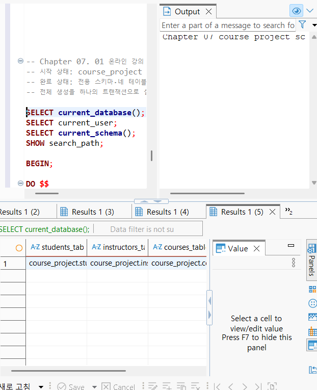
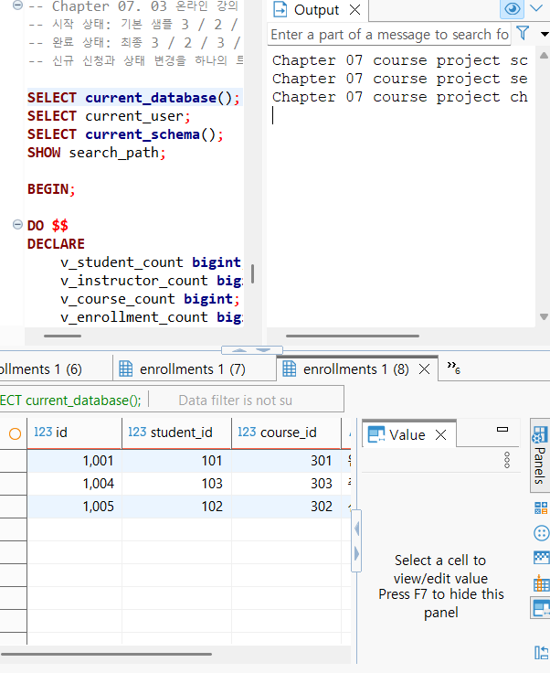
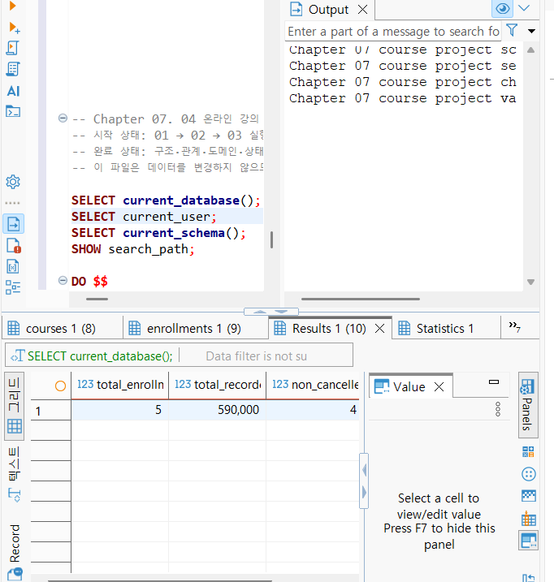
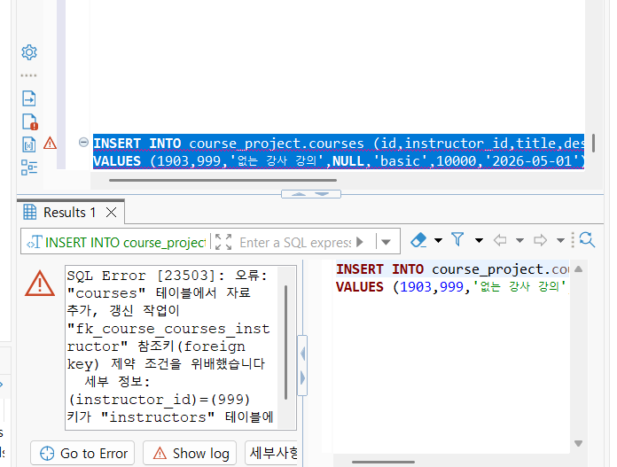
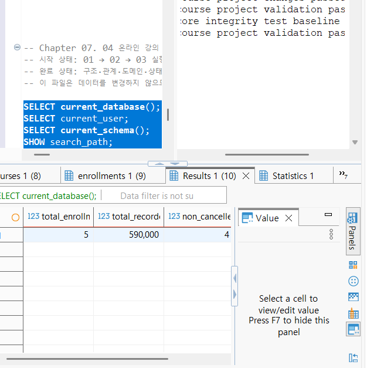
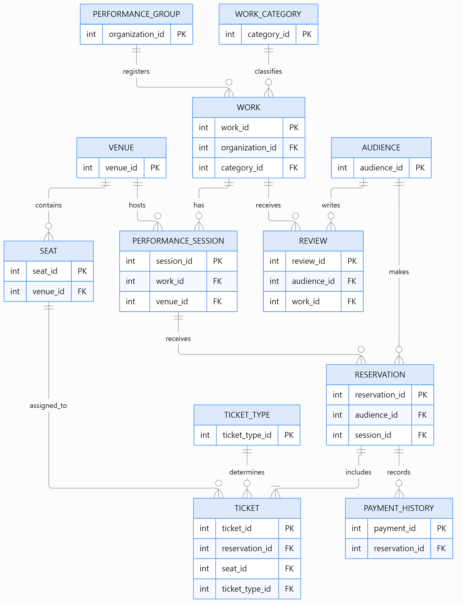

# Chapter 07 확장 실습 답안 템플릿

> **과제:** 실전 프로젝트 1 — 온라인 강의 수강신청 DB 완성하기  
> **사용 방법:** 이 파일을 내려받아 본인의 GitHub 저장소에 `chapter07_answer.md`라는 이름으로 저장한 뒤 실습하면서 바로 작성합니다.  
> **제출 방법:** LMS에는 파일을 직접 업로드하지 않고, **본인 GitHub 저장소의 `chapter07_answer.md` 파일 URL**을 제출합니다.

---

## 제출 전 주의

이 파일과 캡처 화면에는 실제 비밀번호, 전체 DB 접속 URL, API Key, 개인정보를 기록하지 않습니다.

```text
GitHub 계정 또는 별칭:hangyeom06
과제 작성일:2026.10.27
사용한 AI 도구:chatGPT
```

---

# 1. 시작 환경 확인

다음을 실행합니다.

```sql
SELECT current_database();
SELECT current_user;
SELECT current_schema();
SHOW search_path;
SHOW transaction_read_only;
```

| 확인 항목 | 실제 결과 | 의미 |
| --- | --- | --- |
| `current_database()` | ai_database_book | 현재 데이터베이스가 ai_database_book이다 |
| `current_user` | postgres | 현재 데이터베이스 사용자가 postgres이다 |
| `current_schema()` | public | 현재 스키마가 public이다 |
| `search_path` | public, "$user" | 스키마를 지정하지 않고 객체를 찾을 때 public을 먼저 검색하고 현재 사용자 이름과 같은 스키마를 검색한다 |
| `transaction_read_only` | off | 읽기전용이 아니다 |

- [ ] 현재 DB가 `ai_database_book`이다.
- [ ] 쓰기 가능한 연결인지 확인했다.
- [ ] 실행할 SQL 범위를 확인했다.
- [ ] Auto-commit 상태를 확인했다.

### 프로젝트 SQL을 실행하기 전에 시작 상태를 확인해야 하는 이유

```text
SQL이 의도한 데이터베이스와 사용자, 스키마에서 실행되는지 확인하고 읽기 전용 여부 등 실행 환경에 따라 결과가 달라지는 문제를 미리 방지하기 위해서이다.
```

---

# 2. 프로젝트 범위와 요구사항 읽기

## 2-1. 포함 범위

본문을 그대로 복사하지 말고 자신의 말로 정리합니다.

```text
1. 학생, 강사, 강의를 관리한다.
2. 학생이 강의에 신청하는 수강신청 정보를 저장한다.
3. 수강신청 상태를 신청, 수강 중, 완료, 취소로 관리헌다.
4. 강의의 기준 간격과 신청 당시 기록된 금액을 구분해서 저장한다.
```

## 2-2. 제외 범위

```text
1. 실제 결제의 승인, 실패, 환불 처리는 다루지 않는다.
2. 강의 정원이나 대기열은 관리하지 않는다.
3. 수강신청 상태의 전체 변경 이력은 저장하지 않는다.
4. 수강 진도, 수료 여부, 강의 콘텐츠와 쿠폰, 할인은 다루지 않는다.
```

### 범위를 명확하게 정해야 하는 이유

```text
프로젝트에서 구현하고 검증할 기능을 분명히 정해 불필요한 부분을 줄이고 요구사항에 맞게 완성했는지 확인하기 위해서이다.
```

## 2-3. 요구사항 / 프로젝트 결정 / 미확정 질문 구분

아래 항목 중 대표 항목을 정리합니다.

| ID | 종류 | 내용 요약 | DB 구조/규칙에 미치는 영향 |
| --- | --- | --- | --- |
| P07-R01 | 요구사항 | 학생, 강사, 강의, 수강 신청 정보를 관리한다 | students, instructors, courses, enrollments 테이블을 둔다. |
| P07-R05 | 요구사항 | 수강신청에는 신청 시점의 금액을 기록한다. | enrollments에 recorded_amount를 저장한다. |
| P07-R07 | 요구사항 | 	수강신청 상태는 신청, 수강 중, 완료, 취소로 관리한다. | enrollments에 상태를 저장하고 허용된 값으로 제한한다. |
| P07-D02 | 프로젝트 결정 | 강의의 현재 기준 가격과 신청 당시 기록 금액을 구분한다. | courses.price와 enrollments.recorded_amount를 별도로 둔다. |
| P07-D03 | 프로젝트 결정 | 	진행 중인 중복 신청은 허용하지 않는다. | 같은 학생이 같은 강의에 중복으로 신청하지 못하도록 규칙을 둔다. |
| P07-Q01 | 미확정 질문 | 	학생과 강사 사이에서도 이메일을 전역 고유하게 제한할 것인가? | 정책이 확인되기 전까지 학생,강사를 모두 포함하는 이메일 고유 제약은 두지 않는다. |

### 미확정 질문을 바로 제약조건으로 만들면 안 되는 이유

```text
아직 정해지지 않은 정책을 제약조건으로 만들면 실제 요구와 다른 규칙이 데이터베이스에 고정될 수 있기 때문이다. 먼저 정책을 확인한 뒤 필요한 제약조건을 정해야 한다.
```

---

# 3. 네 테이블의 한 행 의미와 관계

## 3-1. 한 행 의미

```text
course_project.students 한 행 = 학생 한 명의 정보

course_project.instructors 한 행 = 강사 한 명의 정보

course_project.courses 한 행 = 강사 한 명이 개설한 강의 한 개

course_project.enrollments 한 행 = 특정 학생이 특정 강의에 신청한 사건 한 건
```

## 3-2. 키와 중요 규칙

| 테이블 | PK | FK | 중요 규칙 |
| --- | --- | --- | --- |
| students | student_id | 없음 | 	학생별로 고유한 ID를 사용한다. |
| instructors | instructor_id | 없음 | 강사별로 고유한 ID를 사용한다. |
| courses |	course_id | 	instructor_id → instructors.instructor_id | 강의는 한 명의 강사를 참조한다. |
| enrollments | enrollment_id | student_id → students.student_id
course_id → courses.course_id | 신청 상태는 정해진 값 중 하나이며, 진행 중인 중복 신청은 허용하지 않는다. recorded_amount에는 신청 당시 금액을 기록한다. |

## 3-3. 관계를 양방향 문장으로 작성

```text
instructors ↔ courses: 한 강사는 여러 강의를 담당하는 것이 가능하고, 한 강의는 한 명의 강사를 참조한다.

students ↔ enrollments: 한 학생은 여러 수강신청을 할 수 있고, 한 수강신청을 한 명의 학생에 속한다.

courses ↔ enrollments: 한 강의에는 여러 수강신청이 가능하고, 한 수강신청은 하나의 강의에 속한다.
```

### 학생과 강의의 N:M 관계가 `enrollments`를 통해 어떻게 바뀌는지 설명

```text
학생과 강의는 서로 여러 개와 연결될 수 있는 N:M 관계이다. 이를 학생 한 명과 강의 한 개의 신청을 나타내는 enrollments로 나누어 나타내면 students와 enrollments, courses와 enrollments tkdldml en 1:N 관계로 표현이 가능하다.
```

### `enrollments`가 단순 연결 테이블이 아니라 사건 테이블이라고 볼 수 있는 이유

```text
enrollments에는 학생과 강의를 연결하는 정보뿐 아니라 신청일, 신청 상태, 신청 당시 금액도 저장된다. 따라서 단순한 연결 테이블이 아니라 특정 시점에 발생한 수강신청이라는 사건을 기록하는 테이블이다.
```

---

# 4. `recorded_amount`의 의미 이해

```text
courses.price = 현재 강의의 기준 가격

enrollments.recorded_amount = 수강신청이 생성될 때 해당 신청에 기록한 금액
```

### 두 값이 처음에는 같아도 같은 의미가 아닌 이유

```text
신청 당시에는 두 값이 같을 수 있지만, courses.price는 현재 강의에 적용되는 기준 가격이고 recorded_amount는 개별 수강신청에 저장된 금액이다. 이후 강의 가격이 바뀌어도 신청 당시 금액은 그대로 기록으로 남아 있어야 하므로 의미가 다르다.
```

### `recorded_amount`를 실제 결제 성공액이나 회계 매출로 해석하면 안 되는 이유

```text
recorded_amount는 신청 시점에 기록한 금액일 뿐, 실제 결제가 승인되었는지나 환불되었는지를 나타내지 않는다. 따라서 결제 금액이나 회계 매출로 해석할 수 없다.
```

---

# 5. STEP 01 — 스키마와 테이블 생성

실행 파일:

```text
code/chapter07/01_course_project_schema.sql
```

## 5-1. 실행 전 예상

```text
course_project 스키마 존재 여부: 없음
예상 테이블 수: 4개
예상 데이터 행 수: 0행
예상되는 명명 제약조건 수: 15개
예상되는 NOT NULL 열 수: 20개
부분 고유 인덱스 존재 여부: 있음
```

## 5-2. 실행 결과

```text
실제 테이블 수: 4개
실제 명명 제약조건 수: 15개
실제 NOT NULL 열 수: 20개
부분 고유 인덱스: uq_course_enrollments_active
네 테이블의 실제 행 수: 0행
통과 메시지:Chapter 07 course project schema creation passed
```

### 예상과 실제 비교

```text
예상한 대로 전용 스키마와 네 테이블, 제약조건, 부분 고유 인덱스가 생성되었고 네 테이블은 모두 0행이었다. 검증 메시지도 출력되어 스키마 생성이 정상적으로 완료되었다.
```

### 증거 화면

권장 경로:

```text
assignments/chapter07/images/step05_schema.png
```

`여기에 스키마/테이블 생성 검증 화면을 삽입하세요.`

---

# 6. STEP 02 — Seed 데이터 입력

실행 파일:

```text
code/chapter07/02_course_project_seed.sql
```

## 6-1. 실행 전 예상

```text
students: 3
instructors: 2
courses: 3
enrollments: 4
recorded_amount 합계: 470000
학생 101 신청 건수: 2
강의 301 신청 건수: 2
강사 201 담당 강의 수: 2
활성 중복 신청: 0
```

## 6-2. 실제 결과

```text
students: 3
instructors: 2
courses: 3
enrollments: 4
recorded_amount 합계: 470000
학생 101 신청 건수: 2
강의 301 신청 건수: 2
강사 201 담당 강의 수: 2
활성 중복 신청: 0
1001 상태: 수강중
1004 상태: 신청
1005 존재 여부: 없음
통과 메시지: Chapter 07 course project seed passed
```

### Seed 데이터를 단순 예제가 아니라 검증 데이터라고 볼 수 있는 이유

```text
Seed 데이터에는 테이블별 행 수뿐 아니라 학생&강의별 신청 수, 강사의 담당 강의 수, 신청 금액 합계와 중복 신청 여부를 확인할 수 있는 값이 들어 있다. 따라서 데이터를 넣는 데 그치지 않고 관계와 규칙이 예상대로 작동하는지 검증하는 데 사용할 수 있다.
```

---

# 7. STEP 03 — 변경 시나리오 실행

실행 파일:

```text
code/chapter07/03_course_project_changes.sql
```

## 7-1. 실행 전에 상태 변화를 예상

| 신청 ID | 변경 전 예상 상태 | 변경 후 예상 상태 | 예상 recorded_amount |
| ---: | --- | --- | ---: |
| 1001 | 수강중 | 완료 | 100000 |
| 1004 | 신청 | 취소 | 150000 |
| 1005 | 없음 | 신청 | 120000 |

```text
변경 후 예상 enrollments 행 수: 5
변경 후 예상 전체 recorded_amount 합계: 590000
변경 후 예상 취소 제외 건수: 4
변경 후 예상 취소 제외 recorded_amount 합계: 440000
```

## 7-2. 실제 결과

```text
1001 상태 / recorded_amount: 완료 / 100000
1004 상태 / recorded_amount: 취소 / 150000
1005 상태 / recorded_amount: 신청 / 120000
최종 enrollments 행 수: 5
전체 recorded_amount 합계: 590000
취소 제외 건수: 4
취소 제외 recorded_amount 합계: 440000
활성 중복 신청: 0
통과 메시지: Chapter 07 course project changes passed
```

### 조건부 UPDATE에서 예상 이전 상태를 확인해야 하는 이유

```text
조건부 UPDATE는 행이 예상한 이전 상태일 때만 변경되도록 하여 상태가 달라진 데이터를 실수로 덮어쓰는 것을 방지하기 위해 사용한다.
```

### 증거 화면

권장 경로:

```text
assignments/chapter07/images/step07_changes.png
```

`여기에 주요 변경 전/후 결과를 삽입하세요.`

---

# 8. STEP 04 — 최종 완료 게이트 실행

실행 파일:

```text
code/chapter07/04_course_project_validation.sql
```

## 8-1. 최종 검증 결과

```text
최종 행 수 students/instructors/courses/enrollments: 3/2/3/5
서비스 JOIN 결과 행 수: 5
학생 101 신청 수: 2
강의 301 신청 수: 2
강사 201 강의 수: 2
고아 관계 수: 0
활성 중복 신청 수: 0
전체 recorded_amount: 590000
취소 제외 recorded_amount: 440000
통과 메시지: Chapter 07 course project validation passed
```

### SQL 파일 4개가 모두 실행되었다는 사실과 프로젝트 검증 PASS가 다른 이유

```text
SQL 파일 4개가 오류 없이 실행됐다는 것은 명령이 수행됐다는 뜻이다. 프로젝트 검증 PASS는 행 수와 관계, 중복 신청, 상태, 금액 등이 예상한 조건을 만족하는지 확인했다는 뜻이다.
```

### 증거 화면

권장 경로:

```text
assignments/chapter07/images/step08_validation.png
```

`여기에 최종 validation PASS 화면을 삽입하세요.`

---

# 9. 무결성 테스트

실행 파일:

```text
code/chapter07/05_course_project_integrity_tests.sql
```

> 오류 테스트는 파일 전체를 무작정 실행하지 않고 **한 테스트 구간씩** 실행합니다.

## 9-1. 허용되어야 하는 경계값 1개

```text
테스트 내용: 가격이 0인 무료 강의와 신청 금액이 0인 무료 신청을 입력한 후 삭제한다.
기대 결과: INSERT와 DELETE가 모두 성공한다.
실제 결과: 성공
왜 허용되어야 하는가: 가격과 신청 기록 금액은 0이상이어야 하므로 0은 허용되는 값이다.
```

## 9-2. 실패해야 하는 테스트 1 — 잘못된 참조 또는 값

```text
테스트 내용: 존재하지 않는 강사 ID 999를 참조하는 강의를 입력한다.
기대 결과: INSERT가 실패한다.
실제 오류 핵심: 참조된 instructor_id 999가 instructors 테이블에 없어 외래 키 위반 오류가 발생한다.
동작한 제약조건/규칙: fk_course_courses_instructor
왜 실패해야 하는가: 존재하지 않는 강사를 담당 강사로 연결하면 유효하지 않은 관계가 저장되기 때문이다.
```

## 9-3. 실패해야 하는 테스트 2 — 활성 중복 신청

```text
테스트 내용: 이미 활성 신청이 있는 학생 101이 강의 302에 다시 신청한다.
기대 결과: INSERT가 실패한다.
실제 오류 핵심: uq_course_enrollments_active 인덱스의 중복 키 위반 오류가 발생한다.
동작한 인덱스/규칙: uq_course_enrollments_active
왜 실패해야 하는가: 같은 학생이 같은 강의에 신청 또는 수강 중인 상태로 중복 등록되는 것을 막기 위해서이다.
```

## 9-4. 실패 후 기준 상태 재검증

```text
04 validation 재실행 결과: Chapter 07 course project validation passed
기준 데이터가 유지되었는가: 예. 검증이 통과하고 기준 행 수와 금액이 유지되면 데이터가 보존된 것이다.
```

### 실패 테스트가 프로젝트 품질 검증에 필요한 이유

```text
실패 테스트를 통해 제약조건과 인덱스가 잘못된 데이터 입력을 실제로 차단하는지 확인할 수 있다. 이후 기준 상태를 다시 검증하면 테스트가 원래 데이터를 바꾸거나 손상시키지 않았는지도 확인할 수 있다.
```

### 증거 화면

권장 경로:

```text
assignments/chapter07/images/step09_integrity.png
```

`여기에 대표 실패 테스트와 기준 상태 유지 결과를 삽입하세요.`
 
---

# 10. 재현성 실험

> 이 단계는 본인의 실습 환경이며 보존할 데이터가 없을 때만 수행합니다.

실행 순서:

```text
reset_course_project.sql
→ 01_course_project_schema.sql
→ 02_course_project_seed.sql
→ 03_course_project_changes.sql
→ 04_course_project_validation.sql
```

```text
처음 실행의 최종 결과: students / instructors / courses / enrollments = 3 / 2 / 3 / 5, 전체 recorded_amount = 590000, 취소 제외 합계 = 440000
재실행의 최종 결과: students / instructors / courses / enrollments = 3 / 2 / 3 / 5, 전체 recorded_amount = 590000, 취소 제외 합계 = 440000
두 결과가 일치했는가: 예
중간에 수동 수정이 필요했는가: 아니오
```

### 다른 사람이 같은 순서로 실행해 같은 결과를 얻는 것이 중요한 이유

```text
실행 순서와 절차가 명확하면 다른 사람도 프로젝트를 다시 만들고 검증할 수 있어 결과를 신뢰하고 오류가 생겼을 때 원인을 찾기 쉽기 때문이다.
```

---

# 11. Chapter 01~06 개인 프로젝트를 중간 프로젝트 초안으로 확장

온라인 강의 예제를 이름만 바꾸지 않고 본인의 아이디어를 사용합니다.

## 11-1. 프로젝트 기본 정보

```text
프로젝트 이름: 공연 검색&예매 플랫폼

해결하려는 문제: 공연 정보가 여러 곳에 흩어져 있어 관객이 원하는 공연을 찾고, 회차와 좌석을 확인해 예매하기 어려운 문제를 해결한다.

주요 사용자: 공연을 찾고 예매하는 관객, 공연 정보를 등록하고 관리하는 공연단체
```

## 11-2. 포함 범위 / 제외 범위

```text
[포함]
1. 공연단체, 관객, 공연장 정보를 저장한다.
2. 작품과 카테고리, 공연 회차 정보를 관리한다.
3. 관객이 카테고리와 시간대별로 공연을 검색하고 정렬할 수 있다.
4. 회차별 좌석·티켓 종류와 예약, 티켓, 결제 내역, 리뷰를 관리한다.

[제외]
1. 운영자 계정과 공연단체 소속 개인 인력 관리는 다루지 않는다.
2. 수수료나 매출 등 플랫폼의 수익 모델은 다루지 않는다.
3. 외부 결제 시스템의 승인, 환불 처리와 실시간 좌석 잠금은 다루지 않는다.
```

## 11-3. 요구사항

최소 8개를 작성합니다.

| ID | 요구사항 | 관련 테이블/관계 | 검증 방법 후보 |
| --- | --- | --- | --- |
| P07-MR01 | 	관객 정보를 저장하고 관객별 예약 내역을 조회할 수 있어야 한다. | 관객, 예약 | 관객별 예약 조회 결과 확인 |
| P07-MR02 | 공연단체가 등록한 작품 정보를 저장할 수 있어야 한다. | 공연 단체, 작품 제목 | 작품마다 등록된 공연단체가 연결되는지 확인 |
| P07-MR03 | 	작품의 카테고리를 저장해 카테고리별로 공연을 찾을 수 있어야 한다. | 작품 제목, 작품 카테고리 | 카테고리별 작품 검색 결과 확인 |
| P07-MR04 | 작품별 공연 회차의 날짜와 시간을 저장해야 한다. | 작품 제목, 공연 회차 | 작품별 회차 목록과 일정 조회 |
| P07-MR05 | 공연 회차가 열리는 공연장과 좌석 정보를 저장해야 한다. | 공연 회차, 공연장, 좌석 | 회차별 공연장과 좌석 조회 |
| P07-MR06 | 관객이 카테고리와 시간대 등을 기준으로 공연을 검색하고 정렬할 수 있어야 한다. | 작품 카테고리, 공연 회차 | 조건별 검색·정렬 SQL 결과 확인 |
| P07-MR07 | 관객의 예약에 회차, 좌석, 티켓 종류가 연결되어야 한다. | 관객, 예약, 티켓, 공연 회차, 좌석, 티켓 종류 | 예약에서 해당 회차·좌석·티켓 종류를 조회 |
| P07-MR08 | 예약과 관련된 결제 내역 및 관람 후 리뷰를 저장할 수 있어야 한다. | 예약, 결제 내역, 리뷰 | 예약별 결제 내역·리뷰 조회 |

## 11-4. 프로젝트 결정

최소 3개를 작성합니다.

| ID | 이번 프로젝트에서 내린 결정 | 이유 | 구현 후보 |
| --- | --- | --- | --- |
| P07-MD01 | 초기 버전에서는 작품 하나에 대표 카테고리 하나를 연결한다. | 카테고리별 검색을 구현하면서 구조를 단순하게 유지하기 위해서다. | 작품 테이블에 카테고리 FK 설정 |
| P07-MD02 | 	하나의 예약에 여러 티켓을 담을 수 있도록 한다. | 여러 명이 함께 예매하는 경우를 표현하기 위해서다. | 예약과 티켓을 1:N 관계로 연결 |
| P07-MD03 | 같은 회차의 같은 좌석은 유효한 예약으로 중복 배정하지 않는다. | 한 좌석이 여러 관객에게 동시에 판매되는 일을 막기 위해서다. | 회차 ID와 좌석 ID의 중복을 검사하는 제약조건 또는 인덱스 |

## 11-5. 미확정 질문

최소 3개를 작성합니다.

```text
P07-MQ01. 관객은 공연 시작 전 언제까지 예약을 취소할 수 있는가
P07-MQ02. 취소된 예약의 좌석은 언제 다시 예매 가능 상태가 되는가
P07-MQ03. 결제 취소와 환불 내역까지 저장해야 하는가, 아니면 결제 기록만 저장하면 되는가
```

---

# 12. 개인 프로젝트 ERD와 한 행 의미

## 12-1. 테이블 후보

최소 4개를 권장합니다.

| 테이블 | 한 행의 의미 | PK 후보 | FK 후보 | 주요 규칙 |
| --- | --- | --- | --- | --- |
|  |  |  |  |  |
|  |  |  |  |  |
|  |  |  |  |  |
|  |  |  |  |  |
| 공연 단체 | 공연단체 한 곳의 정보 | organization_id | 없음 | 단체별로 고유한 ID를 둔다. |
| 관객 | 관객 한 명의 정보 | audience_id | 없음 | 관객별로 고유한 ID를 둔다. |
| 작품 제목 | 공연 작품 한 개의 정보 | work_id | organization_id → 공연 단체, category_id → 작품 카테고리 | 작품 하나에 공연단체 하나와 대표 카테고리 하나를 연결한다. |
| 공연장 | 공연장 한 곳의 정보 | venue_id | 없음 | 공연장별로 고유한 ID를 둔다. |
| 공연 회차 | 작품이 특정 공연장에서 열리는 회차 한 건 | session_id	work_id → 작품 제목, venue_id → 공연장 | 회차마다 작품, 공연장, 날짜와 시간을 저장한다. |
| 좌석 | 공연장에 있는 좌석 한 개 | seat_id | venue_id → 공연장 | 좌석은 한 공연장에 속한다. |
| 예약 | 관객이 특정 회차에 한 예약 한 건 | reservation_id | audience_id → 관객, session_id → 공연 회차 | 예약에는 관객과 공연 회차가 연결된다. |
| 티켓 | 예약에 포함된 티켓 한 장 | ticket_id | reservation_id → 예약, seat_id → 좌석, ticket_type_id → 티켓 종류 | 한 예약에 여러 티켓이 포함될 수 있다. |

## 12-2. 관계 문장

```text
1. 한 공연단체는 여러 작품을 등록할 수 있고 작품 하나는 한 공연단체에 속한다.
2. 한 작품은 여러 공연 회차를 가질 수 있고 공연 회차 하나는 한 작품에 해당한다.
3. 한 관객은 여러 예약을 할 수 있고 예약 하나는 한 관객의 예약이다.
4. 한 예약에는 여러 티켓이 포함될 수 있고 티켓 하나는 한 예약에 속한다.
```

## 12-3. ERD

권장 이미지 경로:

```text
assignments/chapter07/images/personal_project_erd.png
```

`여기에 본인의 ERD 이미지를 삽입하세요.`

### Chapter 05~06 ERD에서 이번에 바꾼 점

```text
초안에서는 운영자와 공연단체 내부 담당자를 별도 사용자로 두지 않고 공연단체와 관객을 주요 주체로 정리했다. 작품과 카테고리를 분리하고, 작품 정보와 실제 공연 회차도 별도 테이블로 나누어 한 작품의 여러 회차를 표현할 수 있게 했다. 예약과 티켓, 결제 내역, 리뷰도 각각의 의미에 맞게 구분했다. 좌석 중복 예매를 막는 규칙과 티켓 종류의 적용 범위는 추가로 정해야 한다.
```

---

# 13. 개인 프로젝트 완료 기준 만들기

“잘 동작한다”처럼 모호하게 쓰지 말고 검증 가능한 기준을 최소 6개 작성합니다.

| 번호 | 완료 기준 | 자동 SQL 검증 가능? | 검증 방법 |
| ---: | --- | --- | --- |
| 1 | 공연단체, 관객, 공연장, 좌석, 작품 카테고리, 작품, 공연 회차, 티켓 종류, 예약, 티켓, 결제 내역, 리뷰 테이블이 모두 존재한다. | 예 | 시스템 카탈로그에서 12개 테이블 존재 여부 확인 |
| 2 | 	작품의 공연단체와 카테고리, 공연 회차의 작품과 공연장 등 모든 FK 참조가 유효하고 고아 행이 0건이다. | 예 | 	각 FK를 기준으로 부모 테이블과 연결되지 않는 행을 조회 |
| 3 | 	각 작품에 대표 카테고리가 하나씩 연결되어 있다. | 예 | 작품별 category_id가 비어 있거나 유효하지 않은 행이 있는지 조회 |
| 4 | 	카테고리와 날짜·시간 조건으로 공연을 검색했을 때 조건에 맞는 회차만 반환된다. | 예 | 	조건을 지정한 검색 쿼리 결과와 조건에 맞지 않는 행이 없는지 확인 |
| 5 | 	같은 공연 회차에서 같은 좌석이 유효한 예약 티켓에 중복 배정되지 않는다. | 예 | 	예약과 회차를 연결해 회차·좌석별 티켓 수를 집계하고 중복 여부 확인 |
| 6 | 예약 티켓은 유효한 예약, 좌석, 티켓 종류를 참조하고 결제 내역과 리뷰도 각각 유효한 예약·관객·작품에 연결된다. | 예 | 관련 FK의 고아 행이 없는지 조회 |

예시 형식:

```text
Seed 실행 후 A/B/C/D 테이블의 행 수가 각각 5/3/8/12다.
존재하지 않는 부모를 참조하는 행은 0건이다.
허용되지 않은 상태 입력은 DB가 거부한다.
검증 SQL이 예상 결과를 반환한다.
```

---

# 14. AI를 프로젝트 리뷰어로 사용

AI에게 프로젝트를 대신 완성시키지 않고 누락과 위험을 찾게 합니다.

## 14-1. AI에게 전달한 핵심 자료

```text
요구사항: 공연단체와 관객을 위한 공연 검색·예매 플랫폼이다. 작품과 카테고리, 공연 회차, 공연장과 좌석, 예약과 티켓, 결제 내역과 리뷰를 관리한다. 관객은 카테고리와 날짜·시간 조건으로 공연을 검색할 수 있다.

테이블/ERD 설명: 공연단체, 관객, 공연장, 좌석, 작품 카테고리, 작품 제목, 공연 회차, 티켓 종류, 예약, 티켓, 결제 내역, 리뷰의 12개 테이블로 구성한다. 예약은 관객 및 공연 회차와 연결하고, 예약 하나에 여러 티켓을 담는 구조를 초안으로 작성했다.


프로젝트 결정: 작품 하나에는 대표 카테고리 하나를 연결한다. 한 예약에는 여러 티켓이 포함될 수 있다. 같은 공연 회차에서 같은 좌석이 유효한 예약에 중복 배정되지 않도록 한다.


미확정 질문: 관객의 예약 취소 가능 시점은 언제인가? 취소된 좌석은 언제 다시 예매할 수 있는가? 결제 취소와 환불 내역도 저장해야 하는가?


완료 기준: 12개 테이블 존재, 고아 FK 0건, 작품별 카테고리 연결, 카테고리·시간 검색 결과 확인, 같은 회차의 좌석 중복 배정 0건 등을 검증한다.
```

## 14-2. 내가 사용한 프롬프트

```text
아래 공연 검색&예매 프로젝트를 대신 완성하지 말고 리뷰어로 검토해 줘. 요구사항과 테이블/ERD가 잘 연결되는지, 누락된 관계나 모호한 한 행의 의미가 있는지, 근거 없이 확정한 제약조건이 있는지 확인해 주고 특히 예약,티켓,회차,좌석의 관계와 좌석 중복 예매 방지 방법을 확인해줘. 미확정 정책은 임의로 확정하지 말고, 확인 질문과 우선순위를 알려줘.
```

## 14-3. AI 제안 검토

| AI 제안 | 수용 / 수정 / 보류 / 거절 | 실제 근거 | 반영 내용 |
| --- | --- | --- | --- |
| 작품 하나에 대표 카테고리 하나를 연결한다 | 수용 | 카테고리별 검색을 위해 작품의 대표 카테고리를 정하기로 했다 | 작품과 작품 카테고리를 1:N 관계로 표현했다 |
| 예약 하나는 한 공연 회차에 속하도록 한다. | 수정 | 	현재 초안은 예약에 회차 FK를 둔다. 한 예약에 여러 회차 티켓을 허용할지는 별도로 정하지 않았다. | 현재 초안에서는 한 예약을 한 회차에 대한 예약으로 한정하고, 이 범위를 요구사항에 명시한다. |
| 같은 회차의 같은 좌석이 중복 판매되지 않도록 검증한다. | 수용 | 	한 좌석은 같은 회차에서 두 관객에게 배정될 수 없다. | 회차와 좌석을 기준으로 중복 티켓이 있는지 검증 기준에 추가했다. 취소 좌석의 재판매 시점은 미확정으로 남겼다. |
| 티켓 종류가 전체 공연에 공통인지 회차별로 다른지 확인한다. | 보류 | 티켓 종류의 적용 범위가 아직 정해지지 않았다. | 임의로 관계를 확정하지 않고 미확정 질문으로 남겼다. |

### AI가 미확정 정책을 임의로 확정하려 한 부분이 있었나요?

```text
있었다. AI가 예약 하나를 한 공연 회차에 연결하는 구조를 제안했지만 한 예약에 여러 회차의 티켓을 담을 수 있는지는 아직 확정하지 않았다. 따라서 현재 초안의 선택지로만 두고 최종 요구사항으로 확정하기 전 확인이 필요하다. 예약마다 티켓이 최소 한 장 있어야 한다는 조건도 아직 정해지지 않았다.
```

### AI가 제안한 규칙 중 아직 배우지 않은 기능이라 보류한 것이 있나요?

```text
같은 회차의 같은 좌석이 중복 배정되지 않도록 하는 규칙은 필요하지만 이를 구현하는 방법은 아직 배우지 않은 내용이라 보류했다. 우선 SQL로 중복 여부를 검증하는 기준만 두었다.
```

### AI 활용 후 실제로 좋아진 부분

```text
예약,티켓,회차,좌석 사이에서 빠진 정책과 관계를 확인할 수 있었다. 또 이미 정한 내용과 미확정 질문을 구분하고 좌석 중복처럼 검증할 수 있는 완료 기준으로 구체화했다.
```

---

# 15. 최종 성찰

아래 문장은 반드시 본인의 말로 작성합니다.

```text
1. 데이터베이스 프로젝트가 완료되었다고 판단하려면
   SQL 파일의 존재보다 요구사항에 맞는 결과가 나오는지 검증하고, 같은 결과를 다시 재현할 수 있는지가 중요하다.

2. Seed 데이터의 목적은 단순히 화면을 채우는 것이 아니라
    테이블 간 관계와 업무 규칙이 예상대로 작동하는지 확인하는 것이다.

3. 실패 테스트가 필요한 이유는
   잘못된 값이나 관계가 데이터베이스에 저장되지 않도록 제약조건이 제대로 작동하는지 확인하기 위해서이다.

4. 요구사항과 프로젝트 결정을 구분해야 하는 이유는
   반드시 지켜야 할 조건과 이번 프로젝트에서 선택한 규칙을 구별하고, 정해지지 않은 정책을 섣불리 확정하지 않기 위해서이다.

5. 내가 만든 개인 프로젝트에서 가장 먼저 추가 확인해야 할 정책은
   예약을 취소했을 때 해당 좌석을 언제 다시 예매할 수 있는지이다.
```

---

# 16. 제출 체크리스트

- [ ] `chapter07_answer.md`를 본인 저장소에 만들었다.
- [ ] 시작 환경과 현재 DB를 확인했다.
- [ ] 프로젝트 포함/제외 범위를 설명했다.
- [ ] 요구사항/결정/미확정 질문을 구분했다.
- [ ] 네 테이블의 한 행 의미와 관계를 설명했다.
- [ ] `01_course_project_schema.sql`을 실행하고 결과를 확인했다.
- [ ] `02_course_project_seed.sql`의 기준 상태를 확인했다.
- [ ] `03_course_project_changes.sql` 전후 상태를 비교했다.
- [ ] `04_course_project_validation.sql` PASS를 확인했다.
- [ ] 허용 경계값 1개 이상을 확인했다.
- [ ] 실패 테스트 2개 이상을 한 구간씩 실행했다.
- [ ] 실패 후 validation을 다시 실행했다.
- [ ] 개인 프로젝트 요구사항 8개 이상을 작성했다.
- [ ] 프로젝트 결정 3개 이상과 미확정 질문 3개 이상을 작성했다.
- [ ] 개인 프로젝트 ERD를 작성했다.
- [ ] 검증 가능한 완료 기준 6개 이상을 작성했다.
- [ ] AI 제안을 수용/수정/보류/거절로 구분했다.
- [ ] 핵심 캡처는 3~4장 정도로 정리했다.
- [ ] 캡처에 비밀번호나 개인정보가 없다.
- [ ] GitHub 웹에서 Markdown과 이미지가 정상적으로 보인다.
- [ ] 최종 파일을 commit/push했다.

---

# 17. LMS 제출 URL

아래 형식의 **본인 GitHub 파일 URL**을 LMS에 제출합니다.

```text
https://github.com/<본인-GitHub-ID>/<본인-저장소>/blob/main/assignments/chapter07/chapter07_answer.md
```

내 제출 URL:

```text

```

> 저장소 메인 URL, 교수자 템플릿 URL, Raw URL이 아니라 **작성 완료된 본인 `chapter07_answer.md` 파일 화면 URL**을 제출합니다.
