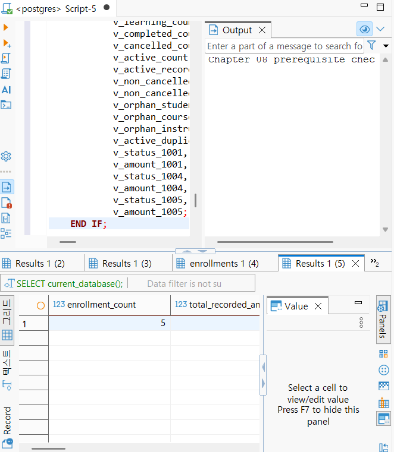
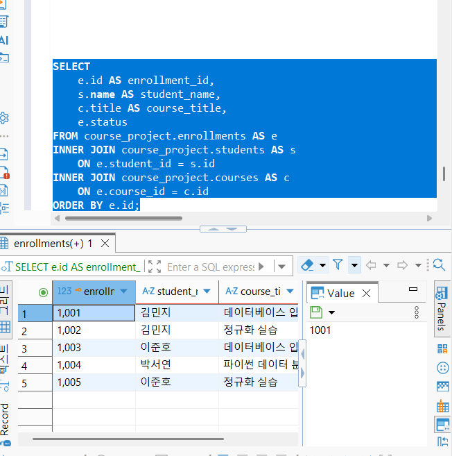
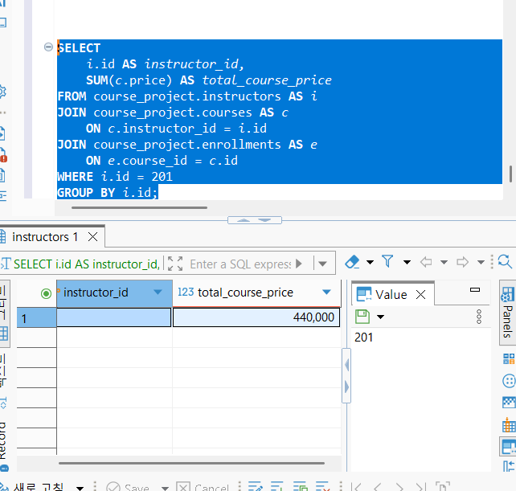
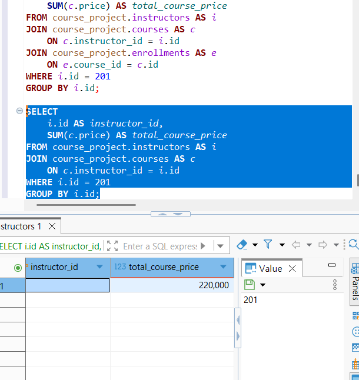

# Chapter 08 확장 실습 답안 템플릿

> **과제:** JOIN과 집계로 서비스 질문에 답하기  
> **사용 방법:** 이 파일을 내려받아 본인의 GitHub 저장소에 `chapter08_answer.md`라는 이름으로 저장한 뒤 실습하면서 바로 작성합니다.  
> **제출 방법:** LMS에는 파일을 직접 업로드하지 않고, **본인 GitHub 저장소의 `chapter08_answer.md` 파일 URL**을 제출합니다.

---

## 제출 전 주의

이 파일과 캡처 화면에는 실제 비밀번호, 전체 DB 접속 URL, API Key, 개인정보를 기록하지 않습니다.

```text
GitHub 계정 또는 별칭:hangyeom06
과제 작성일:2026.11.02
사용한 AI 도구:chatgpt
```

---

# 1. Chapter 07 기준 상태 확인

다음을 실행합니다.

```text
code/chapter08/00_check_course_project.sql
```

## 1-1. 사전 검사 결과

```text
검증 메시지:Chapter 08 prerequisite check passed

students 행 수:3
instructors 행 수:2
courses 행 수:3
enrollments 행 수:5

전체 신청 건수:5
전체 recorded_amount:590000
활성 신청 건수:3
활성 recorded_amount:340000
취소 제외 신청 건수:4
취소 제외 recorded_amount:440000
```

기준값:

```text
students = 3
instructors = 2
courses = 3
enrollments = 5

전체 = 5 / 590000
활성 = 3 / 340000
취소 제외 = 4 / 440000
```

### 기준값이 다르면 그대로 진행하면 안 되는 이유

```text
기준값이 다른 상태로 진행하면 이후 실습 결과가 달라져 원인을 찾기 어렵고 검증 기준도 적용할 수 없으므로 먼저 차이가 생긴 이유를 확인해야 한다.
```

### 증거 화면

권장 경로:

```text
assignments/chapter08/images/step01_prerequisite.png
```

`여기에 사전 검사 통과 화면을 삽입하세요.`

---

# 2. 업무 질문을 SQL보다 먼저 정의하기

다음 세 질문을 각각 SQL 작성 전에 먼저 정의합니다.

## 질문 A

```text
업무 질문:수강 신청별 학생, 강의, 담당 강사, 신청 상태와 신청 당시 기록 금액을 보여 주세요.
결과 한 행의 의미:수강 신청 한 건
포함 상태:신청, 수강중, 완료, 취소
제외 상태:없음
JOIN할 테이블:enrollments, students, courses, instructors
JOIN 경로:enrollments.student_id -> students.student_id
enrollments.course_id -> courses.course_id
courses.instructor_id -> instructors.instructor_id
INNER JOIN / LEFT JOIN 선택:INNER JOIN
그 이유:각 신청에 연결된 학생, 강의, 담당 강사 정보를 함께 조회하기 위해서이다.
예상 행 수:5
```

## 질문 B

```text
업무 질문: 취소되지 않은 신청 수와 recorded_amount 합계를 강의별로 보여 주세요.
결과 한 행의 의미: 강의 한 개
포함 상태: 신청, 수강중, 완료
제외 상태: 취소
JOIN할 테이블: courses, enrollments
JOIN 경로: courses.course_id → enrollments.course_id
집계 대상: 취소되지 않은 신청 건수, 취소되지 않은 recorded_amount 합계
예상 결과: 강의별 3행, 전체 신청은 4건, recorded_amount 합계는 440000이다.
```

## 질문 C

```text
업무 질문: 신청이 없는 강의도 포함해 강의별 수강 신청 건수를 보여 주세요.
결과 한 행의 의미: 강의 한 개
포함 상태: 신청, 수강중, 완료, 취소
제외 상태: 없음
0건인 부모도 보여야 하는가: 예. 신청이 없는 강의도 표시한다.
NULL을 어떻게 해석할 것인가: 신청이 없어 집계 결과가 NULL이면 신청 건수 0으로 표시한다.
예상 결과: 강의별 3행
```

---

# 3. INNER JOIN과 다중 JOIN

## 3-1. 신청 한 건마다 학생 이름과 강의 제목 조회

실행 전 예상:

```text
결과 한 행 = 수강신청 한 건
예상 행 수 = 5
JOIN 경로 = enrollments.student_id -> students.id
enrollments.course_id -> courses.id
```

내가 실행한 SQL:

```sql
SELECT
    e.id AS enrollment_id,
    s.name AS student_name,
    c.title AS course_title,
    e.status
FROM course_project.enrollments AS e
INNER JOIN course_project.students AS s
    ON e.student_id = s.id
INNER JOIN course_project.courses AS c
    ON e.course_id = c.id
ORDER BY e.id;
```

실제 결과:

```text
실제 행 수:5
예상과 일치 여부: 일치
```

### 학생 이름이 여러 번 보이는 것이 중복 오류가 아닐 수 있는 이유

```text
한 학생이 여러 강의에 신청할 수 있으므로 수강신청 한 건을 기준으로 조회하면 같은 학생 이름이 여러 행에 나타날 수 있다. 각 행은 서로 다른 신청을 나타내므로 오류가 아니다.
```

## 3-2. 학생·강의·강사까지 연결

```text
결과 한 행 = 수강신청 한 건
강사까지 가는 JOIN 경로 = enrollments -> courses -> instructors
```

```sql
SELECT
    e.id AS enrollment_id,
    s.name AS student_name,
    c.title AS course_title,
    i.name AS instructor_name,
    e.status,
    e.recorded_amount,
    e.enrolled_at
FROM course_project.enrollments AS e
JOIN course_project.students AS s
    ON e.student_id = s.id
JOIN course_project.courses AS c
    ON e.course_id = c.id
JOIN course_project.instructors AS i
    ON c.instructor_id = i.id
ORDER BY e.id;
```

실제 행 수:

```text
5
```

### 증거 화면

권장 경로:

```text
assignments/chapter08/images/step03_inner_join.png
```

`여기에 다중 JOIN 결과 화면을 삽입하세요.`

---

# 4. LEFT JOIN과 0건 표현

## 4-1. 강의별 취소 제외 신청 수

신청이 없는 강의도 결과에 남도록 작성합니다.

실행 전:

```text
결과 한 행 = 강의 한 개
강의 303의 예상 실제 신청 수 = 0
강의 303의 예상 고유 학생 수 = 0
강의 303의 예상 recorded_amount = 0
```

내 SQL:

```sql
SELECT
    c.id AS course_id,
    c.title AS course_title,
    COUNT(e.id) AS non_cancelled_count,
    COUNT(DISTINCT e.student_id) AS unique_student_count,
    COALESCE(SUM(e.recorded_amount), 0) AS recorded_amount
FROM course_project.courses AS c
LEFT JOIN course_project.enrollments AS e
    ON c.id = e.course_id
   AND e.status <> '취소'
GROUP BY c.id, c.title
ORDER BY c.id;
```

실제 결과:

```text
강의 301: 실제 신청 2, 고유 학생 2, recorded_amount 200000
강의 302: 실제 신청 2, 고유 학생 2, recorded_amount 240000
강의 303: 실제 신청 0, 고유 학생 0, recorded_amount 0
```

## 4-2. `COUNT(*)`와 `COUNT(e.id)` 비교

강의 303을 기준으로 작성합니다.

```text
COUNT(*) 결과:1
COUNT(e.id) 결과:0
COUNT(DISTINCT e.student_id) 결과:0
```

### 왜 `COUNT(*) = 1`인데 실제 신청 수는 0일 수 있나요?

```text
LEFT JOIN은 신청이 없는 강의도 결과에 남긴다. 그래서 강의 303을 나타내는 행은 하나 있지만 연결된 신청 정보는 NULL이다.
```

### 자식 사건 수를 셀 때 `COUNT(child.id)`가 더 적절한 이유

```text
신청이 없는 경우에도 부모 행은 LEFT JOIN 결과에 남지만 연결된 신청의 id는 NULL이다. 실제로 연결된 신청 건수만 셀 수 있기 때문에 적절하다.
```

---

# 5. `LEFT JOIN`에서 `ON`과 `WHERE` 조건 비교

취소 제외 신청만 연결한다고 가정합니다.

## 5-1. 조건을 `ON`에 둔 경우

```sql
SELECT
    s.id AS student_id,
    s.name AS student_name,
    e.id AS enrollment_id,
    e.status
FROM course_project.students AS s
LEFT JOIN course_project.enrollments AS e
    ON s.id = e.student_id
   AND e.status <> '취소'
ORDER BY s.id, e.id;
```

```text
결과 학생 수: 3
박서연 포함 여부: 포함
```

## 5-2. 조건을 `WHERE`에 둔 경우

```sql
SELECT
    s.id AS student_id,
    s.name AS student_name,
    e.id AS enrollment_id,
    e.status
FROM course_project.students AS s
LEFT JOIN course_project.enrollments AS e
    ON s.id = e.student_id
WHERE e.status <> '취소'
ORDER BY s.id, e.id;
```

```text
결과 학생 수:2
박서연 포함 여부:제외
```

## 5-3. 차이 설명

```text
ON 조건이 LEFT JOIN의 오른쪽 연결 대상을 제한하는 방식:학생은 모두 남겨 놓고 취소 상태가 아닌 신청만 학생 정보에 연결한다. 해당 신청이 없어도 학생 행은 유지된다.

WHERE 조건이 JOIN 이후 결과 행을 제거하는 방식:JOIN이 끝난 결과에서 취소 상태인 행이나 신청 정보가 NULL인 행을 제거한다.

이번 사례에서 ON = 3명, WHERE = 2명이 되는 이유: 박서연에게 취소되지 않은 신청이 없기 때문이다. ON에 조건을 두면 박서연은 신청 정보 없이도 남지만 WHERE에 두면 연결된 신청의 상태가 NULL인 행이 조건을 만족하지 않아 제외된다.
```

---

# 6. 신청이 없는 학생 찾기 — 두 방법 비교

## 방법 1. `LEFT JOIN ... IS NULL`

```sql
SELECT
    s.id,
    s.name,
    s.email
FROM course_project.students AS s
LEFT JOIN course_project.enrollments AS e
    ON s.id = e.student_id
   AND e.status <> '취소'
WHERE e.id IS NULL
ORDER BY s.id;
```

## 방법 2. `NOT EXISTS`

```sql
SELECT
    s.id,
    s.name,
    s.email
FROM course_project.students AS s
WHERE NOT EXISTS (
    SELECT 1
    FROM course_project.enrollments AS e
    WHERE e.student_id = s.id
      AND e.status <> '취소'
)
ORDER BY s.id;
```

```text
방법 1 결과:박서연
방법 2 결과:박서연
두 결과가 같은가:예
찾아진 학생:박서연
```

### 두 방식의 공통 의미를 자신의 말로 설명

```text
두 방식 모두 학생을 기준으로 취소되지 않은 수강신청이 하나도 없는 학생을 찾는다. 취소된 신청만 있는 학생도 취소되지 않은 신청은 없는 것으로 본다.
```

---

# 7. 기본 집계 검산

다음 결과를 직접 확인합니다.

| 분석 범위 | 예상 건수 | 실제 건수 | 예상 금액 | 실제 금액 | 일치? |
| --- | ---: | ---: | ---: | ---: | --- |
| 전체 신청 | 5 | 5 | 590000 | 590000 | 예 |
| 활성 신청 | 3 | 3 | 340000 | 340000 | 예 |
| 취소 제외 | 4 | 4 | 440000 | 440000 | 예 |
| 취소 | 1 | 1 | 150000 | 150000 | 예 |

## 7-1. 전체 평균 `recorded_amount`

```text
예상 평균:118000
실제 평균:118000
```

## 7-2. 취소 제외 평균

```text
예상 평균:110000
실제 평균:110000
```

### `recorded_amount`를 실제 회계 매출이라고 부르면 안 되는 이유

```text
recorded_amount는 수강 신청 시 기록한 금액이다. 실제 결제가 승인되었는지 환불되었는지는 나타내지 않으므로 실제 회계 매출이라고 단정할 수 없다.
```

---

# 8. `GROUP BY`, `HAVING`, `FILTER`

## 8-1. 상태별 신청 건수

```sql
SELECT
    status,
    COUNT(*) AS enrollment_count
FROM course_project.enrollments
GROUP BY status
ORDER BY status;
```

결과:

```text
신청:2
수강중:1
완료:1
취소:1
상태별 합계:5
```

### 상태별 건수 합이 전체 신청 5건과 맞는지 검산

```text
일치한다.
```

## 8-2. 강의별 취소 제외 신청 수와 금액

```sql
SELECT
    c.id AS course_id,
    c.title AS course_title,
    COUNT(e.id) AS non_cancelled_count,
    COALESCE(SUM(e.recorded_amount), 0) AS recorded_amount
FROM course_project.courses AS c
LEFT JOIN course_project.enrollments AS e
    ON c.id = e.course_id
   AND e.status <> '취소'
GROUP BY c.id, c.title
ORDER BY c.id;
```

```text
강의 301: 신청수 2, 금액 200000
강의 302: 신청수 2, 금액 240000
강의 303: 신청수 0, 금액 0
강의별 합계를 다시 더한 값:440000
전체 취소 제외 기준 440000과 일치 여부: 일치
```

## 8-3. `HAVING` 사용

취소 제외 신청이 2건 이상인 강의를 조회합니다.

```sql
SELECT
    c.id AS course_id,
    c.title AS course_title,
    COUNT(e.id) AS non_cancelled_count
FROM course_project.courses AS c
LEFT JOIN course_project.enrollments AS e
    ON c.id = e.course_id
   AND e.status <> '취소'
GROUP BY c.id, c.title
HAVING COUNT(e.id) >= 2
ORDER BY c.id;
```

```text
예상 강의 수:2
실제 강의 수:2
```

---

# 9. 과대 집계 오류 직접 관찰

강사 201의 강의 가격 합계를 구한다고 가정합니다.

## 9-1. 신청까지 JOIN해서 잘못 집계한 결과

```sql
SELECT
    i.id AS instructor_id,
    SUM(c.price) AS total_course_price
FROM course_project.instructors AS i
JOIN course_project.courses AS c
    ON c.instructor_id = i.id
JOIN course_project.enrollments AS e
    ON e.course_id = c.id
WHERE i.id = 201
GROUP BY i.id;
```

```text
강사 201 잘못된 가격 합계: 440000
```

본문 기준:

```text
440000
```

## 9-2. 강의 수준에서 올바르게 집계

```sql
SELECT
    i.id AS instructor_id,
    SUM(c.price) AS total_course_price
FROM course_project.instructors AS i
JOIN course_project.courses AS c
    ON c.instructor_id = i.id
WHERE i.id = 201
GROUP BY i.id;
```

```text
강사 201 올바른 가격 합계:220000
```

본문 기준:

```text
220000
```

## 9-3. 왜 두 결과가 달라졌나요?

```text
JOIN 전 강의 행 수:2
JOIN 후 강의가 반복된 이유:각 강의가 해당 강의의 수강 신청 수만큼 반복되었기 때문이다.
SUM이 무엇을 반복해서 더했는가:강의 한 개의 가격을 그 강의의 신청 수만큼 반복해서 더했다.
```

### `SUM(DISTINCT c.price)`를 일반적인 해결책으로 사용하면 안 되는 이유

```text
서로 다른 강의의 가격이 같으면 DISTINCT가 같은 가격을 하나만 남긴다. 그 결과 실제로는 각각 더해야 할 강의 가격이 누락될 수 있다.
```

### 증거 화면

권장 경로:

```text
assignments/chapter08/images/step09_over_aggregation.png
```

`여기에 잘못된 합계와 올바른 합계를 비교한 화면을 삽입하세요.`

---

# 10. 상세 결과 ↔ 집계 결과 교차 검산

강의 하나를 선택합니다.

```text
선택한 course_id:301
강의 제목: 데이터베이스 입문
```

## 10-1. 상세 신청 행 조회

```sql
SELECT
    e.id AS enrollment_id,
    e.student_id,
    e.course_id,
    e.status,
    e.recorded_amount
FROM course_project.enrollments AS e
WHERE e.course_id = 301
ORDER BY e.id;
```

```text
상세 행 수:2
상세 recorded_amount를 직접 더한 값:200000
```

## 10-2. 집계 SQL

```sql
SELECT
    COUNT(*) AS enrollment_count,
    COALESCE(SUM(recorded_amount), 0) AS total_recorded_amount
FROM course_project.enrollments
WHERE course_id = 301;
```

```text
집계 건수:2
집계 금액:200000
```

## 10-3. 비교

```text
상세 행 수와 COUNT 결과 일치 여부:예
상세 금액 합과 SUM 결과 일치 여부:예
다르다면 원인:
```

---

# 11. 자동 완료 게이트

다음을 실행합니다.

```text
code/chapter08/03_join_aggregation_validation.sql
```

```text
최종 검증 메시지:Chapter 08 join and aggregation validation passed
```

기대 메시지:

```text
Chapter 08 join and aggregation validation passed
```

### 자동 검증이 통과했어도 사람이 SQL 의미를 설명해야 하는 이유

```text
자동 검증은 미리 정해 둔 조건에 맞는 결과가 나왔는지 확인한다. 하지만 어떤 행을 기준으로 집계했는지, 값이 반복되지는 않았는지, recorded_amount를 잘못 해석하지 않았는지는 사람이 이해하고 설명해야 한다.
```

---

# 12. 개인 프로젝트 업무 질문 3개 만들기

Chapter 07에서 작성한 개인 프로젝트를 사용합니다.

| 질문 ID | 업무 질문 | 결과 한 행 | 포함/제외 범위 | JOIN 경로 | 집계 대상 | 검산 방법 |
| --- | --- | --- | --- | --- | --- | --- |
| P08-Q01 | 작품별 공연 회차와 공연장을 보여 주세요. | 공연 회차 한 건 | 전체 공연 회차 포함 | 공연 회차 → 작품 제목, 공연 회차 → 공연장	 | 없음 | 결과 행 수가 공연 회차 수와 같은지 확인 |
| P08-Q02 | 	관객별 예약 건수를 보여 주세요. 예약이 없는 관객도 표시해 주세요. | 관객 한 명 | 전체 관객과 모든 예약 포함 | 관객 → 예약 | 관객별 예약 건수 | 전체 관객이 모두 나오고 예약 건수 합계가 전체 예약 수와 같은지 확인 |
| P08-Q03 | 	작품별 리뷰 수와 평균 평점을 보여 주세요. 리뷰가 없는 작품도 표시해 주세요. | 작품 한 개 | 전체 작품과 해당 작품의 리뷰 포함 | 작품 제목 → 리뷰 | 리뷰 수, 평균 평점 | 작품별 리뷰 수 합계가 전체 리뷰 수와 같은지 확인 |

## 12-1. 질문 1 SQL

```sql
SELECT
    s.id AS session_id,
    w.title AS work_title,
    s.session_date,
    v.name AS venue_name
FROM performance_sessions AS s
JOIN works AS w
    ON s.work_id = w.id
JOIN venues AS v
    ON s.venue_id = v.id
ORDER BY s.session_date, s.id;
```

```text
예상 결과:공연 회차별로 작품 제목, 날짜, 공연장이 표시된다.
실제 결과:미실행
검산 결과:경과 행 수와 공연 회차 수가 같은지 확인
```

## 12-2. 질문 2 SQL

```sql
SELECT
    a.id AS audience_id,
    a.name AS audience_name,
    COUNT(r.id) AS reservation_count
FROM audiences AS a
LEFT JOIN reservations AS r
    ON a.id = r.audience_id
GROUP BY a.id, a.name
ORDER BY a.id;
```

```text
예상 결과:모든 관객이 표시되고, 예약이 없는 관객의 예약 건수는 0이다.
실제 결과:미실행
검산 결과:관객별 예약 건수의 합계와 전체 예약 수를 비교
```

## 12-3. 질문 3 SQL

```sql
SELECT
    w.id AS work_id,
    w.title AS work_title,
    COUNT(rv.id) AS review_count,
    AVG(rv.rating) AS average_rating
FROM works AS w
LEFT JOIN reviews AS rv
    ON w.id = rv.work_id
GROUP BY w.id, w.title
ORDER BY w.id;
```

```text
예상 결과:리뷰가 없는 작품도 표시되고 리뷰 수는 0으로 나온다. 리뷰가 없는 작품의 평균 평점은 NULL일 수 있다.
실제 결과: 미실행
검산 결과:작품별 리뷰 수의 합계와 전체 리뷰 수를 비교
```

> 아직 개인 프로젝트 테이블을 PostgreSQL로 완성하지 않았다면 SQL 초안과 예상 검산 방법까지만 작성하고 `미실행`이라고 명시합니다.

---

# 13. AI를 JOIN·집계 리뷰어로 활용

## 13-1. 내가 AI에게 전달한 질문

```text
공연 예매 프로젝트의 ‘관객별 예약 건수 조회’ SQL 초안을 리뷰해 줘.
각 결과 행의 의미, 예약 상태의 포함 범위, JOIN 경로와 LEFT JOIN을 쓴 이유,
COUNT 대상, 과대 집계 위험, 상세 결과와 비교하는 검산 방법 등을 확인해 줘.
테이블명과 열 이름은 임의로 확정하지 말고
실제 테이블을 만든 뒤 확인할 부분을 알려줘.
```

## 13-2. 내 SQL과 AI SQL 비교

| 검토 항목 | 내 판단/SQL | AI 제안 | 최종 선택 | 이유 |
| --- | --- | --- | --- | --- |
| 결과 한 행 | 관객 한 명 | 관객 한 명을 기준으로 집계 | 관객 한 명 | 	관객별 예약 수를 비교하기 위해 |
| 상태 범위 | 	모든 예약 행을 세는 초안 | 취소 예약 포함 여부를 업무 규칙으로 확인 | 우선 모든 예약 행을 세는 초안으로 둠 | 취소 예약의 집계 정책은 아직 미정 |
| JOIN 경로 | 관객 -> 예약 | audiences.id = reservations.audience_id | 실제 FK가 이 경로인지 확인 후 사용 | 임의의 열로 연결하면 잘못된 결과가 날 수 있음 |
| INNER/LEFT 선택 | LEFT JOIN | 예약이 없는 관객도 보여야 한다면 LEFT JOIN | LEFT JOIN | 모든 관객을 결과에 남기기 위해 |
| COUNT 대상 | COUNT(r.id) | 	COUNT(*) 대신 예약 ID를 세는 편이 적절 | COUNT(r.id) | 예약이 없는 관객의 NULL 연결 행을 예약으로 세지 않기 위해 |
| 과대 집계 위험 | 예약 테이블만 연결 | 티켓·결제처럼 여러 행이 생기는 테이블을 추가 JOIN하면 예약이 반복될 수 있음 | 예약 건수 조회에는 예약 테이블만 연결 | 예약 한 건이 여러 행으로 늘어나는 것을 막기 위해 |
| 상세 검산 방법 | 관객별 상세 예약을 확인 | 상세 예약 행 수와 집계 건수를 비교 | 같은 범위의 상세 조회와 집계 결과를 비교 | 두 결과가 같은 기준을 세는지 확인하기 위해 |

### AI가 만든 SQL에서 발견한 위험 또는 확인한 점

```text
AI는 예약이 없는 관객도 표시하려면 LEFT JOIN을 사용하고
COUNT(*) 대신 COUNT(r.id)를 써야 한다고 확인했다.
다만 테이블명과 id 열 이름은 아직 실제 스키마에서 확인하지 않았고
취소 예약을 집계에 포함할지도 미정이므로 실행 전 확인이 필요하다.
```

### AI SQL이 실행 성공했다고 바로 정답이라고 할 수 없는 이유

```text
SQL이 실행되더라도 결과 한 행의 의미나 예약 상태 범위가 업무 질문과 다를 수 있다.
또한 JOIN 경로가 틀리거나 여러 테이블을 연결하면서 예약 행이 반복되면
건수도 부풀려질 수 있다. 실제 테이블과 관계를 확인하고 상세 결과와 집계 결과를 검산해야 한다.
```

---

# 14. 최종 성찰

아래 문장은 본인의 말로 작성합니다.

```text
1. JOIN SQL을 작성하기 전에 가장 먼저 정해야 하는 것은
   결과 한 행이 무엇을 의미하는지이다.

2. LEFT JOIN에서 COUNT(*) 대신 COUNT(child.id)를 검토해야 하는 이유는
   연결된 자식 행이 없는 경우에도 부모 행은 남아 COUNT(*)가 1로 셀 수 있기 때문이다.

3. ON과 WHERE 조건 위치가 중요한 이유는
   LEFT JOIN에서 부모 행을 유지할지, 조건에 맞지 않는 결과 행을 제거할지가 달라지기 때문이다.

4. 여러 1:N 관계를 JOIN한 뒤 바로 SUM하면 위험한 이유는
   한 행이 여러 번 반복되어 같은 금액을 중복해서 더할 수 있기 때문이다.

5. 집계 결과를 신뢰하기 전에 가장 좋은 검산 방법 중 하나는
   상세 행을 조회해 직접 센 건수와 금액 합계를 집계 결과와 비교하는 것이다.
```

---

# 15. 제출 체크리스트

- [ ] `chapter08_answer.md`를 본인 저장소에 만들었다.
- [ ] `00_check_course_project.sql`이 통과했다.
- [ ] 업무 질문마다 결과 한 행을 먼저 정의했다.
- [ ] INNER JOIN과 다중 JOIN을 실행했다.
- [ ] LEFT JOIN에서 0건 부모를 확인했다.
- [ ] `COUNT(*)`와 `COUNT(child.id)` 차이를 설명했다.
- [ ] ON과 WHERE 조건 위치 차이를 직접 비교했다.
- [ ] `LEFT JOIN ... IS NULL`과 `NOT EXISTS`를 비교했다.
- [ ] 전체/활성/취소 제외 기준값을 직접 검산했다.
- [ ] `GROUP BY`, `HAVING`을 사용했다.
- [ ] 과대 집계 오류와 수정 결과를 비교했다.
- [ ] 상세 결과와 집계 결과를 교차 검산했다.
- [ ] `03_join_aggregation_validation.sql`이 통과했다.
- [ ] 개인 프로젝트 업무 질문 3개를 작성했다.
- [ ] AI SQL을 실행 성공 여부가 아니라 의미와 검산 결과로 평가했다.
- [ ] 핵심 캡처는 3~4장 정도만 사용했다.
- [ ] 비밀번호·개인정보·비밀정보가 없다.
- [ ] GitHub 웹에서 Markdown과 이미지가 정상적으로 보인다.
- [ ] 최종 답안을 commit/push했다.

---

# 16. LMS 제출 URL

아래 형식의 **본인 GitHub 파일 URL**을 LMS에 제출합니다.

```text
https://github.com/<본인-GitHub-ID>/<본인-저장소>/blob/main/assignments/chapter08/chapter08_answer.md
```

내 제출 URL:

```text

```

> 저장소 메인 URL, 교수자 템플릿 URL, Raw URL이 아니라 **작성 완료된 본인 `chapter08_answer.md` 파일 화면 URL**을 제출합니다.
