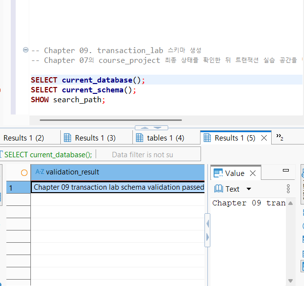
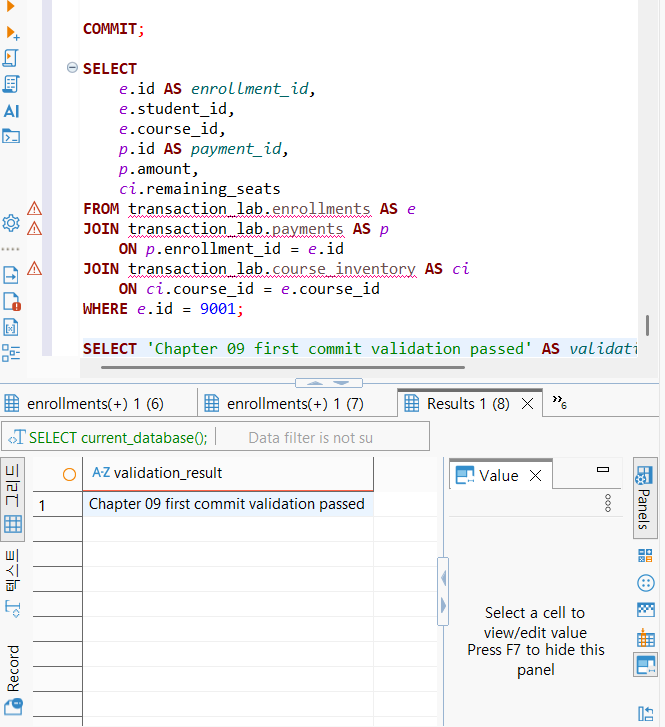

# Chapter 09 확장 실습 답안 템플릿

> **과제:** 트랜잭션으로 데이터 정합성 지키기  
> **사용 방법:** 이 파일을 내려받아 본인의 GitHub 저장소에 `chapter09_answer.md`라는 이름으로 저장한 뒤 실습하면서 바로 작성합니다.  
> **제출 방법:** LMS에는 파일을 직접 업로드하지 않고, **본인 GitHub 저장소의 `chapter09_answer.md` 파일 URL**을 제출합니다.

---

## 제출 전 주의

이 파일과 캡처 화면에는 실제 비밀번호, 전체 DB 접속 URL, API Key, 개인정보를 기록하지 않습니다.

```text
GitHub 계정 또는 별칭:hangyeom06
과제 작성일:2026.11.12
사용한 AI 도구:chatGPT
```

---

# 1. 시작 환경과 Chapter 07·08 기준 상태 확인

다음을 실행하거나 Chapter 09의 `01_transaction_lab_schema.sql` 사전 검사를 확인합니다.

```sql
SELECT current_database();
SELECT current_user;
SELECT current_schema();
SHOW search_path;
SHOW transaction_read_only;
```

| 확인 항목 | 실제 결과 | 의미 |
| --- | --- | --- |
| `current_database()` | ai_database_book | 현재 접속한 데이터베이스가 ai_database_book이다. |
| `current_user` | postgres | 현재 SQL을 실행하는 사용자가 postgres이다. |
| `current_schema()` | public | 	별도로 지정하지 않은 객체를 만들 때 기본으로 사용하는 스키마가 public이다. |
| `search_path` | public, "$user" | 테이블 등을 찾을 때 먼저 public 스키마를 확인하고 그다음 현재 사용자 이름과 같은 스키마를 확인한다. |
| `transaction_read_only` | off | 현재 세션에서 데이터 변경이 가능한 상태이다. |

Chapter 07·08 기준값:

```text
students = 3
instructors = 2
courses = 3
enrollments = 5
전체 recorded_amount = 590000
활성 = 3 / 340000
취소 제외 = 4 / 440000
```

### 기준 상태가 다르면 Chapter 09를 계속 진행하면 안 되는 이유

```text
기준 상태가 다르면 실행 전후의 결과를 정확히 비교할 수 없어 예상대로 실행되었는지 검증하기 어렵다.
```

---

# 2. `transaction_lab` 스키마 생성

실행 파일:

```text
code/chapter09/01_transaction_lab_schema.sql
```

## 2-1. 생성 전 예상

```text
생성될 스키마:transaction_lab
생성될 테이블 3개:course_inventory, enrollments, payments

course_inventory 한 행의 의미:한 강의의 정원과 남은 좌석 정보
enrollments 한 행의 의미:한 학생의 강의 신청 정보
payments 한 행의 의미:한 신청 건의 결제 정보
```

## 2-2. 생성 결과

```text
통과 메시지:Chapter 09 transaction lab schema validation passed
```

기대 메시지:

```text
Chapter 09 transaction lab schema validation passed
```

### Chapter 07·08의 `course_project`와 별도 `transaction_lab`을 사용하는 이유

```text
course_project의 상태를 유지하면서 트랜잭션 실습을 하기 위해 별도의 transaction_lab 스키마를 사용한다.
```

### 증거 화면

권장 경로:

```text
assignments/chapter09/images/step02_schema.png
```

`여기에 transaction_lab 구조가 보이는 핵심 화면을 삽입하세요.`

---

# 3. 초기 좌석과 기준 데이터 입력

실행 파일:

```text
code/chapter09/02_transaction_lab_seed.sql
```

## 3-1. 실행 전 예상

```text
course 301 remaining_seats 예상:2
course 302 remaining_seats 예상:1
course 303 remaining_seats 예상:1
lab enrollments 예상 행 수:0
payments 예상 행 수:0
```

## 3-2. 실제 결과

```text
course 301 remaining_seats:2
course 302 remaining_seats:1
course 303 remaining_seats:1
lab enrollments 행 수:0
payments 행 수:0
통과 메시지:Chapter 09 transaction lab seed validation passed
```

기대 초기 상태:

```text
course 301 / 302 / 303 remaining_seats = 3 / 0 / 0
lab enrollments = 0
payments = 0
```

### 예상과 실제가 다른 경우 원인

```text

```

---

# 4. 첫 번째 정상 COMMIT 추적

실행 파일:

```text
code/chapter09/03_commit_transaction.sql
```

이 실습은 학생 101이 강의 301을 신청하는 하나의 업무 단위를 추적합니다.

## 4-1. 업무 단위 정의

```text
이 트랜잭션에서 함께 성공해야 하는 변경 1: 강의 301의 남은 좌석을 1감소시킨다.
변경 2: 학생 101의 강의 301 신청 정보를 추가한다.
변경 3: 해당 신청의 결제 정보를 추가한다.

하나라도 실패하면 전체를 취소해야 하는 이유: 신청, 좌석, 결제 정보가 서로 일치해야 하기 때문이다.
```

## 4-2. 상태 변화 기록

| 시점 | course 301 남은 좌석 | lab enrollment 9001 | payment 9901 | 설명 |
| --- | ---: | --- | --- | --- |
| BEGIN 전 | 2 | 없음 | 없음 | 초기 상태 |
| 트랜잭션 내부 | 1 | 생성됨 | 생성됨 | 좌석 차감, 신청&결제 생성 |
| COMMIT 후 | 1 | 생성됨 | 생성됨 | 변경 사항이 확정됨 |

## 4-3. COMMIT 조건

```text
좌석 UPDATE 기대 영향 행 수:1
실제 영향 행 수:1
신청 생성 기대 행 수:1
결제 생성 기대 행 수:1
recorded_amount와 payment.amount 일치 여부:일치
최종 COMMIT 판단:COMMIT 가능
```

기대 메시지:

```text
Chapter 09 first commit validation passed
```

### SQL 오류가 없었다는 사실만으로 COMMIT하면 안 되는 이유

```text
SQL 오류가 없어도 좌석, 신청, 결제 데이터가 서로 맞지 않을 수 있기 때문에 기대한 결과인지 먼저 확인한 후 COMMIT해야 한다.
```

### 증거 화면

권장 경로:

```text
assignments/chapter09/images/step04_commit.png
```

`여기에 COMMIT 후 좌석·신청·결제 관계를 확인할 수 있는 화면을 삽입하세요.`

---

# 5. ROLLBACK으로 전체 원상복구 확인

실행 파일:

```text
code/chapter09/04_rollback_transaction.sql
```

## 5-1. ROLLBACK 전 예상

```text
트랜잭션 안에서 임시로 바뀔 값: course 302 잔여 좌석 1 -> 0, 신청 9002와 결제 9902 생성
ROLLBACK 후 다시 돌아와야 할 값:course 302 잔여 좌석1, 신청 9002와 결제 9902는 없음
이미 이전 파일에서 COMMIT된 9001/9901은 유지되어야 하는가: 그렇다.
```

## 5-2. 실제 결과

```text
ROLLBACK 후 course 301 상태: 잔여 좌석 1
ROLLBACK 후 lab enrollments 행 수: 1
ROLLBACK 후 payments 행 수: 1
9001 존재 여부: 존재
9901 존재 여부: 존재
통과 메시지: Chapter 09 rollback validation passed
```

기대 메시지:

```text
Chapter 09 rollback validation passed
```

## 5-3. ROLLBACK과 IDENTITY

```text
ROLLBACK이 테이블 행 변경을 되돌리는 방식: 트랜잭션 안에서 추가, 수정, 삭제한 행을 취소하고 이전 상태로 복구한다.

IDENTITY 자동 번호가 반드시 이전 값으로 되돌아가지는 않는 이유: 번호 생성은 테이블 행 변경과 별도로 처리되기 때문이다.

번호가 건너뛰었다고 데이터 손상이라고 단정할 수 없는 이유: ROLLBACK으로 행은 취소되어도 이미 발급된 번호는 다시 사용되지 않을 수 있기 때문이다.
```

---

# 6. 두 번째 COMMIT과 좌석 부족 0행 관찰

실행 파일:

```text
code/chapter09/05_commit_and_sold_out.sql
```

## 6-1. 두 번째 정상 COMMIT

```text
생성된 enrollment id: 9002
학생 id: 103
course id: 302
recorded_amount: 120000
payment id: 9902
payment amount: 120000
```

## 6-2. 좌석 부족 시도

```text
좌석 확보 UPDATE 기대 영향 행 수: 0
실제 영향 행 수: 0
후속 enrollment 생성 행 수: 0
후속 payment 생성 행 수: 0
```

기준상 좌석 부족 시 생성되지 않아야 하는 ID:

```text
9003
9903
```

### `UPDATE 0`이 SQL 실패가 아니라 업무상 실패일 수 있는 이유

```text
SQL은 정상 실행되었지만 남은 좌석이 없어 신청을 처리하지 못한 상황일 수 있다.
```

### 영향 행 수가 0인데 신청과 결제를 계속 생성하면 어떤 정합성 문제가 생기나요?

```text
좌석이 없는 강의에 신청과 결제 기록이 생겨 실제 좌석 상태와 실청, 결제 데이터가 맞지 않게 된다.
```

---

# 7. 주 실습 최종 정합성 검증

실행 파일:

```text
code/chapter09/06_transaction_validation.sql
```

## 7-1. lab 최종 상태

| 항목 | 기대값 | 실제값 | 일치? |
| --- | ---: | ---: | --- |
| course_inventory 행 수 | 3 | 3 | 일치 |
| lab enrollments 행 수 | 2 | 2 | 일치 |
| payments 행 수 | 2 | 2 | 일치 |
| course 301 remaining | 1 | 1 | 일치 |
| course 302 remaining | 0 | 0 | 일치 |
| course 303 remaining | 1 | 1 | 일치 |

## 7-2. 주요 행

```text
9001 = student 101 / course 301 / amount 100000 / payment 9901
실제: 일치

9002 = student 103 / course 302 / amount 120000 / payment 9902
실제: 일치

9003·9903 = 존재하지 않아야 함
실제: 존재하지 않음
```

## 7-3. 보호 대상 확인

```text
course_project.enrollments 행 수: 5
전체 recorded_amount: 590000
활성 건수/금액: 3 / 340000
취소 제외 건수/금액: 4 / 440000
```

기대값:

```text
course_project.enrollments = 5
전체 = 590000
활성 = 3 / 340000
취소 제외 = 4 / 440000
```

최종 기대 메시지:

```text
Chapter 09 main transaction validation passed
```

### transaction_lab 실습 후에도 course_project 기준 상태를 다시 검사하는 이유

```text
transaction_lab 실습이 별도 스키마의 데이터만 변경했는지, course_project의 기준 데이터와 금액은 그대로 보존됐는지 확인하기 위해서이다.
```

---

# 8. ACID를 이번 실습으로 설명

교과서 정의를 그대로 복사하지 말고 이번 좌석·신청·결제 사례로 작성합니다.

```text
Atomicity: 좌석 차감, 신청 생성, 결제 생성이 모두 성공하거나 모두 취소된다.

Consistency: 트랜잭션 전후에 좌석 수, 신청, 결제 정보가 서로 맞고 정해진 제약조건을 지킨다.

Isolation: 여러 학생이 동시에 신청해도 좌석 차감이 겹쳐 남은 좌석보다 많은 신청이 처리되지 않도록 한다.

Durability: COMMIT된 신청·결제와 좌석 변경은 이후에도 데이터베이스에 유지된다.

```

### Atomicity와 Consistency가 같은 뜻이 아닌 이유

```text
Atomicity는 변경을 전부 적용하거나 전부 취소하는 방식이고 Consistency는 적용된 결과가 데이터 규칙을 지키는 상태인지에 관한 것이다.
```

---

# 9. 선택 실습 — 두 세션 Lock 대기 관찰

실행 파일:

```text
code/chapter09/07_concurrency_two_sessions.sql
```

가능하면 DBeaver에서 **서로 다른 두 연결 세션**으로 수행합니다.

## 9-1. 내 환경

```text
실제 두 세션 실습 수행 / 절차 분석만 수행:
transaction_isolation:
lock_timeout:
```

## 9-2. 시간 순서 기록

| 순서 | Session A | Session B | 관찰 |
| ---: | --- | --- | --- |
| 1 |  |  |  |
| 2 |  |  |  |
| 3 |  |  |  |
| 4 |  |  |  |

```text
먼저 Lock을 획득한 세션:
대기한 세션:
A가 COMMIT/ROLLBACK한 뒤 B에서 일어난 일:
```

### Lock 대기와 Deadlock의 차이

```text

```

### `SELECT ... FOR UPDATE`가 모든 UPDATE 앞에 항상 필요한 것은 아닌 이유

```text

```

### 증거 화면

실제 수행했다면 권장 경로:

```text
assignments/chapter09/images/step09_lock.png
```

---

# 10. 선택 실습 — 취소와 좌석 복구

실행 파일:

```text
code/chapter09/08_cancel_and_restore.sql
```

```text
9001 취소 성공 행 수:
course 301 좌석 변화:
같은 취소를 다시 시도한 행 수:
두 번째 좌석 복구 행 수:
payment 9901 유지 여부:
최종 ROLLBACK 후 원상복구 여부:
통과 메시지:
```

기대 흐름:

```text
9001 수강중 → 취소 1행
course 301 remaining 1 → 2
같은 취소 재시도 → 0행
추가 좌석 복구 → 0행
마지막 ROLLBACK → 주 실습 기준으로 복구
```

### 같은 취소를 두 번 처리해도 좌석이 두 번 증가하지 않아야 하는 이유

```text

```

---

# 11. 선택 실습 — 오류 상태와 SAVEPOINT

실행 파일:

```text
code/chapter09/09_error_and_savepoint.sql
```

## 11-1. 일반 오류 후 트랜잭션 상태

```text
발생시킨 오류:
오류 이후 다음 SQL 실행 결과:
전체 ROLLBACK이 필요한 이유:
```

## 11-2. SAVEPOINT 사용

```text
SAVEPOINT 이름:
오류 발생 위치:
ROLLBACK TO SAVEPOINT 후 상태:
이후 계속 실행할 수 있었는가:
```

### SAVEPOINT가 전체 ROLLBACK과 다른 점

```text

```

---

# 12. 개인 프로젝트 트랜잭션 시나리오 설계

Chapter 07에서 시작한 개인 프로젝트를 사용합니다.

둘 이상의 변경이 함께 성공해야 하는 업무를 **하나** 선택합니다.

예:

```text
예약 생성 + 좌석 차감
주문 생성 + 재고 차감
대여 생성 + 대여 가능 상태 변경
답변 등록 + 질문 상태 변경
```

## 12-1. 업무 정의

```text
시나리오 ID: P09-T01
업무 이름: 공연 좌석 예매 및 결제 등록
사용자 행동: 관객이 특정 공연 회차의 좌석을 선택해 예매하고 결제한다.
왜 하나의 트랜잭션이어야 하는가: 좌석만 예약되거나 결제 내역만 남으면 실제 예매 상태와 맞지 않으므로, 좌석 예약과 예매·결제 등록이 함께 처리되어야 한다.
```

## 12-2. 트랜잭션 설계표

| 항목 | 내 설계 |
| --- | --- |
| BEGIN 전 확인 상태 | 선택한 공연 회차가 예매 가능하고 좌석이 판매되지 않은 상태인지 확인한다. |
| 잠금/경쟁 가능 데이터 | 	선택한 공연 회차의 좌석 행을 잠근다. 같은 좌석을 여러 관객이 동시에 예매할 수 있다. |
| 변경 1 | 	예약 테이블에 관객의 예매 정보를 추가한다. |
| 기대 영향 행 수 | 	1행 |
| 변경 2 | 	선택한 좌석의 상태를 판매 완료로 변경한다. |
| 기대 영향 행 수 | 	1행 |
| 추가 변경 | 	결제 내역을 추가하고 예매에 연결된 티켓을 생성한다. |
| COMMIT 전 검증 | 	예약, 결제, 티켓이 같은 예매에 연결되고 좌석 상태가 판매 완료인지 확인한다. |
| COMMIT 조건 | 예약, 좌석 변경, 결제, 티켓 생성이 모두 성공하고 연결 정보가 일치하면 COMMIT한다. |
| ROLLBACK 조건 | 좌석이 이미 판매됐거나, 필요한 변경 중 하나라도 실패하거나, COMMIT 전 검증을 통과하지 못하면 ROLLBACK한다. |

## 12-3. 실패 시나리오

최소 두 개 작성합니다.

```text
실패 1: 같은 좌석을 다른 관객이 먼저 예매해 좌석 상태 변경이 실패한다.
어느 단계에서 발생: 좌석 상태를 판매 완료로 변경하는 단계
남으면 안 되는 부분 상태: 예약 정보, 결제 내역, 티켓
ROLLBACK 후 기대 상태: 예약, 결제, 티켓이 생성되지 않고 좌석은 먼저 예매한 관객의 판매 완료 상태로 유지된다.

실패 2: 예약과 좌석 변경은 성공했지만 결제 내역 등록이 실패한다.
어느 단계에서 발생: 결제 내역을 추가하는 단계
남으면 안 되는 부분 상태: 예약 정보와 티켓, 현재 예매를 위해 변경한 좌석 상태
ROLLBACK 후 기대 상태: 이번 예매의 예약, 티켓, 결제 내역이 남지 않고 좌석은 다시 예매 가능한 상태가 된다.
```

## 12-4. SQL 초안

```sql
-- 의사 SQL: 관객이 공연 회차의 좌석 한 개를 예매하고 결제하는 업무

BEGIN;

-- 예매할 좌석을 잠그고, 아직 예매 가능한 좌석인지 확인
SELECT seat_id, status
FROM seats
WHERE performance_session_id = :session_id
  AND seat_id = :seat_id
FOR UPDATE;

-- 좌석이 예매 가능한 경우에만 예매 생성
INSERT INTO reservations (audience_id, performance_session_id, status)
VALUES (:audience_id, :session_id, '예매완료')
RETURNING reservation_id;

-- 좌석을 예매 완료 상태로 변경
UPDATE seats
SET status = '예매완료'
WHERE performance_session_id = :session_id
  AND seat_id = :seat_id
  AND status = '예매가능';

-- 생성한 예매에 연결해 티켓과 결제 내역 생성
INSERT INTO tickets (reservation_id, seat_id, ticket_type_id)
VALUES (:reservation_id, :seat_id, :ticket_type_id);

INSERT INTO payment_details (reservation_id, amount, status)
VALUES (:reservation_id, :amount, '결제완료');

-- 예매·좌석·티켓·결제 정보가 모두 정상인지 확인한 뒤 확정
COMMIT;

-- 좌석이 이미 예매됐거나 중간 작업 또는 검증이 실패하면 전체 취소
ROLLBACK;
```

---

# 13. AI를 트랜잭션 리뷰어로 활용

AI에게 완성 SQL부터 요구하지 않습니다.

## 13-1. 사용한 프롬프트

```text
내가 하려는 프로젝트는 소극장 예매 시스템이고 관객이 공연 회차의 좌석을 예매하고 결제하는 상황을 설계할거야. 관련 테이블은 공연 회차, 좌석, 예약, 티켓, 결제 내역이야. 네가 검토할 내용은 다음과 같아.
1. 하나의 업무 단위가 어디까지인지
2. BEGIN 전 확인할 상태
3. 동시에 같은 좌석을 예매할 때 경쟁이 생기는 데이터와 잠금 필요성
4. 좌석 변경, 예약&티켓&결제 생성의 기대 영향 행 수
5. 여러 테이블 최종 정합성 검증 방법
6. COMMIT 조건과 ROLLBACK 조건
8. 동시 실행 위험
먼저 설계상의 문제나 빠진 조건을 설명하고 그다음 내 테이블 구조에 맞춘 SQL 초안을 제안해줘. 테이블이나 열 이름이 불확실하면 임의로 확정하지 말고 확인이 필요한 부분으로 표시해.
```

권장 질문 요소:

```text
1. 하나의 업무 단위가 어디까지인지
2. BEGIN 전 확인할 상태
3. 경쟁 가능 데이터와 잠금 필요성
4. 각 변경의 기대 영향 행 수
5. 여러 테이블 최종 정합성 검증
6. COMMIT 조건
7. ROLLBACK 조건
8. 동시 실행 위험
을 먼저 검토한 뒤 PostgreSQL 초안을 제안하도록 요청
```

## 13-2. AI 제안 검토

| AI 제안 | 수용 / 수정 / 보류 / 거절 | 실제 또는 논리 검증 | 판단 이유 |
| --- | --- | --- | --- |
| 좌석 행을 FOR UPDATE로 잠근 뒤 예매 가능 여부를 확인한다. | 수용 | 같은 좌석을 동시에 예매하는 경우를 고려하면 필요한 방식이다. | 좌석 중복 예매를 막을 수 있다. |
| 좌석 변경과 예약·티켓·결제 내역 생성이 각각 1행씩 처리됐는지 확인한 뒤 COMMIT한다. | 수용 | 	각 단계의 예상 영향 행 수와 최종 연결 상태를 확인하도록 설계했다. | 일부 데이터만 저장되는 상황을 방지할 수 있다. |
| 결제 내역 생성까지 데이터베이스 트랜잭션 하나로 처리한다. | 수용 | 결제가 외부 결제 서비스에서 이뤄진다면 DB 트랜잭션만으로 결제 취소까지 보장할 수 없다. | 외부 결제 성공 후 DB 저장이 실패하는 경우를 별도로 처리해야 한다. |

### AI SQL에서 확인한 가장 중요한 위험

```text
실제 테이블과 열 이름, 좌석 상태값을 확인하지 않고 AI가 임의로 정하면 SQL이 실행되지 않거나 잘못된 상태값을 저장할 수 있다. 실제 스키마에 맞춰 수정해야 한다.
```

### “오류가 없으면 COMMIT”만으로 부족한 이유

```text
SQL 오류가 없어도 좌석 변경이나 예약, 티켓, 결제 생성이 누락되거나 서로 연결되지 않을 수 있다. 각 변경의 영향 행 수와 최종 데이터 정합성을 확인한 뒤 COMMIT해야 한다.
```

---

# 14. 최종 성찰

아래 문장은 본인의 말로 작성합니다.

```text
1. 트랜잭션은 여러 SQL을 단순히 묶는 것이 아니라
   하나의 업무가 전부 성공하거나 전부 취소되도록 처리하는 것이다.

2. ROLLBACK이 필요한 대표 상황은
   좌석 변경이나 예약·티켓·결제 생성 중 하나라도 실패한 경우이다.


3. 조건부 UPDATE의 영향 행 수가 중요한 이유는
   좌석이 실제로 확보됐는지 확인할 수 있기 때문이다.

4. 제약조건이 있어도 트랜잭션이 필요한 이유는
   여러 테이블의 변경을 하나의 업무로 함께 처리해야 하기 때문이다.

5. Lock이 필요한 이유는
   여러 사람이 같은 좌석을 동시에 예매하는 상황을 막기 위해서이다.

6. AI가 만든 트랜잭션 SQL을 검토할 때 가장 먼저 확인할 것은
   실제 테이블 구조와 업무 흐름에 맞는지이다.
```

---

# 15. 제출 체크리스트

- [ ] `chapter09_answer.md`를 본인 저장소에 만들었다.
- [ ] Chapter 07·08 기준 상태를 확인했다.
- [ ] `transaction_lab` 스키마와 초기 데이터를 만들었다.
- [ ] 정상 COMMIT의 전·중·후 상태를 기록했다.
- [ ] ROLLBACK 후 부분 변경이 남지 않는지 확인했다.
- [ ] ROLLBACK과 IDENTITY 번호의 차이를 설명했다.
- [ ] 좌석 부족 시 영향 행 수 0을 관찰했다.
- [ ] 영향 행 수 0일 때 후속 행이 생성되지 않음을 확인했다.
- [ ] `06_transaction_validation.sql` 최종 검증을 통과했다.
- [ ] `course_project`가 변경되지 않았음을 확인했다.
- [ ] ACID를 이번 실습 사례로 설명했다.
- [ ] Lock 실습 또는 두 세션 절차 분석을 수행했다.
- [ ] 개인 프로젝트 트랜잭션 시나리오를 작성했다.
- [ ] AI 제안의 COMMIT/ROLLBACK/영향 행 수 검증을 확인했다.
- [ ] 핵심 캡처는 3~4장 정도로 정리했다.
- [ ] 캡처에 비밀번호·개인정보가 없다.
- [ ] GitHub 웹에서 Markdown과 이미지가 정상적으로 보인다.
- [ ] 최종 파일을 commit/push했다.

---

# 16. LMS 제출 URL

아래 형식의 **본인 GitHub 파일 URL**을 LMS에 제출합니다.

```text
https://github.com/<본인-GitHub-ID>/<본인-저장소>/blob/main/assignments/chapter09/chapter09_answer.md
```

내 제출 URL:

```text

```

> 교수자 템플릿 URL, 저장소 메인 URL, Raw URL이 아니라 **작성 완료된 본인의 `chapter09_answer.md` 파일 화면 URL**을 제출합니다.
