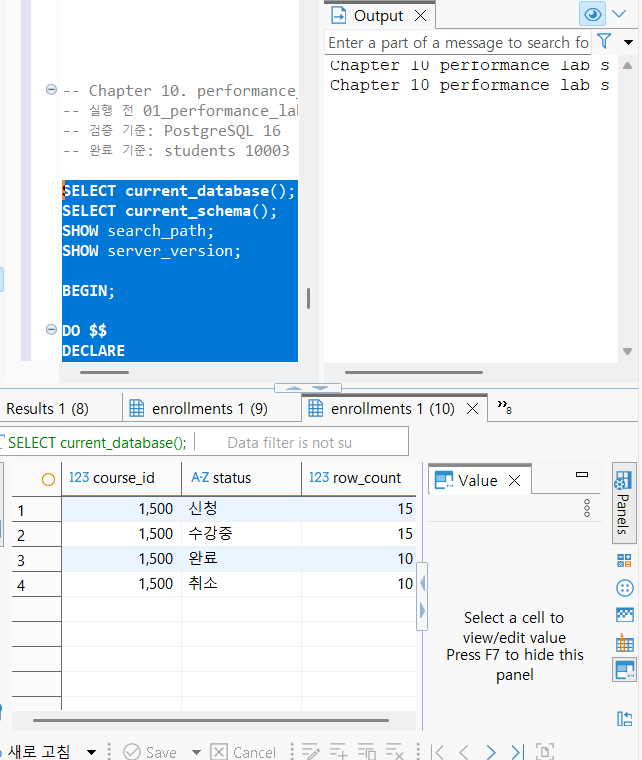
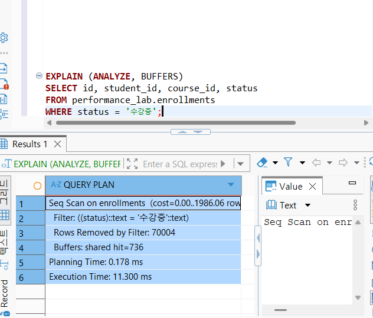
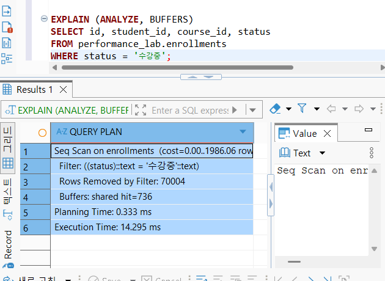

# Chapter 10 확장 실습 답안 템플릿

> **과제:** 실행 계획으로 인덱스 효과 검증하기  
> **사용 방법:** 이 파일을 내려받아 본인의 GitHub 저장소에 `chapter10_answer.md`라는 이름으로 저장한 뒤 실습하면서 바로 작성합니다.  
> **제출 방법:** LMS에는 파일을 직접 업로드하지 않고, **본인 GitHub 저장소의 `chapter10_answer.md` 파일 URL**을 제출합니다.

---

## 제출 전 주의

이 파일과 캡처 화면에는 실제 비밀번호, 전체 DB 접속 URL, API Key, 개인정보를 기록하지 않습니다.

```text
GitHub 계정 또는 별칭:hangyeom06
과제 작성일:2026.11.14
사용한 AI 도구:chatGPT
```

---

# 1. PostgreSQL 버전과 시작 환경 확인

다음을 실행합니다.

```sql
SELECT version();
SELECT current_database();
SELECT current_user;
SELECT current_schema();
SHOW search_path;
```

| 확인 항목 | 실제 결과 | 의미 |
| --- | --- | --- |
| PostgreSQL 버전 | PostgreSQL 18.6 on x86_64-windows, compiled by msvc-19.44.35228, 64-bit | Windows 64비트 환경에서 PostgreSQL 18.6을 사용하고 있다. |
| `current_database()` | ai_database_book | 현재 접속한 데이터베이스의 이름이다. |
| `current_user` | postgres | 	현재 SQL을 실행하는 사용자 계정이다. |
| `current_schema()` | public | 	현재 기본으로 사용하는 스키마다. |
| `search_path` | public, "$user" | 	테이블 이름에 스키마를 따로 적지 않으면 public 스키마를 먼저 찾고, 그다음 사용자 이름과 같은 스키마를 찾는다. |

### PostgreSQL 버전을 기록해야 하는 이유

```text
PostgreSQL 버전에 따라 사용할 수 있는 기능 등이 달라질 수 있기 때문에 사용 환경을 확인해놓으면 문제 해결에 도움이 된다.
```

> 이 장의 자동 검증 기준은 PostgreSQL 16입니다. PostgreSQL 18 이상에서는 B-tree Skip Scan 등으로 동일 SQL의 실행 계획이 달라질 수 있습니다.

---

# 2. Chapter 07·08 기준 상태 확인

Chapter 10은 기존 `course_project`를 변경하지 않습니다.

확인 기준:

```text
students = 3
instructors = 2
courses = 3
enrollments = 5

전체 recorded_amount = 590000
활성 = 3건 / 340000
취소 제외 = 4건 / 440000
```

```text
1001 = 완료 / 100000
1004 = 취소 / 150000
1005 = 신청 / 120000
```

### 실제 확인 결과

```text
students: 3
instructors: 2
courses: 3
enrollments: 2
전체 recorded_amount: 590000
활성 신청 건수/금액: 3 / 340000
취소 제외 건수/금액: 4 / 440000
```

### 성능 실험을 기존 `course_project`에 대량 데이터를 넣지 않고 별도 스키마에서 하는 이유

```text
기존 데이터를 보존하고 성능 실험을 독립적으로 진행하기 위해서이다.
```

---

# 3. `performance_lab` 생성과 대량 데이터 확인

다음 파일을 순서대로 실행합니다.

```text
code/chapter10/01_performance_lab_schema.sql
code/chapter10/02_performance_lab_seed.sql
```

## 3-1. 생성 후 행 수

| 테이블 | 기대 행 수 | 실제 행 수 | 일치? |
| --- | ---: | ---: | --- |
| `performance_lab.students` | 10003 | 1003 | 일치 |
| `performance_lab.instructors` | 2 | 2 | 일치 |
| `performance_lab.courses` | 2003 | 2003 | 일치 |
| `performance_lab.enrollments` | 100005 | 100005 | 일치 |

## 3-2. 데이터 분포 확인

| 조건 | 기대 행 수 | 실제 행 수 | 대략적 비율 |
| --- | ---: | ---: | ---: |
| `performance5000@example.com` | 1 | 1 | 0.01% |
| `student_id = 5000` | 10 | 10 | 약 0.010% |
| `course_id = 1500` | 50 | 10 | 약 0.050% |
| `course_id = 1500 AND status='수강중'` | 15 | 15 | 약 0.015% |
| 전체 `status='수강중'` | 30001 | 30001 | 약 30.0% |

### 선택도가 낮은 조건과 많은 행을 반환하는 조건은 인덱스 판단에서 어떻게 다르게 볼 수 있나요?

```text
적은 행만 찾는 조건은 인덱스로 빠르게 조회할 가능성이 높다. 반대로 많은 행을 반환하는 조건은 빠르게 조회하기 힘들 수 있다.
```

### 증거 화면

권장 경로:

```text
assignments/chapter10/images/step03_data_scale.png
```

`여기에 데이터 규모 확인 화면을 삽입하세요.`

---

# 4. 인덱스 생성 전 기준 계획 기록

다음 파일을 실행합니다.

```text
code/chapter10/03_baseline_explain.sql
```

> **중요:** `04_create_candidate_indexes.sql`을 먼저 실행하지 않습니다. 기준 계획을 잃으면 같은 조건의 전후 비교가 어려워집니다.

최소 3개 SQL의 실행 계획을 기록합니다.

## Query A

```text
업무 질문: 특정 이메일의 학생 정보를 찾는다.
WHERE email = 'performance5000@sxample.com
예상 반환 행 수: 1행
실제 반환 행 수: 1행
```

```sql
-- 대상 SQL
EXPLAIN (ANALYZE, BUFFERS)
SELECT id, name, email
FROM performance_lab.students
WHERE email = 'performance5000@example.com';
```

| 관찰 항목 | 기록 |
| --- | --- |
| 주요 Scan/계획 노드 | Index Scan (uq_performance_students_email) |
| estimated rows | 1 |
| actual rows | 1 |
| Filter | 없음 |
| Index Cond | email = 'performance5000@example.com' |
| Buffers hit/read | shared hit=0, read=3 |
| Planning Time | 3.856 ms |
| Execution Time | 0.603 ms |

## Query B

```text
업무 질문: 특정 학생의 신청 내역과 강의 정보를 조회한다.
WHERE e.student_id = 5000 / students와 enrollments는 student_id로 JOIN courses는 course_id로 JOIN
예상 반환 행 수: 10행
실제 반환 행 수: 10행
```

| 관찰 항목 | 기록 |
| --- | --- |
| 주요 Scan/계획 노드 | Nested Loop |
| estimated rows | 10 |
| actual rows | 10 |
| Filter | student_id = 5000 |
| Index Cond | students_pkey: id = 5000; courses_pkey: id = e.course_id |
| Buffers hit/read | shared hit=17, read=752 |
| Execution Time | 24.758 ms |

## Query C

```text
업무 질문: 수강 중인 전체 신청 내역을 조회한다.
WHERE status = '수강중' 
예상 반환 행 수: 30001행
실제 반환 행 수: 30001행
```

| 관찰 항목 | 기록 |
| --- | --- |
| 주요 Scan/계획 노드 | Seq Scan on enrollments |
| estimated rows | 30012 |
| actual rows | 30001 |
| Filter | status = '수강중' |
| Index Cond | 없음 |
| Buffers hit/read | shared hit=736, read=0 |
| Execution Time | 11.300 ms |

### `cost`와 실제 실행 시간이 같은 개념이 아닌 이유

```text
cost는 PostgreSQL이 예상한 상대적 작업량이고 실제 실행 시간은 쿼리를 실행해 측정한 시간이다.
```

### `EXPLAIN ANALYZE`는 실제 SQL을 실행한다는 점을 왜 기억해야 하나요?

```text
EXPLAIN ANALYZE는 쿼리를 실제로 실행하므로 데이터 변경 SQL에 사용하면 데이터가 실제로 바뀔 수 있다.
```

### 증거 화면

권장 경로:

```text
assignments/chapter10/images/step04_before_plan.png
```

`여기에 대표 기준 실행 계획을 삽입하세요.`

---

# 5. 후보 인덱스를 만들기 전에 이유 작성

본문 실험 후보는 다음 세 개입니다.

```text
idx_performance_courses_title
idx_performance_enrollments_student_id
idx_performance_enrollments_course_status
```

각 인덱스의 이유를 먼저 작성합니다.

| 후보 인덱스 | 대응 조회 패턴 | 예상 이점 | 컬럼 순서 이유 | 예상 비용/단점 |
| --- | --- | --- | --- | --- |
| `idx_performance_courses_title` | courses에서 title로 검색하거나 제목순 정렬 | 제목 검색과 정렬이 빨라질 수 있음 | title 단일 컬럼 인덱스 | 저장 공간과 데이터 변경 시 인덱스 유지 비용이 듦 |
| `idx_performance_enrollments_student_id` | student_id 조건 검색 및 학생별 신청 JOIN | 해당 학생의 신청 행을 빠르게 찾을 수 있음 | student_id 단일 조건으로 자주 검색함 | 저장 공간과 INSERT·UPDATE·DELETE 비용이 늘어남 |
| `idx_performance_enrollments_course_status` | course_id와 status를 함께 조건으로 검색 | 특정 강의의 특정 상태 신청을 빠르게 찾을 수 있음 | 두 컬럼을 함께 쓰는 조회에서 선두 컬럼인 course_id로 먼저 범위를 좁힘 | 저장 공간과 데이터 변경 비용이 들며, status만 검색할 때는 효과가 제한적일 수 있음 |

### “중요한 컬럼이므로 인덱스를 만든다”는 설명이 부족한 이유

```text
인덱스는 어떤 조회에 도움이 되는지와 예상 효과를 함께 설명할 수 있어야 한다.
```

### `(course_id, status)`와 `(status, course_id)`가 항상 같은 효과가 아닌 이유

```text
복합 인덱스는 컬럼 순서에 따라 검색에 활용되는 방식이 달라진다. 선두 컬럼을 조건으로 사용하는 조회에 특히 효과적이다.
```

---

# 6. 후보 인덱스 생성

다음을 실행합니다.

```text
code/chapter10/04_create_candidate_indexes.sql
```

생성 후 확인:

```text
후보 인덱스 수: 3
전체 인덱스 수: 9
```

본문 기준:

```text
자동 인덱스 = 6
후보 인덱스 = 3
전체 인덱스 = 9
```

### PRIMARY KEY나 UNIQUE가 이미 인덱스를 만들 수 있는데 같은 목적의 인덱스를 또 만들면 어떤 문제가 생기나요?

```text
불필요하게 저장 공간을 차지하고 데이터 추가/수정/삭제 때 인덱스 유지 비용이 늘어난다. 조회 성능도 중복 인덱스로 크게 좋아지지 않는다.
```

---

# 7. 같은 SQL로 인덱스 후 재측정

다음 파일을 실행합니다.

```text
code/chapter10/05_after_index_explain.sql
```

Chapter 4에서 기록한 **동일 SQL**을 비교합니다.

## Query A 전후 비교

| 항목 | Before | After | 해석 |
| --- | --- | --- | --- |
| 주요 계획 노드 | Index Scan | Index Scan | 기존 UNIQUE 인덱스를 계속 사용함 |
| actual rows | 1 | 1 | 결과 행 수 동일 |
| Buffers hit/read | hit=0, read=3 | hit=3, read=0 | 이번 실행은 캐시에서 읽음 |
| Execution Time | 0.603 ms | 0.152 ms | 감소했지만 캐시 영향도 고려해야 함 |
| Index Cond | 이메일 조건 | 이메일 조건 | 동일 |

```text
결과 행이 동일했는가: 네
읽은 버퍼가 줄었는가: 디스크 read는 3에서 0으로 줄었고 shared hit는 0에서 3으로 늘었다.
계획이 바뀌었는가: 아니오
실행 시간 한 번만으로 결론낼 수 있는가: 아니오. 캐시 상태 등 영향을 받을 수 있어 여러 번 측정해야 한다.
```

## Query B 전후 비교

| 항목 | Before | After | 해석 |
| --- | --- | --- | --- |
| 주요 계획 노드 | Nested Loop, 신청 테이블 Seq Scan | Nested Loop, 신청 테이블 Index Scan | 새 student_id 인덱스를 사용함 |
| actual rows | 10 | 10 | 결과 행 수 동일 |
| Buffers hit/read | hit=17, read=752 | hit=36, read=0 | 디스크 읽기 없이 캐시에서 읽음 |
| Execution Time | 24.758 ms | 0.231 ms | 크게 감소 |
| Index Cond | 학생,강의 기본키 조건 | 신청의 student_id 조건과 기본키 조건 | 새 인덱스가 학생별 신청 검색에 사용됨 |

## Query C 전후 비교

| 항목 | Before | After | 해석 |
| --- | --- | --- | --- |
| 주요 계획 노드 | Seq Scan | Seq Scan | 계획이 바뀌지 않음 |
| actual rows | 30001 | 30001 | 결과 행 수 동일 |
| Buffers hit/read | hit=736, read=0 | hit=736, read=0 | 동일 |
| Execution Time | 11.300 ms | 14.295 ms | 	오히려 늘었지만 한 번의 측정만으로 판단하기 어려움 |
| Index Cond | 없음 | 없음 | 인덱스를 사용하지 않음 |

### `Index Scan`으로 바뀌었다는 사실만으로 성공이라고 할 수 없는 이유

```text
인덱스를 사용해도 실행 시간과 읽은 버퍼가 줄지 않을 수 있으므로 계획 노드만 보지 말고 실제 성능과 인덱스 유지 비용도 함께 비교해야 한다.
```

### 증거 화면

권장 경로:

```text
assignments/chapter10/images/step07_after_plan.png
```

`여기에 동일 SQL의 사후 실행 계획을 삽입하세요.`

---

# 8. `status` 단독 조회와 Seq Scan 해석

전체 `status = '수강중'`은 약 30%의 행을 반환합니다.

```text
예상 행 수 = 30001
실제 행 수 = 30001
주요 계획 노드 = Seq Scan
```

### 인덱스가 존재해도 PostgreSQL이 Seq Scan을 선택할 수 있는 이유

```text
조건에 맞는 행이 많으면 인덱스로 찾아가는 것보다 테이블을 순차적으로 읽는 것이 효율적일 수 있다.
```

### “Seq Scan = 나쁜 계획”이라고 단정하면 안 되는 이유

```text
많은 행을 반환하거나 테이블이 작을 때는 Seq Scan이 더 효율적일 수 있다. 조회 조건과 실제 비용을 함께 봐야 한다.
```

### PostgreSQL 16과 18 이상에서 복합 B-tree 후행 컬럼 조건의 계획이 다를 수 있는 이유

```text
PostgreSQL 18 이상은 선두 컬럼 조건이 없어도 후행 컬럼을 활용하는 B-tree Skip Scan을 지원한다. PostgreSQL 16에는 없어 같은 쿼리도 실행 계획이 달라질 수 있다.
```

---

# 9. `ORDER BY`와 `LIMIT`에서 인덱스 관찰

`ORDER BY title`과 `ORDER BY title LIMIT 20` 계획을 비교합니다.

```text
ORDER BY title 계획: Index Scan using idx_performance_courses_title

ORDER BY title LIMIT 20 계획: Limit → Index Scan using idx_performance_courses_title
```

### LIMIT이 있을 때 PostgreSQL이 전체 정렬보다 인덱스 순서를 활용하는 것이 유리할 수 있는 이유

```text
인덱스가 정렬된 순서를 제공하면 전체 행을 정렬하지 않고 필요한 행만 읽은 뒤 멈출 수 있다.
```

### 실제 계획에서 Sort 노드 또는 Index Scan을 어떻게 확인했나요?

```text
두 계획 모두 title 인덱스를 이용한 Index Scan이 나타났고 Sort 노드는 없었다. LIMIT 쿼리는 Limit 노드 아래에서 20행만 읽었다.
```

---

# 10. 인덱스 검토

다음을 실행합니다.

```text
code/chapter10/06_index_review.sql
```

## 10-1. 인덱스별 판단

| 인덱스 | 크기/사용 관찰 | 유지 / 보류 / 제거 | 판단 근거 |
| --- | --- | --- | --- |
| idx_performance_courses_title | 실행 결과의 index_size, idx_scan 기록 | 유지 | 목 검색과 정렬 쿼리에서 사용됨 |
| idx_performance_enrollments_student_id | 실행 결과의 index_size, idx_scan 기록 | 유지 | 학생별 신청 조회에서 사용되어 실행 계획이 개선됨 |
| idx_performance_enrollments_course_status | 실행 결과의 index_size, idx_scan 기록 | 보류 | 강의/상태 조건 조회에서의 사용 여부와 효과를 확인한 뒤 판단 |

### `idx_scan = 0`이라는 이유 하나만으로 인덱스를 삭제하면 안 되는 이유

```text
통계 초기화 시점이나 관찰 기간에 따라 0일 수 있고 필요한 조회에 쓰일 수도 있다. 실제 업무와 실행 계획을 함께 확인해야 한다.
```

### 외래키 자식 컬럼 인덱스가 무결성 자체의 필수 조건은 아니지만 성능상 필요할 수 있는 이유

```text
외래키 무결성에는 필수가 아니지만 자식 행 검색이나 부모 행 삭제/수정 시 관련 행을 찾는 작업을 빠르게 할 수 있다.
```

### 인덱스를 많이 만들었을 때 생기는 쓰기·저장 비용

```text
인덱스마다 저장 공간이 필요하고 데이터 추가/수정/삭제 때 인덱스도 함께 갱신해야 해 쓰기 작업이 느려질 수 있다.
```

---

# 11. 자동 완료 게이트

다음을 실행합니다.

```text
code/chapter10/07_result_validation.sql
```

```text
최종 검증 결과: 통과 / performance_lab 기준 행 수와 조회 결과 행 수가 유지되었고, 후보 인덱스 3개가 존재하며, course_project 기준 상태도 유지됨.
```

검증할 핵심 내용:

```text
performance_lab 기준 행 수 유지
조회 결과 행 수 유지
후보 인덱스 3개 존재
course_project 기준 상태 유지
```

### 실행 계획 비교와 별도로 결과 행 동일성을 검증해야 하는 이유

```text
실행 계획은 속도를 확인하는 것이고 결과 행 검증은 쿼리가 같은 데이터를 반환하는지 확인하는 것이다. 성능이 좋아져도 결과가 달라지면 올바른 개선이 아니다.
```

---

# 12. 인덱스 만능론 반박

다음 주장 중 **두 개**를 골라 본문과 실제 실행 계획을 근거로 반박합니다.

```text
A. 인덱스는 많을수록 좋다.
B. 인덱스를 만들었는데 Seq Scan이면 실패다.
C. 모든 FK에는 무조건 같은 방식의 인덱스를 만든다.
D. 실행 시간이 한 번이라도 빨라졌으면 효과가 입증됐다.
E. 선택도가 낮으면 무조건 Index Scan이 나온다.
```

## 주장 1

```text
선택한 주장: B. 인덱스를 만들었는데 Seq Scan이면 실패다.

나의 반박: 조건에 맞는 행이 많으면 테이블 전체를 읽는 Seq Scan이 더 효율적일 수 있다. Seq Scan만으로 인덱스 설계가 실패했다고 판단할 수 없다.

실행 계획에서 확인한 근거: status='수강중' 조회는 30,001행을 반환했고 인덱스 대신 Seq Scan을 사용했다. 결과 행 수는 예상과 같았다.
```

## 주장 2

```text
선택한 주장: D. 실행 시간이 한 번이라도 빨라졌으면 효과가 입증됐다.

나의 반박: 실행 시간은 캐시 상태 등에 따라 달라질 수 있어 한 번의 측정만으로 효과를 단정할 수 없다. 계획과 버퍼 사용량도 함께 보고 반복 측정해야 한다.

실행 계획에서 확인한 근거: Query A는 실행 시간이 0.603ms에서 0.152ms로 줄었지만 Buffers가 디스크 read에서 cache hit로 바뀌었다. 따라서 인덱스 효과만으로 빨라졌다고 단정하기 어렵다.
```

---

# 13. 개인 프로젝트 조회 패턴과 인덱스 후보

Chapter 07~09에서 발전시킨 개인 프로젝트를 사용합니다.

최소 2개의 **실제 반복 조회 질문**을 먼저 만듭니다.

| ID | 반복 조회 질문 | WHERE | JOIN | ORDER BY/LIMIT | 예상 반환 비율 | 후보 인덱스 |
| --- | --- | --- | --- | --- | --- | --- |
| P10-Q01 | 특정 작품의 공연 회차와 장소를 확인한다 | showtimes.work_id = ? | 공연 회차 <-> 작품, 공연장 | start_at ASC, 향후 회차만 조회 | 전체 회차 중 일부 | showtimes(work_id, start_at) |
| P10-Q02 | 관객이 자신의 최근 예약 내역을 확인한다 | reservations.audience_id = ? | 예약 <-> 회차/작품, 결제 | created_at DESC, 최근 10건 | 전체 예약 중 소수 | reservations(audience_id, created_at DESC) |

## 후보 1

```text
후보 인덱스: showtimes(work_id, start_at)
컬럼 순서: work_id -> start_at
이 조회에 도움이 될 것으로 예상한 이유: 작품을 먼저 좁힌 뒤 회차를 날짜순으로 조회할 수 있다.
쓰기/저장 비용: 회차 추가/수정 때 인덱스 갱신 비용과 저장 공간이 든다.
현재 바로 적용 / 후보로 보류: 후보로 보류. 실제 조회 계획과 빈도를 확인한 뒤 적용한다.
```

## 후보 2

```text
후보 인덱스: reservations(audience_id, created_at DESC)
컬럼 순서: audience_id -> created_at 내림차순
이 조회에 도움이 될 것으로 예상한 이유: 관객의 예약만 찾고 최신순으로 정렬하는 데 도움이 될 수 있다.
쓰기/저장 비용: 예약 추가/수정 때 인덱스 갱신 비용과 저장 공간이 든다.
현재 바로 적용 / 후보로 보류: 후보로 보류. 실제 조회 계획과 빈도를 확인한 뒤 적용한다.
```

### 개인 프로젝트 데이터가 너무 적어 성능 검증이 어렵다면

```text
필요한 데이터 규모: 관객 약 1000명, 공연 회차 약 1000개, 예약 10000건 이상
필요한 데이터 분포: 관객별 예약 수와 회차별 예약 수가 다양하도록, 예약 상태도 고르게 섞이도록 구성
비교할 SQL: 특정 작품의 회차 조회, 관객별 최근 예약 조회
비교할 지표: 실행 계획, actual rows, Buffers, Execution Time
현재 판단 상태: 보류
```

> 작은 데이터에서 Index Scan이 나오지 않는다고 억지로 설정을 바꾸어 특정 계획을 강제하지 않습니다.

---

# 14. AI를 실행 계획 리뷰어로 활용

AI에게 인덱스를 바로 추천하게 하지 않고 실제 실행 계획과 조회 문맥을 제공합니다.

## 14-1. AI에게 전달한 정보

```text
업무 질문: 학생 한 명의 신청 내역과 강의 정보를 조회한다.
PostgreSQL 버전: 18.6
테이블 행 수: students 10003행, courses 2003행, enrollments 100005행
데이터 분포: student_id = 5000인 신청은 10건
기존 인덱스: 후보 인덱스 생성 전 자동 인덱스 6개
SQL: enrollments와 students, courses를 JOIN하고 e.student_id = 5000으로 조회
EXPLAIN (ANALYZE, BUFFERS) 핵심 결과: Nested Loop, enrollments Seq Scan, actual rows 10, Filter student_id = 5000, Buffers shared hit=17/read=752, Execution Time 24.758 ms
```

## 14-2. AI 제안 검토

| AI 제안 | 수용 / 수정 / 보류 / 거절 | 실제 계획/데이터 근거 | 최종 판단 |
| --- | --- | --- | --- |
| enrollments(student_id) 인덱스 생성 | 수용 | Query B에서 Seq Scan이 Index Scan으로 바뀌고, 실제 반환 행은 10건으로 동일했음 | 학생별 신청 조회에 사용 |
| courses(title) 인덱스 생성 | 보류 | 인덱스 생성 후 정렬 쿼리에서 사용됐지만, 해당 쿼리의 생성 전 계획과 비교가 필요함 | 전후 결과를 확인한 뒤 판단 |
| enrollments(course_id, status) 인덱스 생성 | 수정 | status만 조회할 때는 30,001행을 반환하며 Seq Scan이 선택됨. 두 컬럼 조건 조회 결과는 별도로 확인해야 함 | 실제 반복 조회가 확인될 때 유지 검토 |

### AI가 제안한 인덱스 중 만들지 않기로 한 것이 있다면 이유

```text
status 단독 조회를 빠르게 하려는 목적으로는 복합 인덱스의 효과가 확인되지 않아 바로 채택하지 않았다.
```

### AI가 PostgreSQL 버전이나 데이터 분포를 무시하고 단정한 내용이 있었나요?

```text
PostgreSQL 16과 18 이상은 복합 B-tree 인덱스의 후행 컬럼을 사용하는 방식이 다를 수 있다. 실제 버전과 데이터 분포를 확인하지 않고 실행 계획을 단정하면 안 된다.
```

### AI가 만든 인덱스 제안을 실제 계획 없이 채택하면 위험한 이유

```text
인덱스가 실제 조회에 사용되지 않을 수 있고 저장 공간과 데이터 변경 비용만 늘어날 수 있다. 실행 계획과 결과를 확인한 뒤 판단해야 한다.
```

---

# 15. 최종 성찰

아래 문장은 본인의 말로 작성합니다.

```text
1. 인덱스가 필요한지 판단할 때 가장 먼저 확인할 것은
   자주 실행하는 조회 조건과 현재 실행 계획이다.

2. 같은 SQL의 인덱스 전후를 비교할 때 통제해야 할 조건은
   SQL, 데이터와 분포, 통계, 실행 설정을 동일하게 유지하는 것이다.

3. Seq Scan이 항상 나쁜 것이 아닌 이유는
   많은 행을 반환할 때 테이블을 순차적으로 읽는 편이 더 효율적일 수 있기 때문이다.

4. 실행 시간 한 번보다 계획과 Buffers를 함께 보는 이유는
   실행 시간은 캐시 등의 영향을 받지만 계획과 Buffers를 보면 데이터 접근 방식을 함께 확인할 수 있기 때문이다.

5. 내 개인 프로젝트에서 아직 인덱스를 보류한 후보가 있다면 그 이유는
   데이터가 적어 성능 차이를 확인하기 어렵고 실제 실행 계획으로 효과를 검증하지 못했기 때문이다.
```

---

# 16. 제출 체크리스트

- [ ] `chapter10_answer.md`를 본인 저장소에 만들었다.
- [ ] PostgreSQL 버전을 기록했다.
- [ ] Chapter 07·08 기준 상태를 확인했다.
- [ ] `performance_lab`의 10003 / 2 / 2003 / 100005 기준을 확인했다.
- [ ] `03_baseline_explain.sql`을 후보 인덱스 생성 전에 실행했다.
- [ ] 기준 실행 계획을 최소 3개 기록했다.
- [ ] 후보 인덱스 3개의 근거를 먼저 작성했다.
- [ ] 동일 SQL의 인덱스 전후 계획을 비교했다.
- [ ] 실행 시간뿐 아니라 Scan, actual rows, Buffers, Index Cond를 확인했다.
- [ ] `status` 단독 조건의 계획을 해석했다.
- [ ] `ORDER BY`와 `LIMIT` 계획을 확인했다.
- [ ] 인덱스 만능론 주장 2개를 반박했다.
- [ ] `07_result_validation.sql`로 최종 상태를 확인했다.
- [ ] 개인 프로젝트의 반복 조회 2개와 인덱스 후보를 작성했다.
- [ ] AI 제안을 실제 실행 계획과 비교했다.
- [ ] 핵심 캡처 3~4장만 넣었다.
- [ ] 캡처에 비밀번호·개인정보가 없다.
- [ ] GitHub 웹에서 Markdown과 이미지가 정상적으로 보인다.
- [ ] 최종 답안을 commit/push했다.

---

# 17. LMS 제출 URL

아래 형식의 **본인 GitHub 파일 URL**을 LMS에 제출합니다.

```text
https://github.com/<본인-GitHub-ID>/<본인-저장소>/blob/main/assignments/chapter10/chapter10_answer.md
```

내 제출 URL:

```text

```

> 저장소 메인 URL, 교수자 템플릿 URL, Raw URL이 아니라 **작성 완료된 본인 `chapter10_answer.md` 파일 화면 URL**을 제출합니다.
